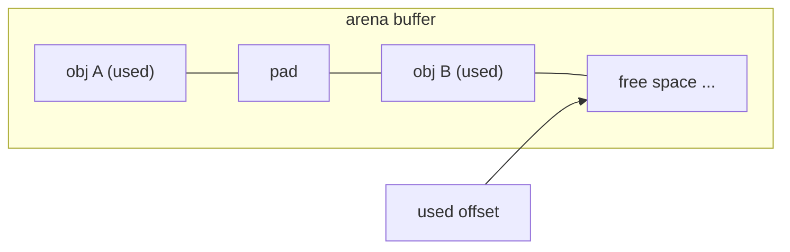
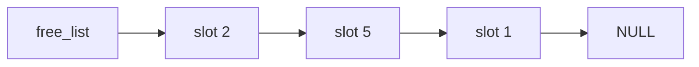

# Custom Allocators and Arenas

General-purpose `malloc` is a marvel of engineering, but it's general: every call pays for thread safety, size classes, metadata and fragmentation management, and its timing is unpredictable. High-performance and real-time systems (game engines, compilers, databases, HFT, robot control loops, embedded firmware) often replace it with **custom allocators** that exploit known allocation patterns: **arenas** (bump allocators) for "allocate many, free all at once", and **pools** (free lists) for "many objects of one size". This lesson builds both, and covers the alignment arithmetic they depend on.

## 1. Why replace malloc?

| Problem with malloc | Who cares | Custom allocator fix |
|---|---|---|
| non-deterministic latency (locks, `brk`/`mmap` syscalls) | real-time control loops, audio, HFT | pre-allocate at startup; O(1) bounded operations |
| per-block header overhead (8–16 bytes) | millions of small nodes | pools: no headers |
| fragmentation over long runs | embedded devices that run for years | fixed-size pools can't fragment |
| freeing thousands of objects one by one | parsers, compilers, per-request servers | arena: free everything in O(1) |
| scattered objects, poor cache locality | tree and graph algorithms | contiguous allocation |

> [!KEY]
> Safety standards for embedded and automotive code (MISRA C, many aerospace rules) **forbid dynamic allocation after initialisation**. Fixed pools and arenas carved from static memory are how such systems manage variable-sized work.

## 2. Alignment

Every type has an **alignment requirement**: its address must be a multiple of `alignof(T)` (for example 8 for `double` and pointers on x86-64). Misaligned access is undefined behaviour in C. On x86 it's slower, and on some ARM cores it traps. An allocator must return suitably aligned addresses.

Rounding `n` up to a multiple of `a`, where `a` is a power of two:

```c
static inline size_t align_up(size_t n, size_t a) {
    return (n + (a - 1)) & ~(a - 1);     // e.g. align_up(13, 8) == 16, align_up(16, 8) == 16
}
```

`a - 1` is a mask of the low bits (for `a = 8`, that's `0b111`). Adding it then clearing those bits rounds up. This works only for powers of two, and every alignment in C is one.

```c
#include <stdalign.h>
#include <stddef.h>
alignof(double);          // 8
alignof(max_align_t);     // 16 on x86-64: what malloc guarantees
```

## 3. The arena (bump / linear) allocator

An arena owns one big buffer and an offset. Allocating rounds the offset up to the requested alignment and bumps it. There's **no per-object free**: you reset or destroy the whole arena at once.

```c
#include <stddef.h>
#include <stdint.h>
#include <stdlib.h>

typedef struct {
    unsigned char *base;
    size_t cap;
    size_t used;
} Arena;

int arena_init(Arena *a, size_t cap) {
    a->base = malloc(cap);           // or a static buffer on embedded systems
    a->cap = cap;
    a->used = 0;
    return a->base ? 0 : -1;
}

void *arena_alloc(Arena *a, size_t size, size_t align) {
    uintptr_t cur = (uintptr_t)(a->base + a->used);
    uintptr_t aligned = (cur + (align - 1)) & ~(uintptr_t)(align - 1);
    size_t start = (size_t)(aligned - (uintptr_t)a->base);
    if (start > a->cap || size > a->cap - start) return NULL;   // overflow-safe check
    a->used = start + size;
    return a->base + start;
}

void arena_reset(Arena *a)   { a->used = 0; }        // "free" everything in O(1)
void arena_destroy(Arena *a) { free(a->base); a->base = NULL; }
```



Use it for **phase-based lifetimes**: all the nodes of a parsed JSON document, all the temporary objects of one HTTP request, everything allocated during one tick of a game or robot control loop (reset at the end of the tick). Allocation costs a few instructions, objects are contiguous (great for caches), and leaks within a phase are impossible because reset frees everything.

> [!TIP]
> A **scratch arena** with save/restore points gives you stack-like temporary memory: `size_t mark = a->used; ...temp work...; a->used = mark;`. Compilers such as Zig's stdlib and Jai make arenas a first-class idiom.

## 4. The pool (fixed-size block) allocator with a free list

When all objects have the same size (tree nodes, particles, network packets, messages), a pool pre-carves a buffer into equal **slots** and threads the free ones into a singly linked **free list**, **storing the "next" pointer inside the free slots themselves**. That costs no extra memory.

```c
typedef union Slot {
    union Slot *next;               // used while the slot is free
    unsigned char data[64];         // the user's object while allocated (the slot size)
} Slot;

typedef struct {
    Slot *slots;
    Slot *free_list;
    size_t count;
} Pool;

int pool_init(Pool *p, size_t count) {
    p->slots = malloc(count * sizeof *p->slots);
    if (!p->slots) return -1;
    p->count = count;
    for (size_t i = 0; i + 1 < count; i++) p->slots[i].next = &p->slots[i + 1];
    p->slots[count - 1].next = NULL;
    p->free_list = p->slots;
    return 0;
}

void *pool_alloc(Pool *p) {                 // O(1): pop the head
    Slot *s = p->free_list;
    if (!s) return NULL;                    // pool exhausted
    p->free_list = s->next;
    return s;
}

void pool_free(Pool *p, void *ptr) {        // O(1): push onto the head
    Slot *s = ptr;
    s->next = p->free_list;
    p->free_list = s;
}
```



The properties that make pools the standard tool in embedded and real-time code:
- `alloc` and `free` are **O(1) with no loops and no syscalls**, so their timing is deterministic.
- There's **zero fragmentation** (every slot is interchangeable) and no per-block header.
- It's **bounded**: the maximum memory is known at compile time, and exhaustion is a well-defined NULL, not a crash.
- **LIFO reuse**: the most recently freed slot is the next one handed out, so it's probably still warm in the cache.

The union trick makes the slot both large enough and correctly aligned for a pointer. In a generic pool you round the slot size up to `max(size, sizeof(void *))` and to the required alignment.

## 5. Other designs, briefly

| Allocator | Idea | Used in |
|---|---|---|
| **stack allocator** | arena with LIFO `free` of the most recent block | frame-temporary data in game engines |
| **slab allocator** | per-type pools with object caching | Linux kernel (`kmem_cache`) |
| **buddy allocator** | power-of-two blocks that split and merge | Linux page allocator |
| **size-class allocators** | many pools for different sizes plus thread caches | jemalloc, tcmalloc, mimalloc |
| **ring/queue allocator** | allocate at the head, free at the tail | message passing between threads or ISRs |

## 6. Exam-ready answers

> [!EXAM]
> **Arena and pool allocators.** An arena (linear or bump) allocator reserves a large contiguous buffer and satisfies each request by aligning and advancing an offset; individual objects cannot be freed, but the entire arena is released or reset at once, giving very fast allocation, good locality and no leaks within a phase, which suits data with a common lifetime. A pool allocator divides a buffer into fixed-size blocks and maintains the free blocks in a free list whose links are stored inside the free blocks; allocation and deallocation are constant-time pops and pushes, with no fragmentation and no per-block headers, which suits many objects of the same size and real-time or embedded systems that require deterministic timing. Both must return addresses that satisfy the alignment requirements of the stored types, typically by rounding up with `(n + a - 1) & ~(a - 1)` for power-of-two alignments.

## 7. Cheat sheet

| Need | Approach |
|---|---|
| align `n` up to `a` (a power of 2) | `(n + a - 1) & ~(a - 1)` |
| query alignment | `alignof(T)` (`<stdalign.h>`) |
| many objects, one lifetime | arena, `reset()` at the end of the phase |
| many same-size objects, freed individually | pool with an intrusive free list |
| deterministic real-time | pre-allocate at init, no `malloc` in the loop |
| temporary scratch | arena mark and restore |

> [!INTERVIEW]
> **"Design a memory allocator for a real-time robot controller."** Ban `malloc` in the control loop. At startup, allocate (or statically declare) everything: a per-cycle **arena** reset at the end of every control tick for temporaries, and **fixed-size pools** for messages, trajectory points and similar objects with bounded counts. Both give O(1), lock-free (per-thread) allocation with bounded memory and no fragmentation. Exhaustion returns NULL, which the code handles as a fault (for example, safe-stop the motors) rather than crashing. Mention alignment, overflow-checked size arithmetic, and testing the allocator under ASan by poisoning freed slots.
