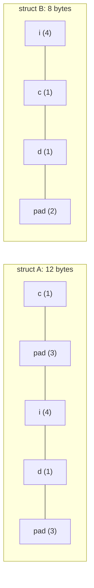

# Bit Fields, Padding and Alignment

How a struct is laid out in memory is decided by **alignment rules**, and it affects size, speed, binary file formats, network protocols, and correctness when talking to hardware. Embedded code packs flags into **bit fields** and maps structs onto hardware registers. This lesson explains padding precisely, shows how to minimise it, and covers `alignof`/`_Alignas`, packed structs, bit fields, and endianness, with the portability traps that catch even experienced engineers.

## 1. Alignment and padding

Each type has an **alignment**: its address must be a multiple of `alignof(T)`. On x86-64: `char` 1, `short` 2, `int` 4, `double`/`long`/pointers 8. The compiler inserts **padding** so every member is aligned, and pads the end so that elements of an *array* of the struct stay aligned too:

```c
struct A { char c; int i; char d; };   // sizeof 12
struct B { int i; char c; char d; };   // sizeof 8: same members, reordered
struct C { char c; double x; };        // sizeof 16
```



> [!KEY]
> Rules: (1) members are laid out **in declaration order**, since the compiler may not reorder them; (2) each member starts at a multiple of its alignment; (3) the struct's alignment is the largest member alignment; (4) `sizeof` is rounded up to a multiple of the struct's alignment. **To minimise padding, declare members from largest to smallest alignment.**

```c
#include <stddef.h>
#include <stdalign.h>
offsetof(struct A, d);      // 8
alignof(struct C);          // 8
```

Saving 4 bytes doesn't sound like much, but for 10 million point-cloud structs it's 40 MB and many cache misses. Tools like `pahole` print struct layouts with their holes.

## 2. Controlling alignment

```c
_Alignas(64) static char buffer[4096];             // C11: e.g. align to a cache line
struct Vec4 { alignas(16) float v[4]; };           // <stdalign.h>: the member (and so the struct) is 16-aligned for SIMD
void *p = aligned_alloc(64, 4096);                 // C11 aligned heap memory (size must be a multiple of the alignment)
```

Aligning per-thread data to 64 bytes avoids **false sharing**, where two threads write different variables that sit on the same cache line and fight over it (the Concurrency lessons).

### Packed structs

```c
struct __attribute__((packed)) Header {   // gcc/clang extension (MSVC: #pragma pack(push, 1))
    uint8_t  type;
    uint32_t length;                       // at offset 1: misaligned!
    uint16_t crc;
};                                         // sizeof 7
```

Packing removes all padding to match an external format exactly. But accessing misaligned members is slower on x86, can **fault on some ARM cores**, and taking `&h.length` gives a misaligned pointer that's undefined behaviour to dereference as `uint32_t *`. Safer and portable: parse byte buffers explicitly with shifts or `memcpy` (next section and the parsing problems).

## 3. Endianness

A multi-byte integer's bytes can be stored most significant first (**big-endian**: network byte order, some DSPs) or least significant first (**little-endian**: x86, ARM by default):

```c
uint32_t x = 0x01020304;
unsigned char *b = (unsigned char *)&x;
printf("%02x\n", b[0]);     // 04 on x86: little-endian
```

**Portable serialisation** never `memcpy`s or casts a struct to bytes. Assemble the integers with shifts, which work identically on every machine:

```c
uint32_t read_be32(const uint8_t *p) {
    return (uint32_t)p[0] << 24 | (uint32_t)p[1] << 16 | (uint32_t)p[2] << 8 | p[3];
}
void write_le16(uint8_t *p, uint16_t v) { p[0] = v & 0xFF; p[1] = v >> 8; }
```

POSIX also provides `htonl`/`ntohl` (host ↔ network order) in `<arpa/inet.h>`.

## 4. Bit fields

Bit fields pack small integers into a few bits of a storage unit:

```c
struct Flags {
    unsigned ready   : 1;
    unsigned error   : 1;
    unsigned mode    : 3;     // 0..7
    unsigned channel : 5;     // 0..31
};                            // sizeof 4 with gcc (it fits in one unsigned int)

struct Flags f = {0};
f.mode = 5;
f.channel = 33;               // truncated to 33 % 32 = 1: gcc warns for a constant, but a run-time value wraps silently
```

> [!DANGER]
> Almost everything about bit-field layout is **implementation-defined**: the order of bits within the unit (LSB-first on gcc x86, but MSB-first on some compilers), whether fields can straddle units, the signedness of plain `int` fields, and padding. So bit fields are **not portable** for describing hardware registers or wire formats. You also can't take the address of a bit field, and updating one is a read-modify-write that isn't atomic, which matters with interrupts and threads.

For registers and protocols, the portable alternative is **explicit masks and shifts**:

```c
#define MODE_SHIFT 2
#define MODE_MASK  (0x7u << MODE_SHIFT)
reg = (reg & ~MODE_MASK) | ((mode << MODE_SHIFT) & MODE_MASK);   // write the field
unsigned mode = (reg & MODE_MASK) >> MODE_SHIFT;                 // read the field
```

Bit fields are still fine for **internal** compact flags where the layout doesn't matter, such as a struct of booleans in a large array.

## 5. Exam-ready answers

> [!EXAM]
> **Structure padding and alignment.** Each object type has an alignment requirement, and compilers insert padding bytes between structure members so that each member is suitably aligned, and at the end so that arrays of the structure remain aligned; members keep their declaration order. Consequently `sizeof` a structure may exceed the sum of its members' sizes, and ordering members by decreasing alignment minimises padding. `offsetof` gives a member's offset and `alignof` a type's alignment; `_Alignas` and `aligned_alloc` request stricter alignment. Packing directives remove padding to match external layouts, at the cost of misaligned and potentially slower or faulting accesses. Byte order (endianness) is platform-dependent, so portable binary formats serialise integers explicitly with shifts.

> [!EXAM]
> **Bit fields.** A bit field is a structure member declared with a width in bits, allowing several small values to share one storage unit. Their allocation order, alignment and straddling behaviour are implementation-defined, their addresses cannot be taken, and assigning out-of-range values truncates them; therefore explicit masks and shifts are preferred for portable descriptions of hardware registers and data formats.

## 6. Cheat sheet

| Need | Code |
|---|---|
| less padding | order members largest → smallest |
| member offset / alignment | `offsetof(T, m)`, `alignof(T)` |
| over-align | `_Alignas(64)` / `aligned_alloc(64, n)` |
| exact external layout | parse bytes with shifts (or packed, carefully) |
| big-endian read | `p[0] << 24 \| p[1] << 16 \| p[2] << 8 \| p[3]` |
| set a field in a register | `r = (r & ~MASK) \| ((v << SHIFT) & MASK)` |
| compact internal flags | `unsigned f : 1;` |

> [!INTERVIEW]
> **"`struct S { char a; double b; char c; };`: what is `sizeof(S)` on x86-64, and how can you shrink it?"** `a` is at 0, then 7 bytes of padding so `b` starts at 8, `b` occupies 8–15, `c` is at 16, then 7 bytes of tail padding to make the size a multiple of 8: **24 bytes**. Reordering to `double b; char a; char c;` gives 8 + 1 + 1 + 6 padding = **16 bytes**. Packing would give 10, but with misaligned access to `b`. Mention `offsetof` and `pahole` to verify.
