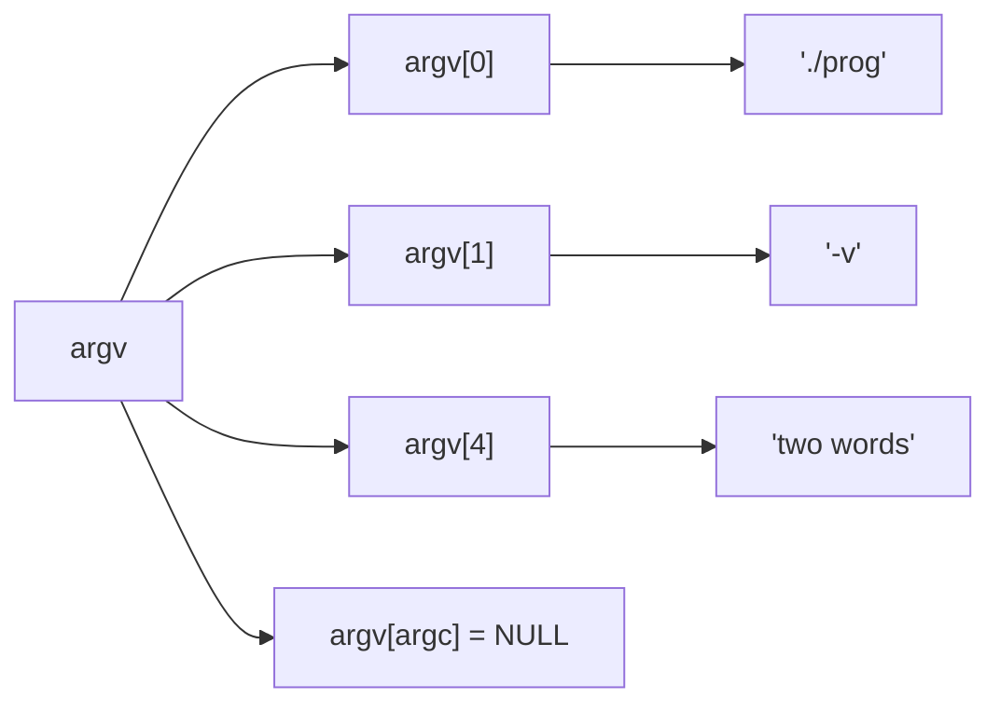

# Command-Line Arguments

Command-line tools (`gcc -O2 -o prog main.c`, `ros2 run`, `ffmpeg -i in.mp4 out.webm`) receive their options through **`argc` and `argv`**. Parsing them well (flags, options with values, defaults, validation, help messages, exit codes) is part of building professional programs. This lesson covers `argv`'s memory layout, manual parsing, POSIX **`getopt`**, environment variables, and exit status conventions.

## 1. `argc` and `argv`

```c
int main(int argc, char *argv[]) {      // equivalently: char **argv
    for (int i = 0; i < argc; i++)
        printf("argv[%d] = \"%s\"\n", i, argv[i]);
    return 0;
}
```

```bash
./prog -v --speed 2.5 "two words"
```

```output
argv[0] = "./prog"
argv[1] = "-v"
argv[2] = "--speed"
argv[3] = "2.5"
argv[4] = "two words"
```



> [!KEY]
> - `argv[0]` is the program name (as invoked), and `argv[argc]` is guaranteed to be `NULL`.
> - The **shell** splits arguments and handles quoting, globbing (`*.txt`) and variables before the program starts. The program receives already-split strings.
> - Every argument is a **string**. Convert numbers with `strtol`/`strtod` and validate them, never with `atoi` (which can't report errors).
> - The strings are writable and live for the whole program.

## 2. Manual parsing

```c
#include <string.h>
#include <stdlib.h>

int verbose = 0;
double speed = 1.0;
const char *file = NULL;

for (int i = 1; i < argc; i++) {
    if (strcmp(argv[i], "-v") == 0 || strcmp(argv[i], "--verbose") == 0) {
        verbose = 1;
    } else if (strcmp(argv[i], "--speed") == 0) {
        if (i + 1 >= argc) { fprintf(stderr, "--speed needs a value\n"); return 2; }
        char *end;
        speed = strtod(argv[++i], &end);              // consume the value
        if (*end || speed <= 0) { fprintf(stderr, "bad speed: %s\n", argv[i]); return 2; }
    } else if (strncmp(argv[i], "--speed=", 8) == 0) {
        speed = strtod(argv[i] + 8, NULL);            // --speed=2.5 form
    } else if (strcmp(argv[i], "--") == 0) {
        /* end of options: everything after is positional, even if it starts with - */
    } else if (argv[i][0] == '-') {
        fprintf(stderr, "unknown option %s\n", argv[i]);
        return 2;
    } else {
        file = argv[i];                               // a positional argument
    }
}
```

## 3. POSIX `getopt`

`getopt` implements the standard Unix conventions: grouped short flags (`-xvf`), attached or separate values (`-ofile` or `-o file`), and `--` to end the options:

```c
#include <unistd.h>

int opt;
while ((opt = getopt(argc, argv, "vo:n:")) != -1) {   // "o:" means -o takes a value
    switch (opt) {
        case 'v': verbose = 1; break;
        case 'o': output = optarg; break;             // optarg points to the value
        case 'n': count = atoi(optarg); break;        // (validate with strtol in real code)
        default:                                      // '?' for unknown options or missing values
            fprintf(stderr, "usage: %s [-v] [-o file] [-n count] input...\n", argv[0]);
            return 2;
    }
}
for (int i = optind; i < argc; i++)                   // optind: the first non-option argument
    process(argv[i]);
```

GNU's `getopt_long` adds `--long-options` (`--output=file`). In C++ and Python you'd use libraries (CLI11, argparse), but they follow the same conventions.

## 4. Environment variables

```c
const char *home = getenv("HOME");                  // NULL if unset; DON'T modify or free the result
const char *dom = getenv("ROS_DOMAIN_ID");
int domain = dom ? atoi(dom) : 0;                   // a default when unset

int main(int argc, char *argv[], char *envp[]);     // a common (non-standard) third parameter
setenv("MODE", "sim", 1);                           // POSIX: modify for this process and its children
```

Typical precedence for configuration: **command-line flag > environment variable > config file > built-in default**.

## 5. Exit status

```c
#include <stdlib.h>
return EXIT_SUCCESS;     // 0: success
return EXIT_FAILURE;     // 1: generic failure
exit(2);                 // ends the program from anywhere (flushes stdio, runs atexit handlers)
```

Conventions: `0` = success, `1` = general error, `2` = **usage error** (bad arguments: `grep` and `bash` use this). Shells read the status with `$?` and chain commands with `&&`/`||`, so a correct exit code makes your tool scriptable. Print diagnostics to **stderr**, not stdout, so they don't pollute output that's piped into other programs.

## 6. Exam-ready answers

> [!EXAM]
> **Command-line arguments.** A C program receives command-line arguments through the parameters of `main(int argc, char *argv[])`: `argc` is the number of arguments including the program name, and `argv` is an array of pointers to null-terminated strings, with `argv[0]` the program name and `argv[argc]` a null pointer. Arguments arrive as strings already split by the shell, so numeric values must be converted and validated, for example with `strtol`. Options can be parsed manually or with POSIX `getopt`, which processes single-character options according to an option string, with `optarg` holding an option's value and `optind` indexing the first non-option argument. Environment variables are read with `getenv`. The value returned from `main` (or passed to `exit`) is the exit status, zero conventionally meaning success.

## 7. Cheat sheet

| Need | Code |
|---|---|
| loop over the arguments | `for (int i = 1; i < argc; i++)` |
| compare an option | `strcmp(argv[i], "--flag") == 0` |
| an option with a value | `if (i + 1 < argc) val = argv[++i];` |
| `--key=value` | `strncmp(arg, "--key=", 6) == 0`, then `arg + 6` |
| standard short options | `getopt(argc, argv, "ab:c")`, `optarg`, `optind` |
| a number from an argument | `strtol(argv[i], &end, 10)`, then check `*end` |
| environment | `getenv("NAME")` (NULL if unset) |
| usage error | message on stderr, `return 2;` |

> [!INTERVIEW]
> **"Why shouldn't you use `atoi(argv[1])`?"** `atoi` has no error reporting: `atoi("abc")` and `atoi("0")` both return 0, `atoi("12abc")` silently returns 12, and out-of-range input is undefined behaviour. Use `strtol(s, &end, 10)` with `errno = 0` beforehand, then check that `end != s` (some digits were read), that `*end == '\0'` (no trailing junk), and that `errno != ERANGE` (no overflow), and print a usage error with exit status 2 if any check fails.
