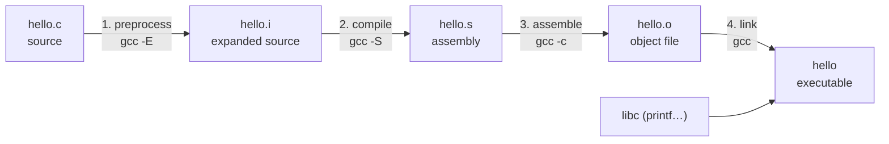

# How a C Program Is Built

C is a **compiled** language: your source code is translated into native machine code **before** it runs. Unlike Python, there's no interpreter at run time; the CPU executes your program directly. That's why C runs on everything from 8-bit microcontrollers to supercomputers, and why the Linux kernel, CPython itself, ROS's low-level drivers and most embedded firmware are written in it. Understanding the four build stages turns cryptic errors ("undefined reference", "implicit declaration", "multiple definition") into obvious ones, because each error belongs to exactly one stage.

## 1. The four stages



Take this program:

```c
#include <stdio.h>
#define GREETING "Hello"

int main(void) {
    printf("%s, world!\n", GREETING);
    return 0;
}
```

**1. Preprocessing** (`gcc -E hello.c`). The preprocessor handles every line starting with `#`. It pastes in the contents of `stdio.h` (thousands of lines of declarations), replaces macros (`GREETING` → `"Hello"`) and removes comments. The output is still C:

```c
int main(void) {
    printf("%s, world!\n", "Hello");
    return 0;
}
```

**2. Compilation** (`gcc -S hello.c`). The compiler proper checks syntax and types and translates the C into **assembly** for the target CPU (`hello.s`), optimising as it goes (`-O2`). Most of your errors come from this stage: syntax errors, type mismatches, undeclared identifiers.

**3. Assembly** (`gcc -c hello.c`). The assembler turns the assembly into machine code in an **object file** (`hello.o`). Object files contain your functions' code plus a **symbol table**: names they define and names they still need:

```text
$ nm hello.o
0000000000000000 T main      ← defined here (T = text/code)
                 U printf    ← used but Undefined: must come from elsewhere
```

**4. Linking** (`gcc hello.o -o hello`). The **linker** combines object files and libraries (here the C standard library, `libc`), resolves every undefined symbol to a definition, and writes the executable. `printf`'s code lives in `libc`. It's linked dynamically, so the program loads it at start-up.

Normally one command runs all four stages: `gcc -Wall -Wextra -O2 hello.c -o hello`, then `./hello`.

## 2. Which stage produced my error?

| Error message | Stage | Typical cause |
|---|---|---|
| `fatal error: stdio.h: No such file` | preprocessor | a misspelled header or missing include path |
| `error: expected ';' before ...` | compiler | syntax |
| `error: 'x' undeclared` | compiler | variable not declared in scope |
| `warning: implicit declaration of function 'foo'` | compiler | called before being declared (C99+ treats it as an error) |
| `undefined reference to 'foo'` | **linker** | declared but never **defined**, or the file or library wasn't linked (`-lm` for math) |
| `multiple definition of 'foo'` | **linker** | the same function or global defined in two `.c` files (often a definition in a header) |
| `undefined reference to 'main'` | linker | no `main` function in the program |

> [!KEY]
> The **compiler** only needs a **declaration** ("a function `int helper(int)` exists somewhere") to compile a call. The **linker** needs exactly one **definition** (the actual body). Compiling succeeds and then linking fails with `undefined reference to 'helper'` when the body is missing.

## 3. Compiler flags you'll use constantly

| Flag | Meaning |
|---|---|
| `-o name` | output file name (the default is `a.out`) |
| `-Wall -Wextra` | enable important warnings. **Always use these.** |
| `-Werror` | treat warnings as errors |
| `-std=c17` | the language standard (`c99`, `c11`, `c17`, `c23`) |
| `-O0` / `-O2` / `-O3` | optimisation level (`-O0` for debugging) |
| `-g` | include debug info (for gdb) |
| `-c` | compile to `.o` only, don't link |
| `-Idir` | add a header search directory |
| `-lm` | link the math library (`sqrt`, `sin`…) |
| `-fsanitize=address,undefined` | detect memory errors and undefined behaviour at run time |

```bash
gcc -std=c17 -Wall -Wextra -O2 main.c utils.c -o app -lm
```

> [!DANGER]
> **Warnings in C are not optional.** `warning: 'x' is used uninitialized` means your program reads garbage memory. Code that compiles with warnings is often already wrong. The judge in this platform compiles with `-Wall -Wextra` and shows you the warnings even when the tests pass.

## 4. Compiled vs interpreted, concretely

| | C (compiled, native) | Python (bytecode on a VM) |
|---|---|---|
| Translation | before running, once | at each run, to bytecode |
| Errors found | type and syntax errors at compile time | most errors at run time |
| Output | a native executable for one CPU and OS | `.py` runs anywhere Python exists |
| Speed | very fast (often 10–100× Python for loops) | slower |
| Memory | manual, explicit | automatic (garbage collected) |
| Typical use | OS kernels, firmware, drivers, performance-critical libraries | glue, scripting, ML orchestration |

## 5. The program's exit status

`main` returns an `int` to the operating system: `0` means success and non-zero means failure. Shells and build tools check it:

```bash
./hello; echo $?      # prints 0
```

## 6. Exam-ready answers

> [!EXAM]
> **Stages of compilation in C.** Building a C program proceeds in four stages. (1) Preprocessing: the preprocessor processes directives such as `#include` and `#define`, inserting header files, expanding macros and removing comments. (2) Compilation: the compiler checks the preprocessed source for syntax and type errors and translates it into assembly language for the target processor, applying optimisations. (3) Assembly: the assembler converts the assembly code into machine code, producing an object file containing code and a symbol table. (4) Linking: the linker combines one or more object files with library code, resolving references to external symbols, to produce an executable. Errors are classified accordingly: compile-time errors (syntax, type), link-time errors (undefined or multiply-defined symbols) and run-time errors.

> [!EXAM]
> **Declaration vs definition.** A declaration introduces a name and its type to the compiler (for example a function prototype `int f(int);`) without allocating storage or providing a body. A definition provides the implementation or allocates storage (`int f(int x) { return x; }`). An identifier may be declared many times but must be defined exactly once in a program (the One Definition Rule); a missing definition causes an "undefined reference" link error.

## 7. Cheat sheet

| Goal | Command |
|---|---|
| build and run | `gcc -Wall -Wextra -O2 main.c -o main && ./main` |
| see preprocessed output | `gcc -E main.c` |
| see assembly | `gcc -S -O2 main.c` |
| object file only | `gcc -c main.c` |
| link objects | `gcc a.o b.o -o app` |
| list symbols | `nm main.o` |
| debug build | `gcc -g -O0 main.c` |
| catch memory bugs | `gcc -g -fsanitize=address,undefined main.c` |

> [!INTERVIEW]
> **"What's the difference between a compile error and a link error? Give an example of each."** A compile error happens while translating one source file: for example a missing semicolon, or using an undeclared variable. A link error happens when combining object files: for example calling a function that is declared (in a header) but whose definition was never compiled or linked, giving `undefined reference`. Or defining a non-`static` global in a header included by two `.c` files, giving `multiple definition`.
