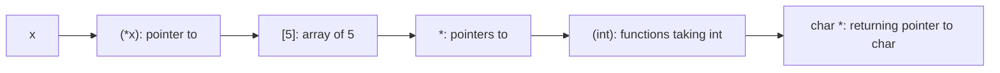

# const Correctness and Complex Declarations

`const` is a promise checked by the compiler: "this won't be modified through this name". With pointers there are **two** things that can be const: the pointer itself, and the data it points to. Getting this right makes interfaces self-documenting (`strlen(const char *)` tells you it won't touch your string) and catches bugs at compile time. This lesson also teaches you to read C's infamous declarations, like `char *(*(*x)[5])(int)`, mechanically.

## 1. The four combinations

```c
int x = 1, y = 2;

int *p1 = &x;              /* mutable pointer to mutable int */
const int *p2 = &x;        /* pointer to CONST int: *p2 = 5 is an error; p2 = &y is OK */
int * const p3 = &x;       /* CONST pointer to int: *p3 = 5 is OK; p3 = &y is an error */
const int * const p4 = &x; /* neither may change */
```

> [!KEY]
> Read declarations **right to left**, starting from the name:
> - `const int *p` / `int const *p`: "p is a pointer to an int that is const"
> - `int * const p`: "p is a const pointer to an int"
>
> `const` applies to whatever is immediately to its **left**, or, if nothing is on its left, to the thing on its right.

| Declaration | Change `*p`? | Change `p`? | Typical use |
|---|---|---|---|
| `T *p` | yes | yes | general |
| `const T *p` | no | yes | **read-only input parameters** |
| `T * const p` | yes | no | a fixed handle (e.g. a hardware register address) |
| `const T * const p` | no | no | a constant lookup-table pointer |

## 2. const in function interfaces

```c
size_t count_char(const char *s, char c);          /* promises not to modify s */
void   fill(int *dst, size_t n, int value);        /* may modify dst */
void   copy(int *restrict dst, const int *restrict src, size_t n);
```

- Every pointer parameter that isn't written through should be `const T *`. Then callers can pass const data, and readers know the function is safe.
- Converting `T *` to `const T *` is implicit and safe. The reverse requires a cast, and writing through the result is UB if the object was originally const.

```c
const int limit = 10;
int *bad = (int *)&limit;   /* compiles with the cast… */
*bad = 20;                  /* …UNDEFINED BEHAVIOUR: limit may live in read-only memory */
```

## 3. Reading any declaration: the spiral / right-left rule

Start at the identifier. Go **right** while you can (`[]` "array of", `()` "function returning"), then **left** (`*` "pointer to", types and qualifiers), jumping out of parentheses as you go.

| Declaration | Reading |
|---|---|
| `int *a[5]` | a is an **array of 5 pointers** to int |
| `int (*a)[5]` | a is a **pointer to an array** of 5 ints |
| `int *f(void)` | f is a **function** returning a pointer to int |
| `int (*f)(void)` | f is a **pointer to a function** returning int |
| `int (*fs[3])(int)` | fs is an array of 3 pointers to functions taking int, returning int |
| `char *(*(*x)[5])(int)` | x is a pointer to an array of 5 pointers to functions (int) returning pointer to char |



> [!TIP]
> In real code, **typedef** complex types step by step instead of writing them inline:
> ```c
> typedef char *(*Handler)(int);     /* pointer to function (int) returning char * */
> typedef Handler HandlerRow[5];     /* array of 5 of those */
> HandlerRow *x;                     /* the monster above, readable */
> ```
> `cdecl` (cdecl.org) translates declarations into English.

## 4. `const` vs `#define` vs `enum`, and `restrict`

- `const` objects are typed and scoped, but in C they're not constant expressions (Variables lesson).
- `restrict` (C99) on a pointer promises that, for its lifetime, the pointed-to object is accessed **only** through that pointer. That lets the compiler optimise (e.g. vectorise `memcpy`). `memcpy(void *restrict, const void *restrict, size_t)` is why its arguments mustn't overlap (use `memmove` when they might).

## 5. Exam-ready answers

> [!EXAM]
> **const with pointers.** In `const int *p` (equivalently `int const *p`), p is a pointer to a constant integer: the pointed-to value cannot be modified through p, but p can be made to point elsewhere. In `int *const p`, p is a constant pointer: it must be initialised and cannot be changed to point elsewhere, but the integer it points to can be modified. `const int *const p` makes both constant. Declaring read-only pointer parameters as pointers to const documents and enforces that a function does not modify its input, and allows const data to be passed. Casting away const and modifying an object originally defined as const is undefined behaviour.

## 6. Cheat sheet

| Want | Write |
|---|---|
| read-only input | `const T *p` |
| fixed pointer | `T *const p` |
| array of pointers | `T *a[N]` |
| pointer to an array | `T (*a)[N]` |
| function pointer | `T (*f)(args)` |
| tame a declaration | `typedef` step by step |
| no-aliasing promise | `T *restrict p` |

> [!INTERVIEW]
> **"Explain `const char *const *argv`."** Reading right to left: argv is a pointer to a const pointer to const char. The function can walk the argv array (change `argv` itself), but can't make any element point elsewhere, and can't modify the characters. Interviewers use these to test whether you know that `const` binds to its left neighbour.
