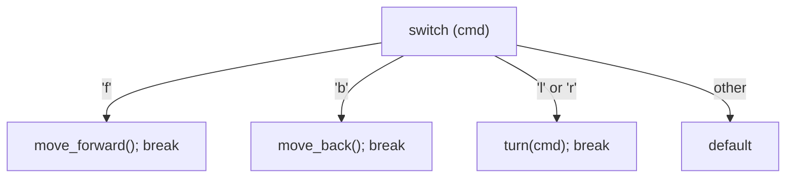

# Conditionals and switch

Decision making in C uses `if`/`else` and `switch`, plus the conditional operator `?:`. The logic is the same as in Python, but the syntax and some behaviours differ: conditions are **integers** (0 is false, anything else true), there's no `elif` keyword, `switch` cases **fall through** unless you `break`, and there's a `goto` statement (with one legitimate use).

## 1. `if` / `else if` / `else`

> [!SYNTAX]
> ```c
> if (condition) {
>     statements;
> } else if (other_condition) {
>     statements;
> } else {
>     statements;
> }
> ```
> The parentheses around the condition are required. Braces are optional for a single statement, but always use them.

```c
int score = 83;
char grade;
if (score >= 90) {
    grade = 'A';
} else if (score >= 80) {
    grade = 'B';
} else {
    grade = 'F';
}
```

### Conditions are integers

```c
int n = 5;
if (n) { ... }          /* true: non-zero */
if (!n) { ... }         /* true only if n == 0 */
int *p = NULL;
if (p) { ... }          /* false: the null pointer is false */
```

Use `<stdbool.h>` (`bool`, `true`, `false`) for readability. Underneath, it's still an integer 0/1.

## 2. The dangling else

`else` attaches to the **nearest** unmatched `if`, whatever the indentation says:

```c
if (a > 0)
    if (b > 0)
        printf("both positive\n");
else                                  /* belongs to `if (b > 0)`, NOT `if (a > 0)` */
    printf("a not positive?\n");      /* actually runs when a > 0 and b <= 0 */
```

> [!DANGER]
> Braces remove the ambiguity. Python avoids this problem entirely through indentation. In C, braces are your protection.

## 3. The conditional operator

```c
int max = (a > b) ? a : b;
printf("%s\n", n % 2 == 0 ? "even" : "odd");
```

## 4. `switch`

`switch` selects a branch by comparing an **integer** expression with constant `case` labels:

```c
switch (cmd) {
case 'f':
    move_forward();
    break;               /* without break, execution FALLS THROUGH into the next case */
case 'b':
    move_back();
    break;
case 'l':
case 'r':                /* intentional fall-through: two labels, one action */
    turn(cmd);
    break;
default:                 /* none matched (optional; conventionally last) */
    printf("unknown\n");
}
```



Rules:

- The controlling expression must be an **integer type** (int, char, enum): no strings, no floats.
- `case` labels must be **integer constant expressions** (`3`, `'x'`, an enum or `#define` constant), all distinct.
- Execution jumps to the matching label and continues **until a `break`** or the end of the switch.

> [!DANGER]
> A missing `break` is a classic bug: the matching case runs, then every following case runs too. Mark intentional fall-through with a comment, or in C23 with `[[fallthrough]];`. `gcc -Wimplicit-fallthrough` (part of `-Wextra`) warns.

Declaring a variable right after a `case` label needs braces: `case 1: { int x = 5; ... break; }`.

Compilers often implement dense switches as a **jump table**: O(1) dispatch, faster than an `if` chain. That's why switches are common in state machines, interpreters and protocol parsers.

## 5. `goto` (and its one good use)

`goto label;` jumps to `label:` in the same function. Unstructured jumps make code hard to follow, so avoid them, **except** for the C idiom of centralised cleanup on error:

```c
int process(void) {
    FILE *f = fopen("data.bin", "rb");
    if (!f) goto fail;
    char *buf = malloc(4096);
    if (!buf) goto close_file;
    /* ... work ... */
    free(buf);
    fclose(f);
    return 0;
close_file:
    fclose(f);
fail:
    return -1;
}
```

This pattern is used throughout the Linux kernel. It replaces deeply nested ifs with one cleanup path per resource (Error Handling lesson).

## 6. Exam-ready answers

> [!EXAM]
> **if–else and switch.** The `if` statement executes a statement or block when its condition, an expression evaluated as an integer, is non-zero, and the optional `else` part executes otherwise; `else if` chains test several conditions in order, and an `else` belongs to the nearest preceding unmatched `if`. The `switch` statement evaluates an integer expression and transfers control to the `case` label with the equal constant value, or to `default` if none matches. Execution continues through subsequent labels until a `break` statement is reached (fall-through), so each case normally ends with `break`. Case labels must be distinct integer constant expressions.

> [!EXAM]
> **`if-else` vs `switch`.** `switch` can only test one integer expression for equality against constant values, while `if-else` can test arbitrary conditions, including ranges, floating-point and string comparisons. For many discrete constant values, `switch` is clearer and may be compiled into a jump table for constant-time dispatch.

## 7. Cheat sheet

| Need | Code |
|---|---|
| two-way | `if (c) { } else { }` |
| chain | `else if` |
| value choice | `x = c ? a : b;` |
| many constants | `switch` + `case K: ... break;` |
| shared action | stacked `case` labels |
| catch-all | `default:` |
| error cleanup | `goto cleanup;` (resource-release pattern only) |

> [!INTERVIEW]
> **"Can you `switch` on a string in C?"** No. `switch` requires an integer expression and constant integer labels. Use an `if`/`else if` chain with `strcmp`, a lookup table of `{name, function pointer}` pairs, or hash the string to an integer first (careful with collisions). C++ can't switch on `std::string` either.
