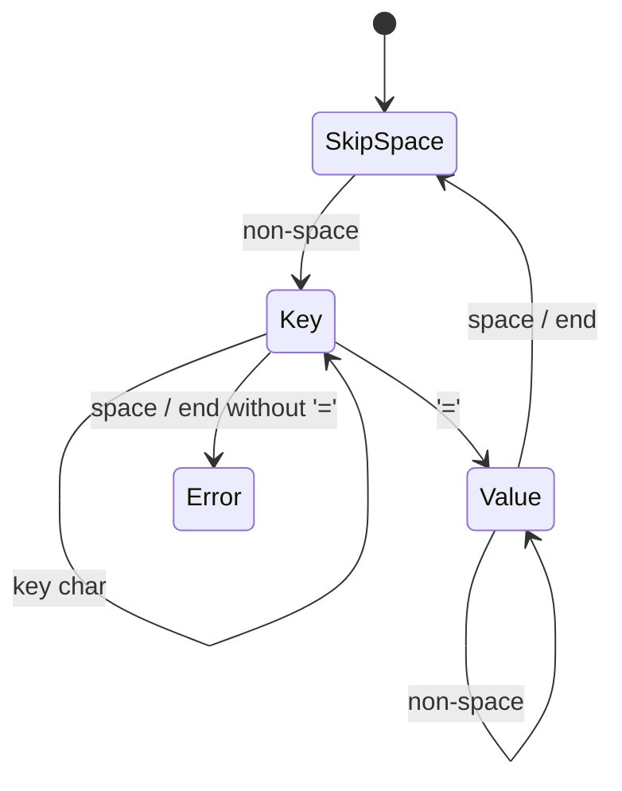

# Character Handling and Parsing

Programs constantly turn text into structure: command lines, config files, CSV logs, sensor messages like `$GPGGA,123519,4807.038,N,...`, robot protocols. In C you build parsers from small tools: the `<ctype.h>` character classifiers, `strtol`/`strtod` for numbers, `sscanf` for fixed formats, and hand-written scanning loops with pointers. This lesson shows each tool and the robust patterns that combine them.

## 1. `<ctype.h>`: classifying characters

| Function | True for |
|---|---|
| `isdigit(c)` | `'0'`–`'9'` |
| `isalpha(c)` | letters |
| `isalnum(c)` | letters or digits |
| `isspace(c)` | space, `\t`, `\n`, `\v`, `\f`, `\r` |
| `isupper(c)` / `islower(c)` | case |
| `isxdigit(c)` | hex digits |
| `ispunct(c)`, `isprint(c)`, `iscntrl(c)` | punctuation / printable / control |
| `toupper(c)` / `tolower(c)` | the converted character |

> [!DANGER]
> These functions take an `int` that must be **`EOF` or a value representable as `unsigned char`**. Passing a plain `char` holding a negative value (any byte ≥ 128 on signed-char platforms, such as UTF-8 bytes) is **undefined behaviour**. Always cast: `isdigit((unsigned char)c)`.

Digit arithmetic doesn't need ctype: `c - '0'` converts `'7'` to 7, because the standard guarantees `'0'`…`'9'` are consecutive.

## 2. Parsing numbers: prefer `strtol` / `strtod`

| Function | Converts | Error detection |
|---|---|---|
| `atoi(s)` | int | **none**: `atoi("abc") == 0`, and overflow is UB |
| `strtol(s, &end, base)` | long | `end` shows where parsing stopped; `errno == ERANGE` on overflow |
| `strtoul`, `strtoll` | unsigned long, long long | same |
| `strtod(s, &end)` | double | same |

```c
#include <errno.h>
#include <stdlib.h>

int parse_int(const char *s, long *out) {
    char *end;
    errno = 0;
    long v = strtol(s, &end, 10);
    if (end == s) return 0;              /* no digits at all */
    if (errno == ERANGE) return 0;       /* out of range */
    if (*end != '\0') return 0;          /* trailing junk like "12abc" */
    *out = v;
    return 1;
}
```

`strtol` with base 0 auto-detects `0x` (hex) and `0` (octal) prefixes. `end` also lets you parse **several numbers in a row**:

```c
const char *p = "10 20 -5";
char *end;
for (long v = strtol(p, &end, 10); p != end; v = strtol(p, &end, 10)) {
    printf("%ld\n", v);
    p = end;
}
```

## 3. `sscanf` for fixed formats

```c
int h, m, s;
if (sscanf("12:34:56", "%d:%d:%d", &h, &m, &s) == 3) { ... }

char key[32];
double value;
if (sscanf(line, " %31[^=]= %lf", key, &value) == 2) { ... }   /* "speed = 2.5" */
```

`%[...]` is a **scanset**: `%31[^=]` reads up to 31 characters that aren't `=`. Always check the return count, and always give string fields a width.

## 4. Tokenising: `strtok` and its problems

```c
char line[] = "move,10,20";
for (char *tok = strtok(line, ","); tok != NULL; tok = strtok(NULL, ",")) {
    puts(tok);
}
```

> [!WARNING]
> `strtok` **modifies** its input (it writes `'\0'` over the delimiters), keeps **hidden static state** (not reentrant or thread-safe: nesting two `strtok` loops breaks both), and **collapses empty fields** (`"a,,b"` gives two tokens, not three). Use `strtok_r` (POSIX) for reentrancy. For CSV with empty fields, scan manually with `strchr` or `strcspn`.

## 5. Hand-written scanners: the professional approach

A pointer that walks the input, with small helper functions per token type, handles any grammar precisely:

```c
#include <ctype.h>

/* parse "x=12 y=-3 name=rover" style key=value pairs */
void parse_pairs(const char *p) {
    while (*p) {
        while (isspace((unsigned char)*p)) p++;          /* skip whitespace */
        if (!*p) break;
        const char *k = p;
        while (*p && *p != '=' && !isspace((unsigned char)*p)) p++;
        int klen = (int)(p - k);
        if (*p != '=') { printf("error near '%.*s'\n", klen, k); return; }
        p++;                                             /* skip '=' */
        const char *v = p;
        while (*p && !isspace((unsigned char)*p)) p++;
        printf("key=%.*s value=%.*s\n", klen, k, (int)(p - v), v);
    }
}
```

`%.*s` prints exactly `len` characters, which lets you print slices of the input **without copying** them.



Parsers like this are **state machines**. The Embedded module formalises them for protocol decoding.

## 6. Exam-ready answers

> [!EXAM]
> **Character classification and conversion.** The `<ctype.h>` header declares functions such as `isdigit`, `isalpha`, `isalnum`, `isspace`, `isupper`, `islower`, `toupper` and `tolower`, which test or convert single characters. Their argument must be representable as an `unsigned char` or equal `EOF`, so `char` values should be cast to `unsigned char` before the call. For converting strings to numbers, `strtol`, `strtoul` and `strtod` are preferred over `atoi` because they report where parsing stopped (through an end pointer) and signal overflow through `errno`, allowing invalid input to be detected.

## 7. Cheat sheet

| Need | Code |
|---|---|
| digit value | `c - '0'` |
| safe classification | `isalpha((unsigned char)c)` |
| strict int parse | `strtol` + check `end` + `errno` |
| fixed pattern | `sscanf(line, "%d:%d", &a, &b) == 2` |
| key=value | `sscanf(line, " %31[^=]= %lf", key, &v)` |
| split, keeping empty fields | loop with `strchr(p, ',')` |
| print a slice | `printf("%.*s", len, start)` |

> [!INTERVIEW]
> **"Why is `atoi` considered unsafe?"** It has no way to report errors: `atoi("abc")` returns 0, which is indistinguishable from `atoi("0")`, trailing junk is ignored silently, and out-of-range input is undefined behaviour. `strtol` reports the stopping position and sets `errno = ERANGE` on overflow, so callers can reject bad input. That matters for anything reading external data, such as config files, network packets or serial devices.
