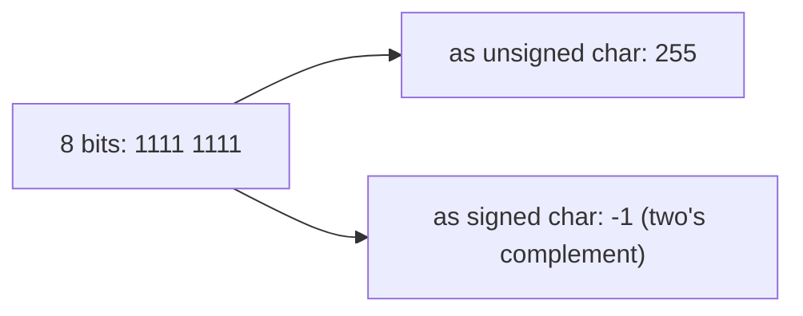

# Data Types and Sizes

In Python, an integer is a flexible object that grows as needed. In C, every variable has a **fixed-size type** chosen by you, and that size decides what values fit, how arithmetic overflows, and how much memory the data uses. This is the foundation of everything low-level: memory layouts, binary file formats, network packets, hardware registers on a microcontroller. Know these types cold.

## 1. The basic types

| Type | Typical size (x86-64 Linux) | Typical range | printf |
|---|---|---|---|
| `char` | 1 byte | −128…127 or 0…255 (implementation-defined signedness!) | `%c` / `%d` |
| `signed char` / `unsigned char` | 1 | −128…127 / 0…255 | `%hhd` / `%hhu` |
| `short` | 2 | −32,768…32,767 | `%hd` |
| `int` | 4 | −2,147,483,648…2,147,483,647 | `%d` |
| `long` | 8 (4 on Windows!) | ±9.2×10¹⁸ | `%ld` |
| `long long` | 8 | ±9.2×10¹⁸ | `%lld` |
| `float` | 4 | ~7 significant digits, ±3.4×10³⁸ | `%f` |
| `double` | 8 | ~15–16 significant digits, ±1.8×10³⁰⁸ | `%f` (printf) / `%lf` (scanf) |
| `long double` | 16 (x86: 80-bit extended) | more precision | `%Lf` |
| `_Bool` / `bool` | 1 | 0 or 1 | `%d` |
| pointers (`T *`) | 8 on 64-bit systems | addresses | `%p` |

> [!KEY]
> The C standard guarantees only **minimum** sizes and an ordering: `char` is exactly 1 byte, `short` ≥ 16 bits, `int` ≥ 16 bits, `long` ≥ 32 bits, `long long` ≥ 64 bits, and `sizeof(short) ≤ sizeof(int) ≤ sizeof(long) ≤ sizeof(long long)`. An `int` is 16 bits on some microcontrollers (AVR/Arduino Uno). Never assume sizes. Use `sizeof` or the fixed-width types.

```c
printf("%zu %zu %zu %zu\n", sizeof(char), sizeof(int), sizeof(long), sizeof(double));
/* on x86-64 Linux: 1 4 8 8 */
```

`sizeof` is an **operator** (not a function) that yields the size in bytes as a `size_t` value, an unsigned type printed with `%zu`.

## 2. Signed vs unsigned

Every integer type has a signed and an unsigned version. With N bits:

| | Range |
|---|---|
| signed (two's complement) | −2ᴺ⁻¹ … 2ᴺ⁻¹ − 1 |
| unsigned | 0 … 2ᴺ − 1 |



The same bits mean different values depending on the type. That's the core idea behind type punning, binary protocols and the classic bugs below.

### Overflow: wrap-around vs undefined behaviour

```c
unsigned int u = 0;
u = u - 1;                 /* well-defined: wraps modulo 2^32 → 4294967295 */
unsigned char uc = 255;
uc++;                      /* wraps to 0 */

int i = INT_MAX;
i = i + 1;                 /* UNDEFINED BEHAVIOUR: anything may happen */
```

> [!DANGER]
> **Unsigned** overflow wraps around (modular arithmetic, defined by the standard). **Signed** overflow is **undefined behaviour (UB)**. The compiler may assume it never happens and optimise accordingly, so a check like `if (x + 1 < x)` can be deleted entirely. Use wider types, check before you add (`if (x > INT_MAX - y)`), or use `__builtin_add_overflow`.

## 3. `char` is a small integer

```c
char c = 'A';               /* 'A' is just the number 65 (ASCII) */
printf("%c %d\n", c, c);    /* A 65 */
printf("%c\n", c + 1);      /* B */
char d = 200;               /* plain char is signed on x86 → stores -56 */
```

Whether plain `char` is signed or unsigned is **implementation-defined** (signed on x86, unsigned on most ARM). For raw bytes, always use `unsigned char` or `uint8_t`.

## 4. Fixed-width integers: `<stdint.h>`

For data whose size matters (file formats, protocols, hardware registers, robotics messages), use exact-width types:

| Type | Meaning |
|---|---|
| `int8_t`, `int16_t`, `int32_t`, `int64_t` | exactly N-bit signed |
| `uint8_t` … `uint64_t` | exactly N-bit unsigned |
| `int_fast32_t`, `int_least16_t` | fastest / smallest with at least N bits |
| `intptr_t`, `uintptr_t` | integers that can hold a pointer |
| `size_t` (`<stddef.h>`) | sizes and array indices (unsigned) |
| `ptrdiff_t` | the difference of two pointers (signed) |

Print them with the macros from `<inttypes.h>`: `printf("%" PRId64 "\n", x);`.

## 5. Limits: `<limits.h>` and `<float.h>`

```c
#include <limits.h>
printf("%d %d %u\n", INT_MIN, INT_MAX, UINT_MAX);   /* -2147483648 2147483647 4294967295 */
printf("%d\n", CHAR_BIT);                            /* 8 bits per byte */
#include <float.h>
printf("%d %d\n", FLT_DIG, DBL_DIG);                 /* 6 15 */
```

## 6. Floating point

`float` and `double` are IEEE-754 binary floating point, the same as Python's `float` (which is a C `double`). All of Python's float lessons apply: `0.1` isn't exact (`printf("%.20f", 0.1)` → `0.10000000000000000555`), compare with a tolerance, and overflow gives `inf`. Prefer `double`. Use `float` only to save memory (big arrays, GPUs) or on hardware with only a single-precision FPU.

## 7. Choosing a type

| Situation | Type |
|---|---|
| general integer arithmetic | `int` |
| counts or sizes of things in memory | `size_t` |
| values that may exceed 2×10⁹ | `long long` / `int64_t` |
| raw bytes | `unsigned char` / `uint8_t` |
| exact layout (protocols, registers) | `uint16_t`, `int32_t`… |
| real numbers | `double` |
| true/false | `bool` (`<stdbool.h>`) |

## 8. Exam-ready answers

> [!EXAM]
> **Basic data types in C.** C provides integer types (`char`, `short`, `int`, `long`, `long long`), each in signed and unsigned variants, floating-point types (`float`, `double`, `long double`) and, since C99, `_Bool`. The standard fixes only minimum ranges and the ordering of sizes, so actual sizes are implementation-defined and are obtained with the `sizeof` operator; typical 64-bit Linux sizes are 1, 2, 4, 8 and 8 bytes for the integer types, and 4 and 8 bytes for `float` and `double`. Signed integers are represented in two's complement (mandatory since C23), with range −2ᴺ⁻¹ to 2ᴺ⁻¹−1, and unsigned integers range from 0 to 2ᴺ−1. Unsigned arithmetic wraps modulo 2ᴺ, while signed overflow is undefined behaviour. `<stdint.h>` provides exact-width types such as `int32_t` and `uint8_t`, and `<limits.h>` and `<float.h>` provide the ranges.

## 9. Cheat sheet

| Need | Code |
|---|---|
| size of a type or variable | `sizeof(int)`, `sizeof x` (`%zu`) |
| max int | `INT_MAX` (`<limits.h>`) |
| exact 32-bit int | `int32_t` (`<stdint.h>`) |
| byte | `uint8_t` |
| big counts | `long long` with `%lld` |
| bool | `#include <stdbool.h>`, `bool ok = true;` |

> [!INTERVIEW]
> **"What does `unsigned int x = -1;` give, and is `int y = INT_MAX + 1;` the same kind of thing?"** `x` becomes `UINT_MAX` (4294967295 with 32-bit int). Converting a negative value to unsigned is defined as reduction modulo 2ᴺ. `INT_MAX + 1` is signed overflow: **undefined behaviour**, not "wraps to INT_MIN". Optimising compilers really do exploit this (for example, removing overflow checks or assuming loops terminate).
