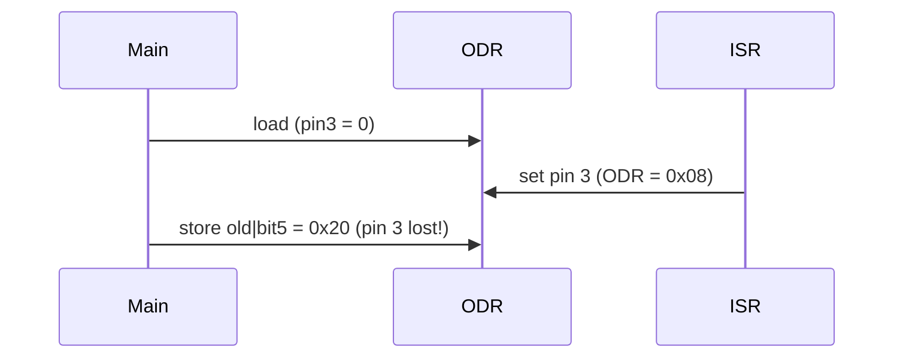

# Bitwise Register Programming

On a microcontroller, hardware is controlled through **registers**: fixed memory addresses where a write configures a peripheral (GPIO, timer, UART, ADC) and a read reports its state. Firmware for motor drivers, IMUs and flight controllers is mostly reading and writing bit fields at those addresses. This lesson covers memory-mapped I/O, `volatile`, the standard mask idioms, register-struct overlays, and the hardware access patterns (read-modify-write, set/reset registers, write-1-to-clear) that decide whether your driver is correct.

## 1. Memory-mapped I/O

A peripheral's registers appear at fixed physical addresses listed in the reference manual. For example, an STM32-style GPIO port:

| Offset | Register | Meaning |
|---|---|---|
| 0x00 | `MODER` | 2 bits per pin: 00 input, 01 output, 10 alternate function, 11 analog |
| 0x04 | `OTYPER` | 1 bit per pin: push-pull / open-drain |
| 0x10 | `IDR` | input data (read-only) |
| 0x14 | `ODR` | output data |
| 0x18 | `BSRR` | bit set/reset (write-only): bits 0–15 set a pin, bits 16–31 reset it |

```c
#include <stdint.h>
#define GPIOA_BASE 0x48000000u
#define GPIOA_ODR (*(volatile uint32_t *)(GPIOA_BASE + 0x14u))

GPIOA_ODR |= (1u << 5);     /* drive PA5 high (an LED on many boards) */
```

The cast turns an integer address into a pointer to a **volatile** 32-bit register, and the leading `*` dereferences it, so `GPIOA_ODR` behaves like a variable that lives in hardware.

> [!KEY]
> `volatile` tells the compiler that every access is an observable side effect. It must perform each read and write exactly as written, in order, without caching values in registers or merging stores. Without it, a polling loop `while (!(UART_SR & RXNE)) {}` can be compiled into an infinite loop that reads the register once.

`volatile` does **not** make accesses atomic, and it does not order them relative to other CPUs or DMA. That needs memory barriers (`__DMB()`, `atomic_thread_fence`) or atomics.

## 2. The four mask idioms

```c
reg |=  (1u << n);          /* set bit n */
reg &= ~(1u << n);          /* clear bit n */
reg ^=  (1u << n);          /* toggle bit n */
if (reg & (1u << n)) {...}  /* test bit n */
```

**Multi-bit fields** are read and written with a mask and a shift:

```c
#define FIELD_MASK(width)       ((width) >= 32 ? 0xFFFFFFFFu : ((1u << (width)) - 1u))
#define FIELD_GET(reg, sh, w)   (((reg) >> (sh)) & FIELD_MASK(w))
#define FIELD_SET(reg, sh, w, v) \
    ((reg) = ((reg) & ~(FIELD_MASK(w) << (sh))) | (((uint32_t)(v) & FIELD_MASK(w)) << (sh)))

/* configure pin 5 as output: MODER bits 11:10 = 01 */
FIELD_SET(GPIOA_MODER, 5 * 2, 2, 1u);
```

> [!DANGER]
> Write `1u << 31`, not `1 << 31`. Shifting a signed `1` into the sign bit is undefined behaviour. Shifting by 32 or more is undefined too, which is why `FIELD_MASK` special-cases a width of 32. Always use unsigned constants (`u` suffix) for register values.

## 3. Register structs

Vendor headers (CMSIS) describe a peripheral as a struct whose layout matches the register map, and then point it at the base address:

```c
typedef struct {
    volatile uint32_t MODER;    /* 0x00 */
    volatile uint32_t OTYPER;   /* 0x04 */
    volatile uint32_t OSPEEDR;  /* 0x08 */
    volatile uint32_t PUPDR;    /* 0x0C */
    volatile const uint32_t IDR;/* 0x10 read-only */
    volatile uint32_t ODR;      /* 0x14 */
    volatile uint32_t BSRR;     /* 0x18 */
} GPIO_TypeDef;

#define GPIOA ((GPIO_TypeDef *)0x48000000u)
GPIOA->BSRR = 1u << 5;
_Static_assert(offsetof(GPIO_TypeDef, BSRR) == 0x18, "register map mismatch");
```

`_Static_assert` with `offsetof` catches a wrong layout at compile time. Every member is a `uint32_t`, so there's no padding. Reserved gaps are filled with `uint32_t RESERVED[n]` arrays.

Because the driver code only takes a `GPIO_TypeDef *`, you can **test it on a PC** by pointing it at an ordinary struct in RAM instead of the hardware address. That's exactly how the problems in this module are graded.

## 4. Read-modify-write and why BSRR exists

`GPIOA->ODR |= 1u << 5;` is three steps: load ODR, OR in the bit, store ODR. Suppose an interrupt fires between the load and the store, and the ISR changes pin 3. Your store then writes back the **old** value of pin 3, and the ISR's change is lost.



Hardware solves this with **atomic set/reset registers**. Writing `1u << n` to `BSRR` sets pin n, and writing `1u << (n + 16)` resets it. Zero bits are ignored, so a single write affects only the pins you name, and no read is involved:

```c
static inline void gpio_write(GPIO_TypeDef *g, unsigned pin, int high) {
    g->BSRR = high ? (1u << pin) : (1u << (pin + 16u));
}
```

Other techniques: disable interrupts around the RMW (`__disable_irq()` / `__enable_irq()`, keeping the window tiny), **bit-banding** on Cortex-M3/M4 (each bit aliased to its own word), or `LDREX/STREX` exclusive access loops.

## 5. Status flags: write-1-to-clear and read-to-clear

Status registers come in three styles:

| Style | How to clear flag n | Trap |
|---|---|---|
| W1C (write-1-to-clear) | `REG = 1u << n;` | `REG \|= 1u << n` reads all set flags and writes them back as 1s, **clearing every pending flag** |
| RC (read-to-clear) | reading clears it | a debugger watch window reading the register clears flags behind your back |
| write-0-to-clear | `REG = ~(1u << n);` | |

> [!WARNING]
> Never use `|=` or `&=` on a W1C register. Write exactly the bit you mean to clear.

## 6. Polling with a timeout

```c
#define UART_SR_TXE (1u << 7)
int uart_putc(UART_TypeDef *u, char c, uint32_t spins) {
    while (!(u->SR & UART_SR_TXE)) {       /* volatile read each iteration */
        if (spins-- == 0) return -1;        /* never spin forever on hardware */
    }
    u->DR = (uint8_t)c;
    return 0;
}
```

Real drivers poll with a timeout, preferably against a hardware timer tick, and report an error code instead of hanging the robot when a peripheral dies.

## 7. Endianness and packing on the wire

Registers are native-endian. Bytes coming from sensors over SPI or I²C are often big-endian. Assemble them with shifts, which are endian-independent, rather than casting a byte pointer to `uint16_t *` (that's an alignment and strict-aliasing hazard):

```c
int16_t accel_x = (int16_t)(((uint16_t)buf[0] << 8) | buf[1]);
```

> [!EXAM]
> **Why must a hardware register be declared `volatile`, and is that enough for correctness?**
> `volatile` forces the compiler to perform every read and write exactly as written, in order, because each access has side effects the compiler can't see. It's not enough on its own. It gives no atomicity (a read-modify-write can be interrupted, so use set/reset registers or disable interrupts), no memory ordering relative to DMA or other cores (use barriers), and W1C or read-to-clear semantics still require writing exactly the intended bits.

> [!INTERVIEW]
> Common questions:
> - "Set bits 4–6 of a register to 5 without touching the others."
>   `r = (r & ~(7u << 4)) | (5u << 4);`
> - "What's wrong with `REG |= FLAG` on a status register?" It clears all W1C flags.
> - "What does `volatile const uint32_t *` mean?" A read-only hardware register whose value can still change.
