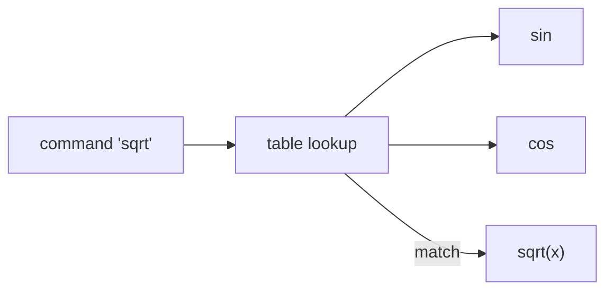

# Function Pointers

Functions live in memory too, so you can store a function's address in a variable and call through it. **Function pointers** are C's way to pass behaviour as data: sorting with a custom comparison (`qsort`), callbacks, dispatch tables, plugin systems, state machines, interrupt vector tables, and **hand-made polymorphism** (vtables) that C++ automates. They're the C equivalent of Python's first-class functions, minus closures.

## 1. Declaring and calling

> [!SYNTAX]
> ```c
> return_type (*name)(param_types);      /* pointer to a function */
> name = some_function;                  /* the function name decays to its address (& optional) */
> result = name(args);                   /* call through the pointer (or (*name)(args)) */
> ```

```c
int add(int a, int b) { return a + b; }
int mul(int a, int b) { return a * b; }

int (*op)(int, int) = add;
printf("%d\n", op(2, 3));        /* 5 */
op = mul;
printf("%d\n", (*op)(2, 3));     /* 6: explicit dereference style, same meaning */
```

> [!KEY]
> The parentheses around `*op` are essential: `int *op(int, int);` declares a **function** returning `int *`. With `typedef` it becomes readable:
> ```c
> typedef int (*BinaryOp)(int, int);
> BinaryOp op = add;
> ```

## 2. Callbacks: passing behaviour to a function

```c
typedef int (*Predicate)(int);

int count_if(const int *a, size_t n, Predicate pred) {
    int c = 0;
    for (size_t i = 0; i < n; i++)
        if (pred(a[i])) c++;
    return c;
}

int is_even(int x) { return x % 2 == 0; }
int is_positive(int x) { return x > 0; }

int data[] = {3, -2, 8, 0, 5};
printf("%d %d\n", count_if(data, 5, is_even), count_if(data, 5, is_positive));   /* 3 3 */
```

## 3. `qsort`: the standard library's callback

```c
#include <stdlib.h>

int cmp_int(const void *pa, const void *pb) {
    int a = *(const int *)pa, b = *(const int *)pb;
    return (a > b) - (a < b);        /* -1, 0, 1, with no overflow */
}

int v[] = {5, 1, 4, 2};
qsort(v, 4, sizeof v[0], cmp_int);   /* 1 2 4 5 */
```

`qsort(base, count, size, compare)` works on **any** type, because it only moves bytes and asks your function how two elements compare. Compare functions receive `const void *` pointers **to the elements**.

> [!DANGER]
> `return a - b;` is a popular but **buggy** comparator: it overflows when `a` and `b` have opposite signs and large magnitudes (e.g. `INT_MIN - 1`). Use `(a > b) - (a < b)`. Also, the comparator must be consistent (a total order), or `qsort`'s behaviour is undefined.

Sorting structs by a field:

```c
typedef struct { char name[16]; int score; } Player;

int by_score_desc(const void *a, const void *b) {
    const Player *x = a, *y = b;         /* void * converts implicitly in C */
    return (y->score > x->score) - (y->score < x->score);
}
```

## 4. Dispatch tables: replacing switch with data

```c
typedef double (*MathFn)(double);
#include <math.h>

struct { const char *name; MathFn fn; } table[] = {
    {"sin", sin}, {"cos", cos}, {"sqrt", sqrt},
};

double apply(const char *name, double x, int *ok) {
    for (size_t i = 0; i < sizeof table / sizeof table[0]; i++)
        if (strcmp(table[i].name, name) == 0) { *ok = 1; return table[i].fn(x); }
    *ok = 0;
    return 0;
}
```



Adding a command means adding a row, not editing control flow. That's the open/closed principle in C. Interpreters, CLI tools, protocol handlers and state machines use exactly this.

## 5. Callbacks with context (C's substitute for closures)

C functions can't capture variables. The convention is an extra `void *` "user data" argument that the library passes back to you:

```c
typedef void (*Visitor)(int value, void *ctx);

void for_each(const int *a, size_t n, Visitor f, void *ctx) {
    for (size_t i = 0; i < n; i++) f(a[i], ctx);
}

void accumulate(int v, void *ctx) { *(long long *)ctx += v; }

long long total = 0;
for_each(data, 5, accumulate, &total);
```

GUI toolkits (GTK), threads (`pthread_create`), timers and ROS 2's C API (`rcl`) all use this pattern.

## 6. Preview: polymorphism by hand

A struct holding function pointers is a **vtable**. Each "object" carries pointers to its own implementations:

```c
typedef struct Shape Shape;
struct Shape {
    double (*area)(const Shape *self);
    const char *name;
};
```

The Master OOP in C module builds full class hierarchies this way. It's exactly how C++ virtual functions work underneath.

## 7. Exam-ready answers

> [!EXAM]
> **Function pointers.** A function pointer stores the address of a function and is declared with the function's return and parameter types, e.g. `int (*fp)(int, int);`. A function name decays to its address, so `fp = add;` is valid, and the function is invoked through the pointer with `fp(2, 3)` or `(*fp)(2, 3)`. Function pointers allow functions to be passed as arguments (callbacks, as in the comparison function of `qsort`), stored in arrays or structures (dispatch tables, state machines, plug-ins), and selected at run time, enabling generic and polymorphic code in C.

## 8. Cheat sheet

| Need | Code |
|---|---|
| declare | `int (*f)(int, int);` |
| readable type | `typedef int (*BinOp)(int, int);` |
| call | `f(a, b)` |
| sort anything | `qsort(arr, n, sizeof arr[0], cmp)` |
| safe int comparator | `return (a > b) - (a < b);` |
| table | array of `{name, fnptr}` structs |
| context | an extra `void *ctx` parameter |

> [!INTERVIEW]
> **"How would you implement a simple state machine in C?"** An enum of states plus a table of function pointers, one handler per state, each returning the next state: `State (*handlers[])(Event) = {idle, moving, error};` and then `state = handlers[state](event);`. It's data-driven, easy to extend, and O(1) dispatch. It's the standard pattern in embedded robot controllers.
