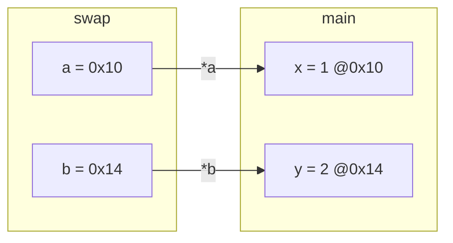

# Functions and Prototypes

Functions are how C programs are decomposed: every real C codebase is a set of small functions spread across files, connected through declarations in headers. C functions are simpler than Python's (no default arguments, no keyword arguments, no closures, no returning several values), and one rule shapes everything: **all arguments are passed by value**. To let a function change a caller's variable you pass its **address**. That's where pointers enter C.

## 1. Definition, declaration, call

> [!SYNTAX]
> ```c
> return_type name(type1 param1, type2 param2) {   /* definition */
>     /* body */
>     return value;                               /* must match return_type */
> }
>
> return_type name(type1, type2);                 /* prototype (declaration): names optional */
> ```

```c
#include <stdio.h>

double average(const int a[], int n);    /* prototype */

int main(void) {
    int scores[] = {90, 72, 85};
    printf("%.2f\n", average(scores, 3)); /* call */
    return 0;
}

double average(const int a[], int n) {   /* definition */
    long long sum = 0;
    for (int i = 0; i < n; i++)
        sum += a[i];
    return n ? (double)sum / n : 0.0;
}
```

| Part | Rule |
|---|---|
| return type | any type except arrays and functions. `void` means "returns nothing" |
| parameters | `(void)` for none; each parameter needs its own type: `int a, int b`, not `int a, b` |
| `return` | exits immediately. A non-`void` function must return a value on every path (reading the result of one that falls off the end is UB; `-Wreturn-type` warns) |
| prototype | must appear before any call; usually placed in a header |

## 2. Pass by value

> [!KEY]
> The parameter is a **new local variable initialised with a copy of the argument**. Changing the parameter never changes the caller's variable.

```c
void swap_bad(int a, int b) {     /* a and b are copies */
    int t = a; a = b; b = t;
}

void swap(int *a, int *b) {       /* receive ADDRESSES */
    int t = *a;                   /* *a = "the int that a points to" */
    *a = *b;
    *b = t;
}

int x = 1, y = 2;
swap_bad(x, y);   /* x = 1, y = 2: unchanged */
swap(&x, &y);     /* x = 2, y = 1: &x passes x's address */
```



This "pass a pointer to modify" pattern is also how C returns **several values**: `void min_max(const int *a, int n, int *lo, int *hi)`. The Pointers module covers it in depth.

### Arrays are the exception that isn't

An array argument **decays to a pointer to its first element**. The function receives an address, so it *can* modify the caller's elements, and it can't find out the array's length:

```c
void fill(int a[], int n, int v) {     /* int a[] is exactly int *a here */
    for (int i = 0; i < n; i++) a[i] = v;
    /* sizeof a == sizeof(int *) == 8, NOT the array size */
}
```

> [!DANGER]
> Always pass the length alongside an array, `f(int *a, size_t n)`. Using `sizeof a / sizeof a[0]` inside the function gives `8 / 4 = 2` on 64-bit systems, whatever the real size is. gcc warns: *'sizeof' on array function parameter will return size of 'int \*'*. Mark arrays the function won't modify as `const int a[]`.

## 3. `void` functions and `return`

```c
void print_line(int width) {
    if (width <= 0) return;      /* early exit, no value */
    for (int i = 0; i < width; i++) putchar('-');
    putchar('\n');
}
```

## 4. The call stack

Each call pushes a **stack frame** holding the return address, parameters and local variables. Returning pops it, and the locals cease to exist:

```c
int *bad(void) {
    int local = 42;
    return &local;      /* DANGLING: local dies when bad returns. UB to use it (gcc warns) */
}
```

> [!DANGER]
> Never return the address of a local variable. Return the value, write into a caller-supplied buffer, or allocate on the heap (Memory module).

## 5. What C functions don't have (and the C way instead)

| Python feature | C equivalent |
|---|---|
| default arguments | separate functions, or pass a sentinel value |
| keyword arguments | pass a struct of options |
| several return values | output pointer parameters, or return a struct |
| overloading | different names (`abs`, `labs`, `fabs`); C11 `_Generic` macros |
| closures / nested functions | function pointers + a `void *context` parameter |
| exceptions | return an error code (Error Handling lesson) |

## 6. `inline` and `static` functions (preview)

- `static int helper(void)` makes the function **private to its source file** (internal linkage). Use it for every helper that isn't part of a module's interface.
- `inline` hints the compiler to substitute the body at call sites. Modern compilers inline small functions on their own at `-O2`.

## 7. Recursion works as you'd expect

Each call has its own frame, so recursion is natural (Recursion lesson). The stack is limited, typically 8 MB on Linux, so very deep recursion crashes with a **segmentation fault** (stack overflow) instead of Python's polite `RecursionError`.

## 8. Exam-ready answers

> [!EXAM]
> **Functions in C.** A function definition specifies a return type, a name, a parameter list and a body. A function prototype declares the function's return type and parameter types so that calls can be type-checked before the definition is seen; prototypes are typically placed in header files. C passes all arguments by value: each parameter is a local copy of the argument, so modifying it does not affect the caller. To allow a function to modify a caller's variable, its address is passed and the function accesses the variable through a pointer. Array arguments are converted to pointers to their first elements, so the function can modify the elements but cannot determine the array's length, which must be passed separately.

> [!EXAM]
> **Call by value vs call by reference.** In call by value the function receives copies of the argument values, so changes to the parameters are not reflected in the caller. In call by reference the function receives references to the caller's variables. C supports only call by value, but call by reference is simulated by passing pointers (addresses) and dereferencing them inside the function.

## 9. Cheat sheet

| Need | Code |
|---|---|
| no parameters | `int f(void)` |
| modify the caller's int | `void inc(int *p) { (*p)++; }` called as `inc(&x)` |
| read-only array | `double avg(const int *a, size_t n)` |
| several results | `void stats(const int *a, size_t n, int *min, int *max)` |
| file-private helper | `static int helper(...)` |
| declare before use | prototype at the top or in a `.h` |

> [!INTERVIEW]
> **"Is C pass-by-value or pass-by-reference?"** Strictly pass-by-value, always. Passing a pointer passes the *address* by value: the function gets a copy of the pointer, so assigning a new address to the parameter doesn't affect the caller's pointer, but writing through it (`*p = ...`) changes the pointed-to object. That's why a function that must change the caller's *pointer itself* (for example `alloc(&ptr)`) takes a pointer to a pointer.
