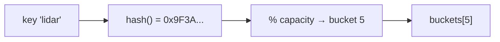

# Hash Tables

A **hash table** maps keys to values with **O(1) average** insert, lookup and delete. It's the most useful data structure in practice: symbol tables in compilers, caches, database indexes, deduplication, counting. C has no built-in one, so every serious C programmer writes (or picks) one, and understands the trade-offs: hash function quality, collision resolution (**chaining** vs **open addressing**), load factor and resizing.

## 1. The idea



1. A **hash function** turns the key into a large integer.
2. Reduce it to a bucket index: `h % capacity`, or `h & (capacity - 1)` for power-of-two capacities.
3. **Collisions** (different keys landing in the same bucket) are inevitable, by the pigeonhole principle and the birthday paradox, so a collision strategy is required.

## 2. Hash functions

For strings, **FNV-1a** is simple and decent:

```c
#include <stdint.h>
uint64_t fnv1a(const char *s) {
    uint64_t h = 1469598103934665603ULL;          // offset basis
    for (; *s; s++) {
        h ^= (unsigned char)*s;
        h *= 1099511628211ULL;                     // FNV prime
    }
    return h;
}
```

For integers, a mixing function like SplitMix64's finaliser spreads nearby keys. A good hash is **fast**, **deterministic**, and **spreads keys uniformly**, so that small key differences flip many output bits. If attackers control the keys (web servers), use a **keyed** hash such as SipHash with a secret seed to prevent hash-flooding attacks.

> [!WARNING]
> `h % capacity` with a power-of-two capacity uses only the **low bits** of `h`. A weak hash (like the identity for integers, or summing characters) then collides massively. Either use a good mixing hash, or a prime capacity.

## 3. Separate chaining

Each bucket holds a linked list of entries:

```c
typedef struct Entry {
    char *key;
    int value;
    struct Entry *next;
} Entry;

typedef struct {
    Entry **buckets;
    size_t cap, size;
} Map;

static Entry *find(const Map *m, const char *key, size_t *bucket_out) {
    size_t b = fnv1a(key) & (m->cap - 1);
    if (bucket_out) *bucket_out = b;
    for (Entry *e = m->buckets[b]; e; e = e->next)
        if (strcmp(e->key, key) == 0) return e;
    return NULL;
}

int map_put(Map *m, const char *key, int value) {
    size_t b;
    Entry *e = find(m, key, &b);
    if (e) { e->value = value; return 0; }            // overwrite
    if ((m->size + 1) * 4 > m->cap * 3 && map_grow(m) != 0) return -1;   // keep the load factor <= 0.75
    b = fnv1a(key) & (m->cap - 1);                    // the capacity may have changed
    e = malloc(sizeof *e);
    if (!e) return -1;
    e->key = malloc(strlen(key) + 1);                 // the map OWNS a copy of the key
    if (!e->key) { free(e); return -1; }
    strcpy(e->key, key);
    e->value = value;
    e->next = m->buckets[b];                          // push at the front of the chain
    m->buckets[b] = e;
    m->size++;
    return 0;
}
```

**Resizing** allocates a bucket array twice as large and **re-inserts every entry** (their bucket indices change). That's O(n), but rare enough to be amortised O(1) per insert.

## 4. Open addressing (linear probing)

All entries live in one flat array. On a collision, probe the next slots:

```c
typedef struct { const char *key; int value; } Slot;    // key == NULL means empty

/* lookup: start at the hash index, probe forward until the key or an empty slot */
size_t i = fnv1a(key) & (cap - 1);
while (slots[i].key && strcmp(slots[i].key, key) != 0)
    i = (i + 1) & (cap - 1);
```

| | Separate chaining | Open addressing (linear probing) |
|---|---|---|
| Storage | an array of pointers + a node per entry | one contiguous array |
| Cache behaviour | pointer chasing | **excellent** (probes are adjacent) |
| Load factor | can exceed 1 | must stay well below 1 (≤ 0.7) |
| Deletion | unlink the node: easy | needs **tombstones** or backward-shift deletion |
| Used by | `std::unordered_map`, Java's `HashMap` | Python's `dict`, Rust's `HashMap`, `absl::flat_hash_map` |

> [!KEY]
> In open addressing you **can't simply empty a slot** on delete: that would break the probe chains of keys inserted after it, making them unfindable. Mark it with a **tombstone** ("deleted, keep probing"), or shift the following cluster back. Tombstones accumulate, so rehash periodically.

## 5. Load factor and complexity

The **load factor** α = size / capacity. Expected probe counts grow with α: chaining averages about 1 + α/2 comparisons, but linear probing degrades sharply as α → 1 (clusters merge). That's why tables grow when α passes 0.75 (chaining) or around 0.5–0.7 (probing). Worst case is O(n) per operation (everything collides), which is why hash quality and seeding matter.

## 6. Exam-ready answers

> [!EXAM]
> **Hash tables.** A hash table stores key–value pairs in an array of buckets, using a hash function to map each key to a bucket index, giving average constant-time insertion, lookup and deletion. Collisions are resolved by separate chaining, where each bucket holds a linked list of entries, or by open addressing, where colliding entries are placed in other slots found by probing (linear, quadratic or double hashing), which requires tombstones or rehashing for deletion. The load factor (entries divided by buckets) determines performance; when it exceeds a threshold the table is resized, typically doubled, and all entries are rehashed, giving amortised constant-time insertion. A good hash function distributes keys uniformly; poor or predictable hashes cause clustering and worst-case linear behaviour, which keyed hashes such as SipHash prevent against adversaries.

## 7. Cheat sheet

| Need | Choice |
|---|---|
| string hash | FNV-1a (simple), xxHash or wyhash (fast), SipHash (adversarial input) |
| integer hash | a SplitMix64 / Murmur3 finaliser |
| index from a hash | `h & (cap - 1)` with a power-of-two `cap` |
| simple and robust | separate chaining, load factor ≤ 0.75 |
| fastest lookups | open addressing with linear probing, load ≤ 0.7 |
| delete in probing | tombstones, or backward shift |
| key ownership | copy keys into the table (`strdup`), free them on delete or destroy |

> [!INTERVIEW]
> **"Design a hash map. What happens when it gets full?"** It never gets truly full with chaining, but performance degrades as the load factor grows, so when size/capacity exceeds a threshold (0.75), allocate a bucket array of double the size and rehash every entry into it. That's O(n) for that insert, but amortised O(1), because doublings are geometrically rare. Discuss the hash function choice (uniformity and speed, plus seeding against hash-flooding), chaining vs open addressing (simplicity vs cache efficiency), deletion with tombstones, who owns the keys, and incremental resizing (move a few buckets per operation) for latency-sensitive systems that can't afford a long pause.
