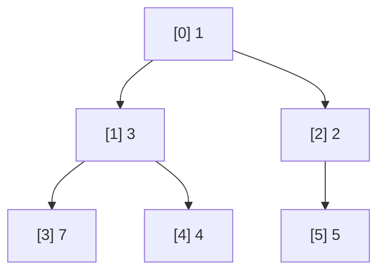

# Heaps and Priority Queues

A **binary heap** is a complete binary tree stored in an **array** where every parent is ≤ its children (a min-heap) or ≥ them (a max-heap). It gives O(log n) insert and remove-min, and O(1) peek: the standard implementation of a **priority queue**. Heaps power schedulers (the next timer to fire), Dijkstra and A* path planning, event-driven simulations, top-k queries, merging sorted streams, and heapsort. In C you implement one in about 40 lines with no pointers at all, just index arithmetic.

## 1. The array layout

For a node at index `i` (0-based):

| Relation | Index |
|---|---|
| parent | `(i - 1) / 2` |
| left child | `2 * i + 1` |
| right child | `2 * i + 2` |



The array `[1, 3, 2, 7, 4, 5]` **is** the tree. Because a complete tree fills levels left to right, there are no gaps and no pointers. The heap property is **local** (parent ≤ children), so siblings aren't ordered and the array isn't sorted.

## 2. The two fundamental operations

```c
typedef struct { int *a; size_t n, cap; } Heap;

static void swap(int *x, int *y) { int t = *x; *x = *y; *y = t; }

static void sift_up(int *a, size_t i) {            /* after appending at the end */
    while (i > 0) {
        size_t p = (i - 1) / 2;
        if (a[p] <= a[i]) break;                   /* heap property restored */
        swap(&a[p], &a[i]);
        i = p;
    }
}

static void sift_down(int *a, size_t n, size_t i) { /* after replacing the root */
    for (;;) {
        size_t l = 2 * i + 1, r = l + 1, m = i;
        if (l < n && a[l] < a[m]) m = l;
        if (r < n && a[r] < a[m]) m = r;           /* m = the smallest of the node and its children */
        if (m == i) break;
        swap(&a[i], &a[m]);
        i = m;
    }
}

int heap_push(Heap *h, int v) {
    if (h->n == h->cap) {
        size_t nc = h->cap ? 2 * h->cap : 16;
        int *t = realloc(h->a, nc * sizeof *t);
        if (!t) return -1;
        h->a = t;
        h->cap = nc;
    }
    h->a[h->n] = v;
    sift_up(h->a, h->n++);
    return 0;
}

int heap_pop(Heap *h, int *out) {
    if (h->n == 0) return -1;
    *out = h->a[0];
    h->a[0] = h->a[--h->n];                        /* move the last element to the root */
    sift_down(h->a, h->n, 0);
    return 0;
}
```

Both operations walk at most one root-to-leaf path: **O(log n)**.

## 3. Building a heap in O(n)

```c
void heapify(int *a, size_t n) {
    for (size_t i = n / 2; i-- > 0;)               /* from the last internal node down to the root */
        sift_down(a, n, i);
}
```

Surprisingly, this is **O(n)**, not O(n log n): most nodes are near the bottom and sift down only a little. The sum ∑ (nodes at height h) × h converges to about 2n.

## 4. Heapsort

```c
void heapsort_desc(int *a, size_t n) {             /* with a min-heap: repeatedly move the min to the end */
    heapify(a, n);
    for (size_t end = n; end > 1; end--) {
        swap(&a[0], &a[end - 1]);
        sift_down(a, end - 1, 0);
    }                                              /* the result is descending; use a max-heap for ascending */
}
```

That's O(n log n) worst case, **in place** (O(1) extra memory). But it's **not stable**, and it's usually slower than quicksort because of poor cache locality. It's used as the fallback in introsort (`std::sort`) to guarantee the worst case.

## 5. Priority queues with records

Real priority queues order **structs** by a key, often with tie-breaking:

```c
typedef struct { double priority; int seq; int task_id; } Item;

static int item_less(const Item *x, const Item *y) {
    if (x->priority != y->priority) return x->priority < y->priority;
    return x->seq < y->seq;                        /* FIFO among equal priorities */
}
```

> [!KEY]
> A binary heap doesn't support efficient **search** or **decrease-key** by value. Dijkstra implementations either push duplicates and skip stale entries ("lazy deletion"), or maintain a `position[]` array mapping each item to its heap index so it can be sifted up in O(log n) after its key decreases (an "indexed heap").

## 6. Classic heap problems

| Problem | Heap technique |
|---|---|
| k smallest of n | max-heap of size k: O(n log k) |
| running median | a max-heap for the lower half + a min-heap for the upper half |
| merge k sorted arrays | a min-heap of (value, array, index): O(N log k) |
| task scheduling, timers | a min-heap keyed by deadline |
| Dijkstra / A* | a min-heap keyed by distance (+ heuristic) |

## 7. Exam-ready answers

> [!EXAM]
> **Binary heaps.** A binary heap is a complete binary tree satisfying the heap property, each node being no greater (min-heap) or no less (max-heap) than its children, and is stored compactly in an array where the children of index i are at 2i+1 and 2i+2 and its parent at (i−1)/2. Insertion appends the element and sifts it up; removal of the root replaces it with the last element and sifts it down; both take O(log n) time, while reading the minimum takes O(1). A heap can be built from an arbitrary array in O(n) time by sifting down internal nodes from the last to the first. Heaps implement priority queues and the in-place, non-stable heapsort algorithm with O(n log n) worst-case time.

## 8. Cheat sheet

| Need | Code / complexity |
|---|---|
| parent / children | `(i-1)/2`, `2i+1`, `2i+2` |
| insert | append + `sift_up`: O(log n) |
| pop min | last → root + `sift_down`: O(log n) |
| peek | `a[0]`: O(1) |
| build from an array | `sift_down` from `n/2 - 1` down to 0: O(n) |
| top-k | a bounded heap of size k |
| decrease-key | an indexed heap, or lazy duplicates |

> [!INTERVIEW]
> **"Why is building a heap O(n) and not O(n log n)?"** Bottom-up heapify calls `sift_down` on each internal node, but the work is bounded by the node's *height*, not the tree's height. Half the nodes are leaves (no work), a quarter have height 1, an eighth height 2, and so on. The total is n·∑ h/2^(h+1), a series that converges to n, so the total is O(n). In contrast, inserting the n elements one at a time with `sift_up` costs O(n log n) in the worst case. Mention that heapsort is O(n log n) overall because the extraction phase dominates.
