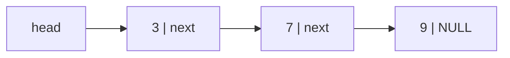

# Linked Lists in C

A **linked list** stores elements in separately allocated **nodes**, each pointing to the next. Unlike an array, inserting or removing at a known position is O(1), with no shifting, and the list grows one node at a time. Linked lists are the foundation of many kernel and embedded data structures (the Linux kernel's `list_head`, free lists in allocators, task queues), and pointer manipulation on lists is the most common C interview topic. This lesson builds singly and doubly linked lists correctly, with special attention to ownership and the pointer-to-pointer technique.

## 1. The node and the list

```c
#include <stdlib.h>

typedef struct Node {
    int value;
    struct Node *next;          // NULL marks the end
} Node;

Node *node_new(int value) {
    Node *n = malloc(sizeof *n);
    if (!n) return NULL;
    n->value = value;
    n->next = NULL;
    return n;
}
```



## 2. Basic operations

```c
/* push at the front: O(1). Takes Node** because it changes the caller's head pointer */
int push_front(Node **head, int value) {
    Node *n = node_new(value);
    if (!n) return -1;
    n->next = *head;
    *head = n;
    return 0;
}

/* traverse: O(n) */
void print_list(const Node *head) {
    for (const Node *p = head; p; p = p->next) printf("%d ", p->value);
    putchar('\n');
}

/* free the whole list: save next BEFORE freeing */
void free_list(Node *head) {
    while (head) {
        Node *next = head->next;
        free(head);
        head = next;              // using head->next after free(head) would be a use-after-free
    }
}
```

> [!KEY]
> Any function that may change **which node is first** (insert at the front, delete the first node, reverse) must receive `Node **head`, a pointer to the caller's head variable. Passing `Node *head` copies the pointer, so the caller never sees the change: a classic bug.

## 3. Pointer-to-pointer deletion: no special cases

Deleting the first node matching a value, the naive way, needs separate handling for the head. Iterating over **the link that points to the current node** removes that special case. This is Linus Torvalds' famous "good taste" example:

```c
int remove_value(Node **head, int value) {
    for (Node **link = head; *link; link = &(*link)->next) {
        if ((*link)->value == value) {
            Node *victim = *link;
            *link = victim->next;     // works the same for the head and for interior nodes
            free(victim);
            return 1;
        }
    }
    return 0;
}

/* insert in sorted position: the same idea */
int insert_sorted(Node **head, int value) {
    Node **link = head;
    while (*link && (*link)->value < value) link = &(*link)->next;
    Node *n = node_new(value);
    if (!n) return -1;
    n->next = *link;
    *link = n;
    return 0;
}
```

## 4. Classic algorithms

```c
/* reverse in place: O(n) time, O(1) space */
Node *reverse(Node *head) {
    Node *prev = NULL;
    while (head) {
        Node *next = head->next;
        head->next = prev;        // flip the pointer
        prev = head;
        head = next;
    }
    return prev;                  // the new head
}

/* middle node: slow/fast pointers */
Node *middle(Node *head) {
    Node *slow = head, *fast = head;
    while (fast && fast->next) { slow = slow->next; fast = fast->next->next; }
    return slow;
}

/* cycle detection: Floyd's tortoise and hare */
int has_cycle(const Node *head) {
    const Node *slow = head, *fast = head;
    while (fast && fast->next) {
        slow = slow->next;
        fast = fast->next->next;
        if (slow == fast) return 1;
    }
    return 0;
}
```

## 5. Doubly linked lists and sentinels

```c
typedef struct DNode { int value; struct DNode *prev, *next; } DNode;

typedef struct {
    DNode head;                   // a SENTINEL: head.next is the first, head.prev the last; the list is circular
    size_t size;
} DList;

void dlist_init(DList *l) { l->head.next = l->head.prev = &l->head; l->size = 0; }

void dlist_insert_after(DNode *pos, DNode *n) {   // O(1), no NULL checks thanks to the sentinel
    n->prev = pos;
    n->next = pos->next;
    pos->next->prev = n;
    pos->next = n;
}

void dlist_unlink(DNode *n) {                      // O(1) removal given only the node
    n->prev->next = n->next;
    n->next->prev = n->prev;
}
```

A **circular list with a sentinel** node removes every NULL edge case: an empty list is the sentinel pointing to itself. That's the design of the Linux kernel's `struct list_head`, which is **intrusive**: the link fields are embedded in your own structs, and `container_of` recovers the enclosing struct (the Master OOP module).

## 6. Arrays vs linked lists

| Operation | Dynamic array | Singly linked | Doubly linked |
|---|---|---|---|
| index i | O(1) | O(n) | O(n) |
| insert/delete at the front | O(n) | O(1) | O(1) |
| insert/delete at the back | O(1)* | O(n) (O(1) with a tail pointer) | O(1) |
| insert/delete at a known node | O(n) | O(1) after it | O(1) |
| memory per element | the element | element + 1 pointer + malloc header | + 2 pointers |
| cache behaviour | excellent | poor (scattered nodes) | poor |

> [!TIP]
> Despite their textbook reputation, linked lists are often **slower** than arrays in practice, even for middle insertions, because traversal chases pointers through cache misses. Use them when you need stable node addresses, O(1) splicing, or intrusive membership in several lists, and allocate nodes from a pool to keep them local.

## 7. Exam-ready answers

> [!EXAM]
> **Linked lists.** A linked list is a sequence of dynamically allocated nodes, each containing data and a pointer to the next node (and, in a doubly linked list, to the previous one); the last node's next pointer is NULL, or the list is circular. Insertion and deletion at a known position take constant time without moving other elements, but access by index and search are linear, and nodes are not contiguous in memory. Functions that modify the head take a pointer to the head pointer, and iterating over the address of each link pointer unifies insertion and deletion at the head and in the interior. Every node must be freed exactly once, saving the next pointer before freeing a node. Sentinel nodes simplify edge cases, and algorithms such as in-place reversal and Floyd's cycle detection use pointer manipulation with constant extra space.

## 8. Cheat sheet

| Need | Code |
|---|---|
| modify the head | pass `Node **head` |
| delete without special cases | `for (Node **l = head; *l; l = &(*l)->next)` |
| free safely | save `next` before `free` |
| reverse | prev/cur/next pointer flip |
| middle / cycle | slow and fast pointers |
| O(1) removal anywhere | a doubly linked list |
| no NULL edge cases | a circular list with a sentinel |

> [!INTERVIEW]
> **"Reverse a singly linked list in place."** Keep three pointers: `prev = NULL`, `cur = head`, and `next`. Loop: save `next = cur->next`, point `cur->next = prev`, advance `prev = cur`, `cur = next`. Return `prev`. That's O(n) time and O(1) space. Mention the recursive version (O(n) stack, so risky for long lists) and the edge cases (empty or single-node lists work naturally). Common follow-ups: reverse in groups of k, check whether a list is a palindrome (reverse the second half), and merge two sorted lists.
