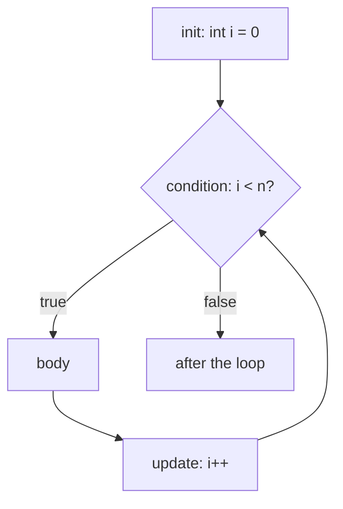

# Loops

C has three loops: `while`, `do`-`while` and the three-part `for`. There are no iterators or `range`: you manage the counter yourself, which gives total control and makes off-by-one errors your responsibility. This lesson covers each loop precisely, plus `break`/`continue`, nested loops, and loop idioms you'll use constantly for arrays and strings.

## 1. `while`

```c
int n = 5;
while (n > 0) {              /* test BEFORE each iteration */
    printf("%d ", n);
    n--;
}
printf("liftoff\n");         /* 5 4 3 2 1 liftoff */
```

## 2. `do`-`while`: at least once

```c
int choice;
do {
    printf("Enter 1-3: ");
    if (scanf("%d", &choice) != 1) return 1;
} while (choice < 1 || choice > 3);     /* test AFTER the body; note the semicolon */
```

The body always runs at least once. That suits menus, input validation and digit loops where 0 must still produce one digit. Python has no equivalent; you saw the `while True: ... break` emulation earlier.

## 3. `for`

> [!SYNTAX]
> ```c
> for (init; condition; update) {
>     body;
> }
> ```
> equivalent to:
> ```c
> init;
> while (condition) {
>     body;
>     update;
> }
> ```
> (with the difference that `continue` in a `for` still runs `update`)

```c
for (int i = 0; i < 5; i++)          /* 0 1 2 3 4: i exists only inside the loop (C99) */
    printf("%d ", i);

for (int i = 10; i > 0; i -= 3)      /* 10 7 4 1 */
    printf("%d ", i);

for (int i = 0, j = 9; i < j; i++, j--)   /* two variables; the comma operator in the update */
    ;
```



Any part can be empty: `for (;;)` is an infinite loop (like `while (1)`).

### Python ↔ C translation

| Python | C |
|---|---|
| `for i in range(n):` | `for (int i = 0; i < n; i++)` |
| `for i in range(a, b + 1):` | `for (int i = a; i <= b; i++)` |
| `for i in range(n - 1, -1, -1):` | `for (int i = n - 1; i >= 0; i--)` (signed i!) |
| `for x in arr:` | `for (size_t i = 0; i < len; i++) { x = arr[i]; }` |
| `while True:` | `for (;;)` / `while (1)` |

## 4. `break` and `continue`

- `break` exits the innermost loop (or `switch`).
- `continue` skips to the next iteration. In a `for`, the update expression still runs.

C has no loop `else` and no labelled break. To leave nested loops, use a flag, put the loops in a function and `return`, or use `goto` (one of its tolerated uses).

## 5. Loop idioms you'll reuse everywhere

```c
/* sum and max of an array */
int a[] = {4, -2, 9, 0};
size_t n = sizeof a / sizeof a[0];        /* element count of a TRUE array */
int sum = 0, max = a[0];
for (size_t i = 0; i < n; i++) {
    sum += a[i];
    if (a[i] > max) max = a[i];
}

/* walk a string to its terminating '\0' */
const char *s = "hello";
int len = 0;
while (s[len] != '\0')
    len++;

/* digits of a number (do-while handles 0) */
int x = 0, digits = 0;
do { digits++; x /= 10; } while (x != 0);

/* reverse an array in place */
for (size_t i = 0, j = n - 1; i < j; i++, j--) {
    int t = a[i]; a[i] = a[j]; a[j] = t;
}
```

## 6. Classic loop bugs in C

> [!DANGER]
> - **Off by one**: `for (i = 0; i <= n; i++)` over an array of `n` elements reads `a[n]`, past the end. That's undefined behaviour, and it often goes unnoticed because nothing crashes.
> - **A stray semicolon**: `for (i = 0; i < n; i++);` runs an **empty** body n times, and the block after it runs once.
> - **Unsigned countdown**: `for (unsigned i = n - 1; i >= 0; i--)` never ends.
> - **Float counters**: `for (double t = 0; t != 1.0; t += 0.1)` never hits exactly 1.0. Loop over integers and compute `t = i * 0.1`.
> - **Modifying the counter** inside the body: legal, but confusing.

## 7. Performance notes

Loops are where C's speed shows. A loop doing 10⁸ simple operations runs in about 0.1 s in C, versus 10 s or more in Python. Two habits matter: hoist loop-invariant work out of the loop (`n = strlen(s)` once, not in the condition, where `strlen` would make the loop O(n²)), and access arrays **sequentially** for cache friendliness (row by row in 2D arrays).

## 8. Exam-ready answers

> [!EXAM]
> **Loops in C.** C provides three iteration statements. The `while` loop tests its condition before each iteration and may execute zero times. The `do-while` loop tests its condition after each iteration and therefore executes its body at least once. The `for` loop combines initialisation, condition and update expressions in its header and is typically used for counter-controlled iteration; it is equivalent to a `while` loop with the initialisation before it and the update at the end of the body. `break` terminates the innermost loop or switch, and `continue` begins the next iteration (executing the update expression in a `for` loop).

## 9. Cheat sheet

| Need | Code |
|---|---|
| n times | `for (int i = 0; i < n; i++)` |
| countdown | `for (int i = n - 1; i >= 0; i--)` |
| at least once | `do { ... } while (cond);` |
| forever | `for (;;)` |
| array length | `sizeof a / sizeof a[0]` (true arrays only) |
| until the end of a string | `for (i = 0; s[i] != '\0'; i++)` |
| until EOF | `while (scanf("%d", &x) == 1)` |

> [!INTERVIEW]
> **"Why is `for (int i = 0; i < strlen(s); i++)` O(n²)?"** The condition is evaluated before every iteration, and `strlen` walks the whole string each time to find `'\0'`, so n iterations × n steps. Compute the length once before the loop. Compilers can sometimes hoist it, but only if they can prove the loop doesn't modify `s`.
