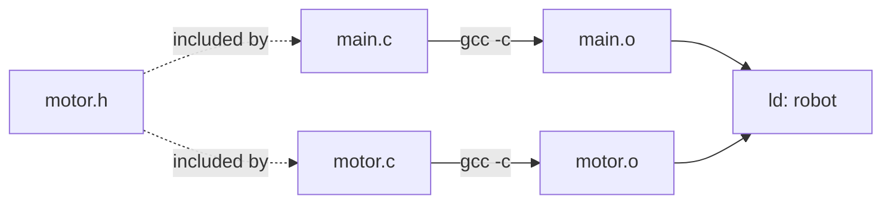

# Make and Build Systems

Typing `gcc *.c` stops working once a project has hundreds of files, several build configurations, generated code and libraries. A **build system** knows what depends on what and rebuilds only what changed. GNU Make, from 1976, is still the substrate under Linux kernel builds, embedded SDKs and many CMake-generated projects. This lesson teaches Make properly (the dependency graph, rules, variables, pattern rules, automatic header dependencies, phony targets, parallel builds) and then how CMake describes the same thing at a higher level.

## 1. The compile model a build system automates



Each `.c` file compiles independently into a `.o` file (a translation unit), and the linker combines them. If only `motor.c` changes, only `motor.o` needs rebuilding, and then the link. If `motor.h` changes, **every file that includes it** must recompile. Tracking this by hand is error-prone. Make does it from **timestamps**: a target is rebuilt if it doesn't exist or is older than any prerequisite.

## 2. Rules

```make
# target: prerequisites
#<TAB>recipe (each line runs in its own shell)
robot: main.o motor.o
	gcc -o robot main.o motor.o -lm

main.o: main.c motor.h
	gcc -c main.c

motor.o: motor.c motor.h
	gcc -c motor.c
```

> [!DANGER]
> Recipe lines must start with a **TAB** character, not spaces. "missing separator" is Make's error for this. Also note that each recipe line runs in a **separate shell**, so `cd dir` on one line doesn't affect the next. Join them: `cd dir && make`.

`make` builds the first target (the default goal). `make motor.o` builds one target. Make walks the dependency graph depth-first, rebuilds stale nodes in dependency order, and with `-j8` it rebuilds independent nodes in parallel.

## 3. Variables and automatic variables

```make
CC      := gcc
CFLAGS  := -std=c17 -O2 -Wall -Wextra -MMD -MP
LDLIBS  := -lm
SRCS    := $(wildcard src/*.c)
OBJS    := $(SRCS:src/%.c=build/%.o)

build/robot: $(OBJS)
	$(CC) $(LDFLAGS) -o $@ $^ $(LDLIBS)

build/%.o: src/%.c | build
	$(CC) $(CFLAGS) $(CPPFLAGS) -c -o $@ $<

build:
	mkdir -p $@
```

| Automatic variable | Meaning |
|---|---|
| `$@` | the target |
| `$<` | the first prerequisite |
| `$^` | all prerequisites (deduplicated) |
| `$?` | prerequisites newer than the target |
| `$*` | the stem matched by `%` |

- `:=` is a simple (immediate) assignment, and `=` is recursive (expanded at each use, so it can see later definitions). `?=` assigns only if unset. `+=` appends.
- `build/%.o: src/%.c` is a **pattern rule**, one rule for every object file.
- `| build` is an **order-only prerequisite**: the directory must exist, but its timestamp changing doesn't trigger rebuilds.

## 4. Header dependencies done right

Listing headers by hand goes stale. Let the compiler generate them: `-MMD` writes `build/motor.d` next to each object, containing `build/motor.o: src/motor.c src/motor.h src/pid.h`, and `-MP` adds dummy targets so that deleting a header doesn't break the build. Then include them:

```make
-include $(OBJS:.o=.d)
```

The leading `-` ignores missing files, which happens on the first build.

## 5. Phony targets and conventions

```make
.PHONY: all clean test install
all: build/robot
clean:
	rm -rf build
test: build/robot
	./build/robot --self-test
```

`.PHONY` tells Make these aren't files, so a stray file named `clean` can't block `make clean`. Conventions users expect:
- Targets: `all` (the default), `clean`, `install` (honouring `PREFIX` and `DESTDIR`), `test`.
- Variables: `CC`, `CFLAGS`, `CPPFLAGS` (preprocessor flags such as `-I` and `-D`), `LDFLAGS` (linker flags such as `-L`), `LDLIBS` (`-l` libraries, placed **after** the objects).

## 6. Configurations and cross-compiling

```make
BUILD ?= debug
ifeq ($(BUILD),release)
  CFLAGS += -O2 -DNDEBUG
else
  CFLAGS += -O0 -g3 -fsanitize=address,undefined
  LDFLAGS += -fsanitize=address,undefined
endif
```

`make BUILD=release` selects a configuration. For an STM32: `make CC=arm-none-eabi-gcc CFLAGS="-mcpu=cortex-m4 -mthumb -Os"`. Embedded builds add a **linker script** (`-T stm32f4.ld`) and `objcopy -O binary robot.elf robot.bin` to produce the flash image.

## 7. Make's pitfalls

- **Recursive make** (`$(MAKE) -C subdir` in every directory) hides cross-directory dependencies and serialises builds. Peter Miller's paper "Recursive Make Considered Harmful" is the classic reference. Prefer one non-recursive Makefile that includes per-directory fragments.
- **Timestamps** can lie: clock skew on network filesystems, or `git checkout` touching files.
- **Flags aren't tracked**: changing `CFLAGS` doesn't rebuild anything. Run `make clean` or encode flags in a stamp file. Ninja and CMake do track command lines.

## 8. CMake: a build-system generator

CMake describes **targets** and their usage requirements, then generates Makefiles or Ninja files:

```cmake
cmake_minimum_required(VERSION 3.20)
project(robot C)
set(CMAKE_C_STANDARD 17)
set(CMAKE_C_STANDARD_REQUIRED ON)

add_library(motor STATIC src/motor.c src/pid.c)
target_include_directories(motor PUBLIC include)          # consumers get -Iinclude too
target_compile_options(motor PRIVATE -Wall -Wextra)
target_link_libraries(motor PUBLIC m)

add_executable(robot src/main.c)
target_link_libraries(robot PRIVATE motor)                 # inherits motor's PUBLIC requirements
```

```bash
cmake -S . -B build -G Ninja -DCMAKE_BUILD_TYPE=Release
cmake --build build -j
ctest --test-dir build
```

- `PUBLIC` requirements propagate to consumers, `PRIVATE` ones don't, and `INTERFACE` ones apply only to consumers.
- Out-of-source builds (`-B build`) keep the tree clean.
- `compile_commands.json` (`-DCMAKE_EXPORT_COMPILE_COMMANDS=ON`) feeds clangd, clang-tidy and IDEs.
- ROS 2's `colcon` drives CMake (`ament_cmake`) for each package.

> [!EXAM]
> **How does Make decide what to rebuild, and how do you make header changes trigger recompilation?**
> Make builds a dependency graph from the rules. A target is remade when it doesn't exist or when any prerequisite has a newer modification time, after first bringing the prerequisites up to date, recursively. Headers are only considered if they're listed as prerequisites, so the robust approach is to compile with `-MMD -MP`. The compiler then emits a `.d` file per object listing every header it actually included, and the Makefile does `-include $(OBJS:.o=.d)`, so dependencies are always exact and stay current.
