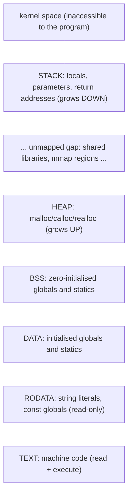
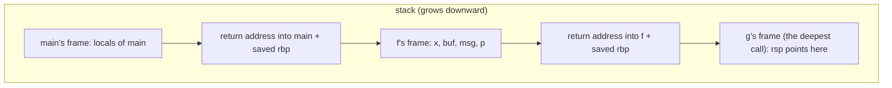

# Memory Layout of a Process

When a C program runs, the operating system gives it a **virtual address space** divided into regions with different purposes, permissions and lifetimes. Knowing which region every variable lives in explains a whole family of facts: why string literals can't be modified, why globals start at zero, why deep recursion crashes, why returning a local's address is a bug, and what a "stack frame" really is. It's core material for systems, embedded and interview work.

## 1. The regions



High addresses are at the top and low addresses at the bottom. A real run on Linux x86-64 (addresses vary per run because of ASLR):

```c
int g_init = 5;                       // .data
int g_zero;                           // .bss
static const char ro[] = "hi";        // .rodata
int main(void) {
    int local;                        // stack
    int *h = malloc(16);              // heap
    printf("text %p\nro %p\ndata %p\nbss %p\nheap %p\nstack %p\n",
           (void *)main, (void *)ro, (void *)&g_init, (void *)&g_zero, (void *)h, (void *)&local);
}
```

```output
text  0x5c0bc48e31a9
ro    0x5c0bc48e4008
data  0x5c0bc48e6010
bss   0x5c0bc48e6018
heap  0x5c0be65ab010
stack 0x7ffe815955b4
```

| Region | Contents | Permissions | Lifetime | Initial value |
|---|---|---|---|---|
| **text** | compiled functions | r-x | whole program | from the executable |
| **rodata** | string literals, `const` globals, jump tables | r-- | whole program | from the executable |
| **data** | globals and `static` locals **with** a non-zero initialiser | rw- | whole program | stored in the executable |
| **bss** | globals and `static` locals that are zero or uninitialised | rw- | whole program | **zero**, filled at load time (takes no space in the file) |
| **heap** | `malloc` blocks | rw- | until `free` | indeterminate (`calloc`: zero) |
| **stack** | locals, parameters, saved registers, return addresses | rw- (no execute) | until the block or function exits | **indeterminate** |

> [!KEY]
> - Uninitialised **globals and statics are guaranteed to be zero**. Uninitialised **locals contain garbage**, and reading them is undefined behaviour.
> - `char *s = "hello";` points into **rodata**, so `s[0] = 'H'` crashes (SIGSEGV). `char s[] = "hello";` copies the literal into a writable array on the stack.
> - BSS ("Block Started by Symbol") costs nothing in the executable file: `int big[10000000];` as a global doesn't make the binary 40 MB bigger, but `int big[10000000] = {1};` does.

```bash
size ./prog          # text / data / bss section sizes of an executable
```

## 2. Where does each variable live?

```c
#include <stdlib.h>

int counter;                      // bss (global, zero)
int limit = 100;                  // data
const double PI = 3.14159;        // rodata
static int file_local = 7;        // data (internal linkage)

void f(int param) {               // param: stack (or a register)
    int x = 1;                    // stack
    static int calls = 0;         // bss: ONE copy, survives between calls
    char *msg = "hi";             // msg: stack; the characters: rodata
    char buf[] = "hi";            // 3 bytes on the stack
    int *p = malloc(sizeof *p);   // p: stack; *p: heap
    free(p);
}
```

## 3. The stack and stack frames

Each function call pushes a **stack frame** (activation record) holding the return address, saved registers, local variables and sometimes arguments. On x86-64 Linux (the System V ABI), the first six integer or pointer arguments travel in registers (`rdi, rsi, rdx, rcx, r8, r9`) and the return value comes back in `rax`.



- A call pushes the return address and moves the stack pointer down. A return pops the frame and **everything in it becomes invalid**, which is why returning `&local` is a bug.
- Each thread has its own stack (8 MB default for the main thread; check with `ulimit -s`). Unbounded recursion or a huge local array (`int a[10000000];` inside a function) runs past it, causing a **stack overflow** and a crash.
- **Stack buffer overflows** (writing past a local array) can overwrite the saved return address. That's the classic exploit. Defences: stack canaries (`-fstack-protector`), non-executable stacks, and ASLR.

## 4. The heap

`malloc` hands out blocks from regions it gets from the kernel (`brk` for the classic heap, `mmap` for large blocks, typically ≥ 128 KB in glibc). Each block has a small hidden header recording its size, which is how `free(p)` knows how much to release. That's also why writing just past the end of a block corrupts the allocator's metadata and crashes much later, somewhere unrelated.

**Fragmentation**: after many allocations and frees of mixed sizes, free memory becomes scattered into small holes, so a large request may fail even though the total free memory is big. Long-running embedded systems often ban `malloc` after initialisation for this reason (next lessons: arenas and pools).

## 5. Virtual memory in one paragraph

Each process sees its own private address space. The MMU translates virtual pages (4 KB) to physical frames using page tables managed by the kernel. Pages are mapped **lazily**: `malloc(1 GB)` usually succeeds instantly, and physical memory is assigned on first touch (Linux overcommit). Touching an unmapped address, or writing to a read-only page, triggers a **segmentation fault** (SIGSEGV). Inspect a live process's map with `cat /proc/<pid>/maps`.

## 6. Exam-ready answers

> [!EXAM]
> **Memory layout of a C program.** A process's address space is divided into segments: the text segment holds executable code and is read-only; the read-only data segment holds string literals and constant data; the data segment holds global and static variables with explicit initialisers; the BSS segment holds global and static variables without initialisers (or initialised to zero), which are zero-filled at load time; the heap holds dynamically allocated memory managed by `malloc` and `free` and typically grows upward; and the stack holds a frame for each active function call containing parameters, local variables, saved registers and the return address, and typically grows downward. Objects with static storage duration (globals and statics) exist for the whole execution, automatic objects (locals) exist only during their block's execution, and dynamic objects exist from allocation until deallocation.

## 7. Cheat sheet

| Declaration | Region | Initial value |
|---|---|---|
| `int g;` (file scope) | bss | 0 |
| `int g = 3;` | data | 3 |
| `static int s;` in a function | bss | 0, persists between calls |
| `const int c = 1;` (file scope) | rodata | 1 |
| `"literal"` | rodata | (don't modify it) |
| `int x;` in a function | stack | garbage |
| `malloc(n)` | heap | garbage |
| `calloc(n, s)` | heap | 0 |

> [!INTERVIEW]
> **"Why does `char *s = "abc"; s[0] = 'X';` crash, but `char s[] = "abc"; s[0] = 'X';` doesn't?"** The first makes `s` a pointer to the string literal, which lives in the read-only data segment. Modifying it is undefined behaviour, and on modern systems the page is read-only, so the write raises SIGSEGV. The second declares an array initialised by **copying** the literal into automatic (stack) storage, which is writable. Declare such pointers `const char *` so the compiler catches the attempt.
