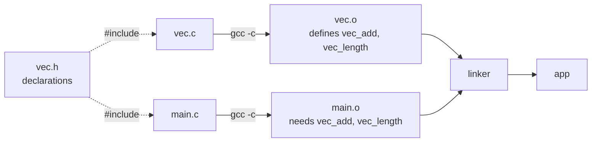

# Header Files and Multi-File Programs

Real C projects consist of many `.c` files, each a **module** with a clear job, connected through **header files** (`.h`) that declare what each module offers. This is C's version of Python modules and packages, and it's the mechanical skill behind "breaking a project into pieces". Here you learn the exact contract between `.h` and `.c`, include guards, how to compile and link several files, and the rules that prevent duplicate-definition and missing-symbol errors.

## 1. The module pattern

```text
project/
├── vec.h        ← INTERFACE: what the module offers (declarations)
├── vec.c        ← IMPLEMENTATION: how (definitions)
└── main.c       ← a client: #include "vec.h" and use it
```

```c
/* vec.h */
#ifndef VEC_H                 /* include guard */
#define VEC_H

typedef struct {
    double x, y;
} Vec2;

Vec2   vec_add(Vec2 a, Vec2 b);
double vec_length(Vec2 v);

#endif /* VEC_H */
```

```c
/* vec.c */
#include "vec.h"              /* the implementation includes its own header: the compiler checks they agree */
#include <math.h>

static double sq(double v) {  /* private helper: static = internal linkage */
    return v * v;
}

Vec2 vec_add(Vec2 a, Vec2 b) {
    return (Vec2){a.x + b.x, a.y + b.y};
}

double vec_length(Vec2 v) {
    return sqrt(sq(v.x) + sq(v.y));
}
```

```c
/* main.c */
#include <stdio.h>
#include "vec.h"

int main(void) {
    Vec2 p = vec_add((Vec2){3, 0}, (Vec2){0, 4});
    printf("%.1f\n", vec_length(p));      /* 5.0 */
    return 0;
}
```

```bash
gcc -Wall -Wextra -c vec.c        # → vec.o
gcc -Wall -Wextra -c main.c       # → main.o
gcc vec.o main.o -o app -lm       # link
# or simply: gcc -Wall -Wextra vec.c main.c -o app -lm
```



> [!KEY]
> **What goes where.**
> - **Header (`.h`)**: type definitions (`struct`, `typedef`, `enum`), function **prototypes**, `extern` variable **declarations**, macros and constants. Nothing that allocates storage or defines a function body (except `static inline` functions).
> - **Source (`.c`)**: function **definitions**, variable **definitions**, and `static` helpers that stay private.
>
> Each `.c` file is compiled **separately** (a *translation unit*): it knows only what it `#include`s. The linker connects the pieces by symbol name.

## 2. Include guards

`#include` literally pastes text. If `a.h` and `b.h` both include `vec.h`, and `main.c` includes both, `vec.h`'s contents appear twice: `redefinition of 'Vec2'`. Guards make the second inclusion empty:

```c
#ifndef VEC_H
#define VEC_H
/* ... */
#endif
```

`#pragma once` at the top does the same thing. It's non-standard but supported by every major compiler. Pick one style and use it in every header.

## 3. Sharing global variables

```c
/* config.h */
extern int g_verbose;          /* declaration: no storage */

/* config.c */
int g_verbose = 0;             /* the ONE definition */
```

> [!DANGER]
> `int g_verbose = 0;` written **in the header** creates a definition in every `.c` file that includes it, so you get a `multiple definition of 'g_verbose'` link error (gcc ≥ 10 defaults to `-fno-common`). Better still, avoid mutable globals: pass state explicitly, or hide it behind functions (`void config_set_verbose(int)`).

## 4. Encapsulation with opaque types (preview)

A header can declare a struct type **without** its fields:

```c
/* stack.h */
typedef struct Stack Stack;            /* incomplete type: clients can't see the fields */
Stack *stack_create(void);
void   stack_push(Stack *s, int v);
int    stack_pop(Stack *s);
void   stack_destroy(Stack *s);
```

Only `stack.c` defines `struct Stack { ... }`. Clients can hold pointers and call functions, but they can't touch the internals. That's real encapsulation in C, the same idea as private members in C++. The Master OOP in C module builds whole systems this way (`FILE *` in `<stdio.h>` is exactly this pattern).

## 5. Header hygiene

1. Every header has guards.
2. Every header is **self-contained**: it includes what *it* needs (e.g. `<stddef.h>` for `size_t`), so it compiles when included first. A good test is to make `foo.c` include `"foo.h"` as its very first line.
3. Include what you use; don't rely on transitive includes.
4. Prefix public names with the module name (`vec_add`, `stack_push`), because C has no namespaces.
5. Keep headers small: every change to a header recompiles every file that includes it.
6. Use `"local.h"` for project headers and `<system.h>` for library headers.

## 6. Build automation (preview)

With many files you recompile only what changed: `make` with a Makefile, or CMake (Tooling module). A minimal Makefile rule is `app: main.o vec.o` / `<TAB>gcc main.o vec.o -o app -lm`.

## 7. Exam-ready answers

> [!EXAM]
> **Header files.** A header file contains declarations shared between source files: function prototypes, type definitions, macro definitions and `extern` declarations of variables. Source files include it with `#include "name.h"` so that the compiler can type-check calls to functions defined in other translation units, while the definitions themselves appear in exactly one `.c` file and are connected by the linker. Include guards (`#ifndef NAME_H` / `#define NAME_H` / `#endif`) or `#pragma once` prevent the contents from being processed more than once in a translation unit. Placing definitions in headers causes multiple-definition link errors when the header is included by several source files.

> [!EXAM]
> **Separate compilation.** Each `.c` file is compiled independently into an object file containing the code it defines and references to external symbols it uses. The linker then combines the object files and libraries, resolving each external reference to exactly one definition. This allows large programs to be organised into modules and rebuilt incrementally.

## 8. Cheat sheet

| Need | Do |
|---|---|
| a module | `mod.h` (declarations, guards) + `mod.c` (definitions) |
| private helper | `static` in `mod.c` |
| shared global | `extern int x;` in `.h`, `int x = 0;` in one `.c` |
| hide the struct layout | `typedef struct T T;` in `.h`, the full struct in `.c` |
| build | `gcc -Wall -Wextra *.c -o app` |
| guard | `#ifndef MOD_H` `#define MOD_H` … `#endif` |

> [!INTERVIEW]
> **"Why shouldn't you `#include` a `.c` file?"** It pastes all the definitions into the including file. If the `.c` is also compiled on its own (or included twice), the linker sees duplicate definitions. It also defeats separate compilation and encapsulation (its `static` helpers become visible to the includer). Include headers containing declarations, and compile and link `.c` files.
