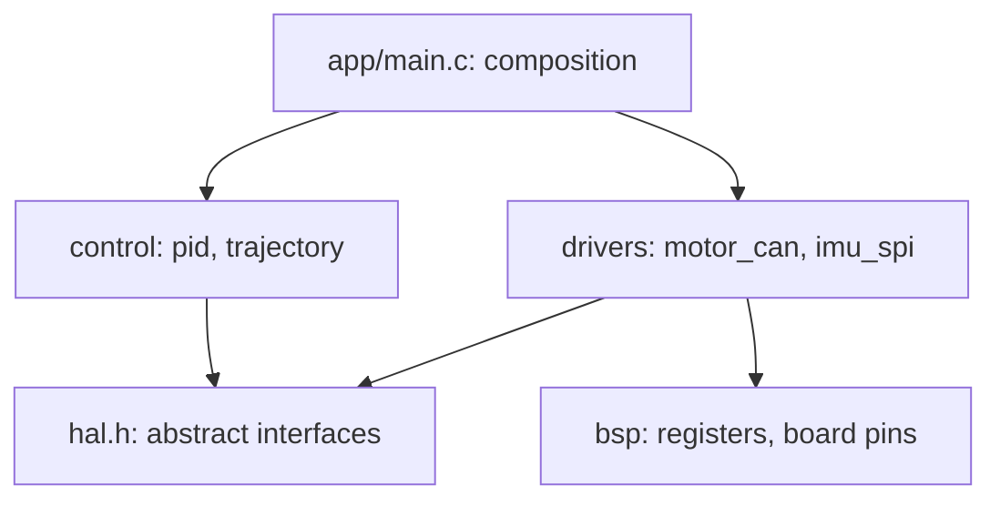

# Modular Design Across Files

Classes in C are **modules**: a header that's the public contract, and a `.c` file that's the private implementation. Large C systems such as the Linux kernel (about 30 million lines), SQLite, CPython and PX4 stay maintainable through disciplined module design. This lesson covers header design, dependency direction and layering, callbacks with context pointers (dependency inversion in C), forward declarations to cut coupling, build-time checks, and the conventions that keep a multi-file C project healthy.

## 1. Header rules

```c
/* scheduler.h */
#ifndef SCHEDULER_H
#define SCHEDULER_H

#include <stdint.h>          /* include what the header itself needs, and nothing else */

typedef struct Scheduler Scheduler;                       /* opaque */
typedef void (*TaskFn)(void *ctx, uint32_t now_ms);       /* callback type with context */

Scheduler *sched_create(unsigned max_tasks);
void       sched_destroy(Scheduler *s);
int        sched_add(Scheduler *s, uint32_t period_ms, TaskFn fn, void *ctx);   /* returns a task id or -1 */
int        sched_cancel(Scheduler *s, int id);
unsigned   sched_tick(Scheduler *s, uint32_t now_ms);     /* runs due tasks; returns how many ran */

#endif
```

| Rule | Why |
|---|---|
| Include guards (or `#pragma once`) | allow multiple inclusion |
| **Self-contained**: compiles when included first | include order can't break builds. Test it by making each `.c` file include its own header first |
| Minimal includes; forward-declare structs you only point to | fewer rebuilds and no include cycles |
| Only declarations: no definitions of non-`inline` functions or variables | avoids multiple-definition link errors |
| Document ownership, units, threading and error conventions | the header *is* the documentation |

## 2. Dependency direction and layering



- Dependencies point **downward and toward abstractions**. The control layer depends on the abstract `hal.h` interface (vtables or function pointers), not on a specific CAN motor driver. That's how the same controller code runs against hardware, a simulator, or unit-test fakes.
- **No cycles**. If A needs B and B needs A, extract the shared part, or invert one dependency with a callback.
- Each module owns its data. Others interact only through its functions, with no `extern` globals shared across modules.

## 3. Callbacks with context: dependency inversion in C

A low-level module must not `#include` the high-level code it notifies. It accepts a function pointer **plus a `void *ctx`**, so the callback can reach its own object state without globals:

```c
typedef struct { double setpoint; Pid *pid; Motor *motor; } SpeedLoop;

static void speed_loop_step(void *ctx, uint32_t now_ms) {
    SpeedLoop *loop = ctx;                       /* recover the typed object */
    double err = loop->setpoint - motor_speed(loop->motor);
    motor_set_duty(loop->motor, pid_step(loop->pid, err, 0.01));
    (void)now_ms;
}

SpeedLoop loop = { 1.0, pid, motor };
sched_add(s, 10, speed_loop_step, &loop);       /* scheduler.c never learns what a SpeedLoop is */
```

This is the C equivalent of an interface plus an object. `qsort`'s comparator, `pthread_create`'s `void *arg`, and every event library (libuv, FreeRTOS timers) use this shape.

## 4. Splitting a module across files

A large module can span several `.c` files that share a private header:

```text
planner/
  planner.h            public API
  planner_internal.h   struct definitions shared by the module's own files
  planner.c            lifecycle and public functions
  planner_astar.c      algorithm details
  planner_costmap.c
```

Only `planner.h` is installed and included by clients. Mark internal cross-file functions with a module prefix and keep them out of the public header.

## 5. Static checks and builds

- Compile with `-Wall -Wextra -Wmissing-prototypes -Wstrict-prototypes`. A non-static function without a prototype in a header is likely an accidental global.
- `-fvisibility=hidden` plus explicit exports for libraries.
- `_Static_assert` on layout assumptions and enum sizes, near the code that relies on them.
- One target per module in CMake (`add_library(scheduler STATIC scheduler.c)`) with `target_include_directories(... PUBLIC include)`. The dependency graph is then visible and enforced: if `control` doesn't link `drivers`, it can't call it.

## 6. Example: the shape of a well-layered robot firmware

```text
app/main.c        composition root: creates objects, wires callbacks, starts the scheduler
control/          pid.c, trajectory.c (pure logic, unit-tested on a PC)
estimation/       ekf.c (pure math)
drivers/          motor_can.c, imu_spi.c (implement hal.h interfaces)
hal/hal.h         interfaces (vtables) for motors, IMUs, clocks
platform/stm32/   registers, interrupt vectors, startup code
tests/            fakes implementing hal.h, plus unit tests for control/ and estimation/
```

> [!EXAM]
> **How do you keep a large C codebase modular?**
> Treat each module as a class: a self-contained header that's the only public contract (opaque types, prefixed functions, documented ownership and error conventions), and an implementation file with `static` internals. Keep dependencies acyclic and pointing toward abstractions. High-level logic depends on interface headers (function-pointer tables), and drivers implement them. Lower layers notify higher ones through callbacks with `void *` context pointers, so they never include the higher-level code. Avoid shared mutable globals, wire concrete implementations together in one composition root (`main`), and enforce the structure with per-module build targets, strict warnings and hidden symbol visibility.

## Worked example: a module with a callback and context

Here a low-level timer module must notify higher-level code **without including its headers**. This is dependency inversion in C: a function pointer plus a `void *ctx`.

```c
#include <stdio.h>

/* ---- timer.h: knows nothing about robots ---- */
typedef void (*timer_cb)(void *ctx, int tick);
typedef struct { timer_cb cb; void *ctx; int period; } Timer;
static void timer_run(Timer *t, int ticks) {
    for (int i = 1; i <= ticks; i++)
        if (i % t->period == 0) t->cb(t->ctx, i);   /* calls "up" without knowing who */
}

/* ---- robot.c: higher layer, supplies the callback ---- */
typedef struct { const char *name; int beats; } Robot;
static void on_heartbeat(void *ctx, int tick) {
    Robot *r = ctx;                                 /* recover our own type */
    r->beats++;
    printf("%s heartbeat at tick %d\n", r->name, tick);
}

int main(void) {
    Robot r = {"R2", 0};
    Timer t = {on_heartbeat, &r, 3};
    timer_run(&t, 7);
    printf("beats = %d\n", r.beats);
    return 0;
}
```

```output
R2 heartbeat at tick 3
R2 heartbeat at tick 6
beats = 2
```

The dependency arrow points **down** (robot → timer), yet the timer can still call robot code. Without `ctx`, the callback would need a global variable to find "its" robot, and then you couldn't have two robots.

## Common mistakes

- **Headers that include everything.** Include only what the header itself needs, and forward-declare structs you only point to.
- **Defining (rather than declaring) variables in headers.** Every `.c` file that includes the header gets its own copy, and you hit linker errors. Use `extern` in the header and define once in a `.c` file.
- **Public structs when an opaque `typedef struct X X;` would do.** Callers then depend on your field layout.

## Check your understanding

1. Why is `void *ctx` needed alongside the function pointer?
2. What does `static` on a function in a `.c` file achieve?

<details><summary>Answers</summary>

1. It carries the caller's state into the callback, the C equivalent of a closure or bound object.
2. Internal linkage. The function is private to that file and can't clash with names in other modules.

</details>
