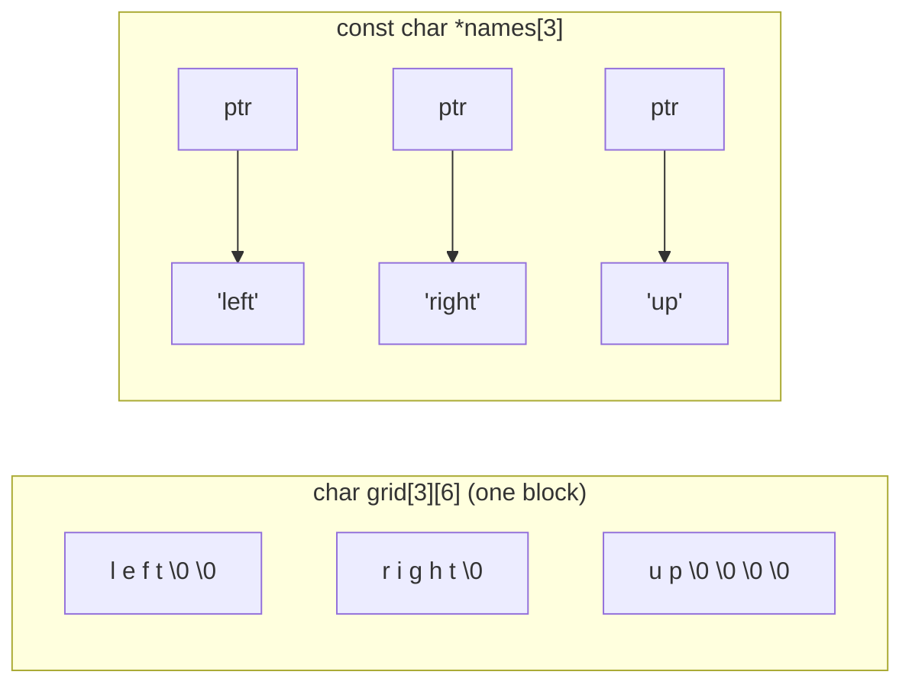

# Pointers and Arrays

Arrays and pointers are tightly linked in C, but they **aren't the same thing**. Knowing exactly where they coincide (indexing, decay, function parameters) and where they differ (`sizeof`, assignment, `&`, storage) is what separates programmers who "kind of know C" from those who can read any C code. The famous identity `a[i] == *(a + i)` is the key.

## 1. Subscripting is pointer arithmetic

> [!KEY]
> By definition, **`E1[E2]` is identical to `*((E1) + (E2))`**. Indexing is pointer arithmetic followed by a dereference. It works on arrays (after decay) and on pointers alike.

```c
int a[4] = {10, 20, 30, 40};
int *p = a;
printf("%d %d %d %d\n", a[2], *(a + 2), p[2], *(p + 2));   /* 30 30 30 30 */
printf("%d\n", 2[a]);    /* 30: *(2 + a). Legal and silly, but proves the identity */
```

## 2. Decay: when an array becomes a pointer

In most expressions an array of `T` is converted to a pointer to its first element (`T *`). It does **not** decay when it's:

- the operand of `sizeof` (gives the whole array's size)
- the operand of `&` (gives a pointer to the whole array, `T (*)[N]`)
- a string literal initialising a char array (`char s[] = "hi";`)

| | `int a[4]` (array) | `int *p = a` (pointer) |
|---|---|---|
| storage | 16 bytes holding the elements | 8 bytes holding an address |
| `sizeof` | 16 | 8 |
| assignable? | no (`a = p` is an error) | yes (`p = other`) |
| `&x` type | `int (*)[4]` | `int **` |
| can be NULL? | no | yes |
| `x[i]` | `*(a + i)` after decay | `*(p + i)` |

## 3. Function parameters: arrays don't exist there

```c
void f(int a[10]);     /* the 10 is IGNORED */
void f(int a[]);       /* same */
void f(int *a);        /* same: the real type */
```

A parameter declared as an array **is** a pointer. Use `const T *` for read-only input, and pass the length. C99's `void f(int a[static 10])` tells the compiler (and the reader) that at least 10 elements are available.

## 4. Strings: char arrays vs char pointers

```c
char arr[] = "robot";       /* array: 6 bytes, modifiable, sizeof == 6 */
const char *ptr = "robot";  /* pointer to a read-only literal, sizeof == 8 */
arr[0] = 'R';               /* OK */
ptr = "arm";                /* OK: the pointer itself can be re-pointed */
/* arr = "arm";             error: arrays aren't assignable */
```

## 5. Arrays of pointers vs 2D arrays

```c
char grid[3][6] = {"left", "right", "up"};   /* 18 bytes: 3 rows of 6 chars, padded */
const char *names[3] = {"left", "right", "up"};  /* 24 bytes: 3 pointers to literals elsewhere */
```



`names[i]` is a string either way, but the memory layouts, sizes and parameter types differ (`char (*)[6]` vs `const char **`). `argv` in `main(int argc, char *argv[])` is an array of pointers.

## 6. Pointer to an array

```c
int m[3][4];
int (*row)[4] = m;           /* pointer to an array of 4 ints: what m decays to */
row++;                       /* advances by a whole row (16 bytes) */
int *cells = &m[0][0];       /* pointer to the first int: walks cell by cell */
```

Read `int (*row)[4]` as "row is a pointer to an array of 4 ints". The parentheses matter: `int *row[4]` is an array of 4 pointers (Const & Declarations lesson).

## 7. Exam-ready answers

> [!EXAM]
> **Relationship between arrays and pointers.** In most expressions an array name is converted to a pointer to its first element, and subscripting is defined in terms of pointer arithmetic: `a[i]` is equivalent to `*(a + i)`. Consequently arrays are passed to functions as pointers, and a parameter declared as an array has pointer type. Arrays and pointers nevertheless differ: an array is a block of storage for its elements whose size is reported by `sizeof`, while a pointer is a variable holding an address whose size is that of an address; an array name cannot be assigned or incremented, whereas a pointer can; and `&array` yields a pointer to the entire array rather than to its first element.

## 8. Cheat sheet

| Fact | Code |
|---|---|
| indexing identity | `a[i] == *(a + i)` |
| decay | `int *p = a;` (`== &a[0]`) |
| true size | `sizeof a` (array only) |
| read-only parameter | `const int *a, size_t n` |
| row pointer | `int (*row)[COLS]` |
| array of strings | `const char *names[]` |

> [!INTERVIEW]
> **"Is an array name a pointer?"** No. An array is an object containing its elements, and its name designates that object. It *converts* to a pointer to the first element in most expressions, which is why the confusion exists. The proofs that it isn't a pointer: `sizeof arr` gives the whole array size, `arr = p` doesn't compile, and `&arr` has type pointer-to-array.
