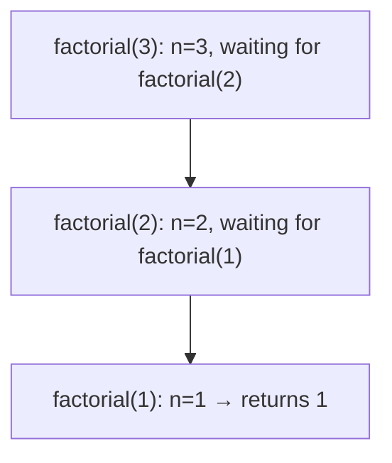

# Recursion

A recursive function calls itself on a smaller version of the problem until it reaches a base case. The theory is identical to the Python Recursion lesson (base case, progress, trusting the recursive call). This lesson focuses on what's **different in C**: the stack frames are real memory you can reason about, there's no recursion-limit safety net (overflowing the stack is a **segmentation fault**), there's no built-in memoization, and compilers often turn tail recursion into loops.

## 1. The shape

```c
unsigned long long factorial(unsigned n) {
    if (n <= 1)                 /* base case */
        return 1;
    return n * factorial(n - 1);   /* recursive case: smaller problem */
}
```

`factorial(20)` = 2,432,902,008,176,640,000 is the largest that fits in 64 bits. `factorial(21)` silently wraps (unsigned overflow is defined but wrong). C has no bignums.

## 2. Stack frames, concretely

Every call pushes a frame containing its parameters, locals, saved registers and return address:



You can watch frames in gdb (`bt` shows the backtrace). Each frame here is a few dozen bytes. With the default 8 MB Linux stack (`ulimit -s`), a simple recursion overflows after somewhere around 10⁵–10⁶ levels, and large local arrays shrink that dramatically.

> [!DANGER]
> **Stack overflow in C is a crash, not an exception.** `int f(int n) { char buf[100000]; return f(n + 1); }` dies with `Segmentation fault (core dumped)` after about 80 calls. There's no `RecursionError` and no traceback unless you use a debugger or AddressSanitizer. Keep recursion depth logarithmic (divide and conquer), or bounded and small, and use an explicit stack or a loop when it could be large (e.g. DFS on a 10⁶-node path graph).

## 3. Tail calls and optimisation

A call is a **tail call** when it's the last thing the function does:

```c
unsigned long long fact_acc(unsigned n, unsigned long long acc) {
    if (n <= 1) return acc;
    return fact_acc(n - 1, acc * n);     /* tail call: nothing left to do afterwards */
}
```

At `-O2`, gcc and clang usually turn tail recursion into a jump, so it runs in constant stack space. The C standard **doesn't guarantee** it, and at `-O0` (debug builds) it doesn't happen. Don't rely on it for correctness. Write the loop when depth could be large.

## 4. Memoization by hand

C has no `@cache`. Use an array (or a hash table) of known answers:

```c
#include <string.h>

static long long memo[91];          /* fib(90) fits in 63 bits */
static int known[91];

long long fib(int n) {
    if (n < 2) return n;
    if (known[n]) return memo[n];
    known[n] = 1;
    return memo[n] = fib(n - 1) + fib(n - 2);
}
```

`static` arrays live for the whole program and start zeroed, which makes them perfect memo tables. Remember that this hidden state persists across calls, so it isn't reset between test cases unless you reset it.

## 5. Classic recursive algorithms in C

```c
/* binary search: O(log n) depth */
int bsearch_rec(const int *a, int lo, int hi, int key) {
    if (lo > hi) return -1;
    int mid = lo + (hi - lo) / 2;          /* avoids overflow of (lo + hi) */
    if (a[mid] == key) return mid;
    return key < a[mid] ? bsearch_rec(a, lo, mid - 1, key)
                        : bsearch_rec(a, mid + 1, hi, key);
}

/* permutations by swapping (backtracking) */
void permute(char *s, int k, int n) {
    if (k == n) { puts(s); return; }
    for (int i = k; i < n; i++) {
        char t = s[k]; s[k] = s[i]; s[i] = t;    /* choose */
        permute(s, k + 1, n);                    /* explore */
        t = s[k]; s[k] = s[i]; s[i] = t;         /* un-choose (backtrack) */
    }
}
```

> [!TIP]
> `lo + (hi - lo) / 2` instead of `(lo + hi) / 2` is the famous fix for a bug that lived in Java's `Arrays.binarySearch` for nine years: `lo + hi` overflows `int` for arrays of more than about 10⁹ elements.

## 6. Recursion vs iteration in C

| | Recursion | Iteration |
|---|---|---|
| Clarity for trees and divide & conquer | high | lower |
| Stack use | O(depth): a risk of segfault | O(1), or an explicit heap stack |
| Speed | function-call overhead (small in C) | slightly faster |
| Debuggability | deep backtraces | flat |

Embedded and safety-critical C (MISRA rule 17.2) **forbids recursion** entirely, because worst-case stack usage must be provable on devices with a few KB of RAM.

## 7. Exam-ready answers

> [!EXAM]
> **Recursion in C.** A recursive function is one that calls itself, directly or indirectly. It must have a base case that terminates the recursion and a recursive case that moves toward the base case. Each call creates a new stack frame containing its parameters, local variables and return address, so the memory used is proportional to the maximum recursion depth. Because the stack has a fixed size, excessive depth causes a stack overflow, typically a segmentation fault. Tail-recursive functions can be converted by optimising compilers into loops, but the C standard does not require this. Recursion simplifies problems with recursive structure, such as tree traversal, divide-and-conquer algorithms and backtracking, at the cost of call overhead and stack usage.

## 8. Cheat sheet

| Need | Pattern |
|---|---|
| linear recursion | `f(n) = g(n, f(n-1))` |
| divide & conquer | recurse on halves; depth O(log n) |
| safe midpoint | `lo + (hi - lo) / 2` |
| memo | a `static` array plus a "known" flag |
| backtracking | choose → recurse → un-choose |
| deep recursion | convert to a loop / explicit stack |
| debug a crash | `gcc -g -fsanitize=address` or gdb `bt` |

> [!INTERVIEW]
> **"Your recursive DFS works on small graphs but segfaults on a 1,000,000-node chain. Why, and how do you fix it?"** Each recursive call uses a stack frame, and a chain makes the depth 10⁶, which exceeds the default 8 MB stack. Fix it by converting to an iterative DFS with an explicit stack allocated on the heap (`malloc`), or by raising the stack limit (`ulimit -s`, or creating a thread with a larger stack). The iterative version is the robust answer.
