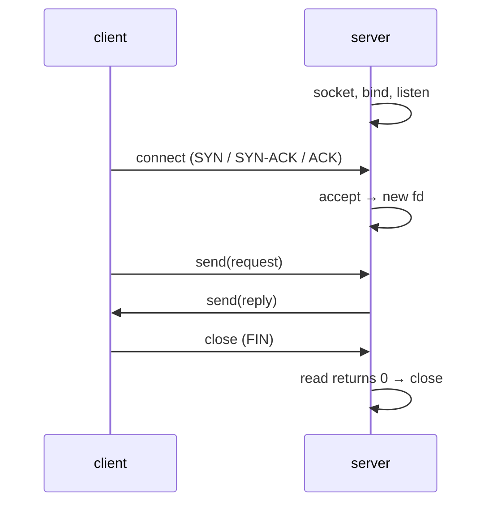

# Socket Programming

Sockets are the API for network communication: robots streaming telemetry to a ground station, web servers, ROS 2's DDS transport, game servers, and IoT devices. The BSD socket API, introduced in 4.2BSD in 1983, is still the foundation every language's networking is built on. This lesson covers TCP and UDP sockets in C: addresses and byte order, the client and server call sequences, handling partial I/O and many clients with `poll`, and the errors and options that matter in practice.

## 1. TCP vs UDP

| | TCP (`SOCK_STREAM`) | UDP (`SOCK_DGRAM`) |
|---|---|---|
| connection | yes (handshake) | no |
| delivery | reliable, in order, no duplicates | best effort: may drop, reorder or duplicate |
| boundaries | **byte stream** (you frame messages) | each `sendto` is one datagram |
| flow/congestion control | yes | no |
| latency | higher (retransmissions, head-of-line blocking) | lowest |
| use | commands, files, HTTP, config | real-time telemetry, video, game state, discovery, DDS |

For robot control loops, stale data is worse than lost data, so high-rate sensor streams usually use UDP (often via DDS/RTPS), while configuration and commands that must arrive use TCP or a reliable layer on top of UDP.

## 2. Addresses and byte order

```c
#define _POSIX_C_SOURCE 200809L
#include <sys/socket.h>
#include <netinet/in.h>
#include <arpa/inet.h>
#include <netdb.h>

struct sockaddr_in addr = {0};
addr.sin_family = AF_INET;
addr.sin_port = htons(8080);                          /* host → network (big-endian) byte order */
inet_pton(AF_INET, "127.0.0.1", &addr.sin_addr);      /* text → binary */
char text[INET_ADDRSTRLEN];
inet_ntop(AF_INET, &addr.sin_addr, text, sizeof text);
```

> [!KEY]
> Port numbers and IPv4 addresses in socket structures are in **network byte order** (big-endian). Always convert with `htons`/`htonl`/`ntohs`/`ntohl`. Forgetting this works on big-endian machines and silently breaks on x86 and ARM (port 8080 becomes 36895).

For portable IPv4/IPv6 and DNS, use `getaddrinfo`, which fills in the address structures for you and lets one code path handle both protocols.

## 3. The TCP server sequence

```c
int srv = socket(AF_INET, SOCK_STREAM, 0);
int yes = 1;
setsockopt(srv, SOL_SOCKET, SO_REUSEADDR, &yes, sizeof yes);   /* rebind quickly after restart (TIME_WAIT) */
struct sockaddr_in a = { .sin_family = AF_INET, .sin_port = htons(0),          /* 0 = any free port */
                         .sin_addr.s_addr = htonl(INADDR_LOOPBACK) };
bind(srv, (struct sockaddr *)&a, sizeof a);
listen(srv, 16);                                       /* backlog of pending connections */
socklen_t len = sizeof a;
getsockname(srv, (struct sockaddr *)&a, &len);         /* which port did we get? */
printf("listening on %d\n", ntohs(a.sin_port));

for (;;) {
    int c = accept(srv, NULL, NULL);                   /* a NEW socket for this client */
    if (c < 0) { if (errno == EINTR) continue; perror("accept"); break; }
    handle_client(c);                                  /* read requests, write replies, framing! */
    close(c);
}
```



## 4. The TCP client

```c
int fd = socket(AF_INET, SOCK_STREAM, 0);
if (connect(fd, (struct sockaddr *)&addr, sizeof addr) < 0) { perror("connect"); exit(1); }
write_all(fd, "GET /status\n", 12);
char buf[4096];
ssize_t n = read(fd, buf, sizeof buf);               /* may be a PARTIAL reply: loop until your framing says done */
close(fd);
```

> [!WARNING]
> TCP is a **byte stream**. One `send` of 100 bytes may arrive as several `recv`s, and several sends may merge into one. Use the framing techniques from the IPC lesson (newline-delimited lines, or length prefixes) plus `read_full`/`write_all` loops. Assuming "one send = one recv" works on localhost in testing and fails in production.

## 5. UDP

```c
int u = socket(AF_INET, SOCK_DGRAM, 0);
bind(u, (struct sockaddr *)&local, sizeof local);
char pkt[1500];
struct sockaddr_in from; socklen_t fl = sizeof from;
ssize_t n = recvfrom(u, pkt, sizeof pkt, 0, (struct sockaddr *)&from, &fl);   /* exactly one datagram */
sendto(u, pkt, (size_t)n, 0, (struct sockaddr *)&from, fl);                    /* echo it back */
```

Keep datagrams under the path MTU (about 1472 bytes of UDP payload on Ethernet) to avoid IP fragmentation. Add sequence numbers and timestamps to detect loss and reordering.

## 6. Many clients: `poll`, non-blocking I/O, threads

| Model | How | Trade-off |
|---|---|---|
| one process per client | `fork` after `accept` | simple and isolated; heavy per client |
| one thread per client | `pthread_create` after `accept` | simple; memory and context switching at thousands of clients |
| event loop | non-blocking sockets + `poll`/`epoll` | scales to 10⁴–10⁶ connections; you manage per-connection state |
| thread pool + event loop | epoll per core | high-performance servers (nginx, Redis I/O threads) |

```c
struct pollfd fds[64];
int nfds = 1;
fds[0] = (struct pollfd){ .fd = srv, .events = POLLIN };
for (;;) {
    poll(fds, nfds, -1);                          /* sleep until something is ready */
    if (fds[0].revents & POLLIN) {                /* new connection */
        int c = accept(srv, NULL, NULL);
        fds[nfds++] = (struct pollfd){ .fd = c, .events = POLLIN };
    }
    for (int i = 1; i < nfds; i++)
        if (fds[i].revents & (POLLIN | POLLHUP)) { /* read; on 0 or error: close and remove */ }
}
```

## 7. Options and pitfalls

| Option / issue | Notes |
|---|---|
| `SO_REUSEADDR` | lets a restarted server bind while old connections sit in TIME_WAIT |
| `TCP_NODELAY` | disables Nagle's algorithm; essential for small, latency-sensitive messages (robot commands) |
| `SO_RCVTIMEO` / `SO_SNDTIMEO` | timeouts on blocking calls |
| `SO_KEEPALIVE` | detects dead peers on idle connections |
| `SIGPIPE` | ignore it in servers; handle `EPIPE` from `send` |
| `ECONNRESET` | peer reset the connection |
| `EADDRINUSE` | port taken (or TIME_WAIT without REUSEADDR) |
| half-close | `shutdown(fd, SHUT_WR)` signals "done sending" while still reading replies |

## 8. Exam-ready answers

> [!EXAM]
> **The TCP socket API.** A TCP server creates a socket with `socket(AF_INET, SOCK_STREAM, 0)`, assigns it a local address and port with `bind`, marks it passive with `listen`, and repeatedly calls `accept`, which blocks until a client connects and returns a new connected socket for that client. A client creates a socket and calls `connect` with the server's address, which performs the three-way handshake. Both sides then exchange data with `send`/`recv` or `read`/`write` and finish with `close` or `shutdown`. Because TCP provides a reliable, ordered byte stream without message boundaries, applications must frame messages and handle partial reads and writes, and addresses and ports must be converted to network byte order with functions such as `htons`.

## 9. Cheat sheet

| Need | Call |
|---|---|
| TCP server | `socket` → `setsockopt(SO_REUSEADDR)` → `bind` → `listen` → `accept` loop |
| TCP client | `socket` → `connect` |
| pick a free port | bind port 0, then `getsockname` |
| byte order | `htons`/`ntohs`, `htonl`/`ntohl` |
| text ↔ binary address | `inet_pton` / `inet_ntop`, or `getaddrinfo` |
| UDP | `sendto` / `recvfrom` (one datagram each) |
| many clients | `poll`/`epoll` with non-blocking fds |
| low latency | `TCP_NODELAY` |

> [!INTERVIEW]
> **"What happens between `connect` and `accept`?"** The client's `connect` sends SYN, the server kernel replies SYN-ACK, and the client ACKs. The connection is then fully established *in the server's kernel*, queued in the listen backlog, even before the application calls `accept`. `accept` just dequeues it and returns a new descriptor. If the backlog is full, new SYNs are dropped or refused. Mention TIME_WAIT on the side that closes first, and why `SO_REUSEADDR` matters for restarting servers.
