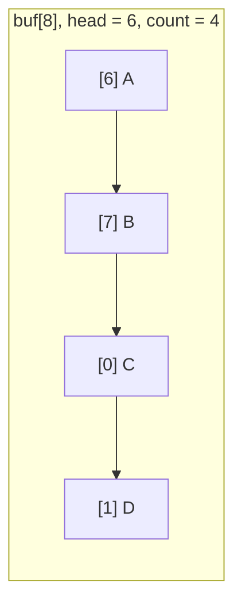

# Stacks and Queues

A **stack** (LIFO: last in, first out) and a **queue** (FIFO: first in, first out) are the two fundamental access-restricted containers. Stacks implement function calls, undo, expression evaluation, backtracking and DFS. Queues implement scheduling, buffering, message passing and BFS. In C you build them yourself, either on a dynamic array or on a linked list. The **circular buffer** (ring buffer), a fixed-size queue with wrap-around indices, is one of the most important data structures in embedded and real-time systems.

## 1. Array-based stack

```c
typedef struct {
    int *data;
    size_t size, cap;
} Stack;

int stack_push(Stack *s, int v) {
    if (s->size == s->cap) {
        size_t nc = s->cap ? s->cap * 2 : 16;
        int *t = realloc(s->data, nc * sizeof *t);
        if (!t) return -1;
        s->data = t;
        s->cap = nc;
    }
    s->data[s->size++] = v;
    return 0;
}

int stack_pop(Stack *s, int *out) {          // returns 0 on success, -1 if empty
    if (s->size == 0) return -1;
    *out = s->data[--s->size];
    return 0;
}

int stack_peek(const Stack *s, int *out) {
    if (s->size == 0) return -1;
    *out = s->data[s->size - 1];
    return 0;
}
```

All operations are O(1) (push amortised). Note the error-reporting style: return a status, and pass the value out through a pointer, because no `int` value is free to act as an "empty" sentinel.

## 2. Stack applications

```c
/* balanced brackets: push openers, pop and match closers */
int balanced(const char *s) {
    char st[1024];
    int top = 0;
    for (; *s; s++) {
        if (*s == '(' || *s == '[' || *s == '{') {
            if (top == 1024) return 0;
            st[top++] = *s;
        } else if (*s == ')' || *s == ']' || *s == '}') {
            char want = *s == ')' ? '(' : *s == ']' ? '[' : '{';
            if (top == 0 || st[--top] != want) return 0;
        }
    }
    return top == 0;
}
```

Other classics: evaluating postfix (RPN) expressions, the **shunting-yard** algorithm (infix → postfix), undo stacks, iterative DFS, and the **monotonic stack** for "next greater element" problems in O(n).

## 3. Queue as a circular buffer

```c
#define CAP 8                       /* a power of two lets us use & instead of % */

typedef struct {
    int buf[CAP];
    size_t head;                    /* index of the next element to read */
    size_t count;
} Ring;

int ring_push(Ring *r, int v) {
    if (r->count == CAP) return -1;                  /* full */
    r->buf[(r->head + r->count) & (CAP - 1)] = v;    /* wrap around */
    r->count++;
    return 0;
}

int ring_pop(Ring *r, int *out) {
    if (r->count == 0) return -1;                    /* empty */
    *out = r->buf[r->head];
    r->head = (r->head + 1) & (CAP - 1);
    r->count--;
    return 0;
}
```



> [!KEY]
> The indices wrap around instead of shifting elements, so both operations are **O(1) with no allocation**: perfect for interrupt handlers, UART receive buffers, audio streams and sensor sample queues. Distinguishing "full" from "empty" needs a `count` (as here), or one deliberately unused slot (`head == tail` means empty, `next(tail) == head` means full). The single-producer/single-consumer variant can be made lock-free with atomic head and tail indices (the Ring Buffers and ISR lesson).

Policy when full: **reject** the new item (as above), **overwrite** the oldest (good for "last N sensor readings"), or **block** the producer (threads).

## 4. Linked-list queue (unbounded)

```c
typedef struct QNode { int v; struct QNode *next; } QNode;
typedef struct { QNode *front, *back; } Queue;

int q_enqueue(Queue *q, int v) {
    QNode *n = malloc(sizeof *n);
    if (!n) return -1;
    n->v = v;
    n->next = NULL;
    if (q->back) q->back->next = n; else q->front = n;
    q->back = n;
    return 0;
}

int q_dequeue(Queue *q, int *out) {
    QNode *n = q->front;
    if (!n) return -1;
    *out = n->v;
    q->front = n->next;
    if (!q->front) q->back = NULL;      // the queue became empty: reset back too
    free(n);
    return 0;
}
```

Keeping both `front` and `back` pointers makes enqueue and dequeue O(1).

## 5. Deque and priority queue

- A **deque** (double-ended queue) allows O(1) operations at both ends: a circular buffer indexed from both sides, or a doubly linked list. The sliding-window maximum uses one.
- A **priority queue** pops the smallest (or largest) element first. It's implemented with a binary heap (the Heaps lesson).

## 6. Exam-ready answers

> [!EXAM]
> **Stacks and queues.** A stack is a last-in-first-out collection supporting push, pop and peek at one end; a queue is a first-in-first-out collection supporting enqueue at the back and dequeue at the front. In C, a stack is commonly implemented with a dynamically resized array and a top index, giving constant-time (amortised) operations, and a queue with either a linked list maintaining front and back pointers or a circular buffer, a fixed-size array in which the head and tail indices wrap around modulo the capacity, so neither operation moves elements or allocates memory. Circular buffers must distinguish full from empty using a count or a reserved slot. Stacks support expression evaluation, bracket matching, backtracking and depth-first search; queues support buffering, scheduling and breadth-first search.

## 7. Cheat sheet

| Need | Structure |
|---|---|
| LIFO, unbounded | dynamic array + size |
| FIFO, bounded, no malloc | circular buffer (power-of-two capacity, `& (CAP-1)`) |
| FIFO, unbounded | linked list with front and back pointers |
| both ends | deque (ring buffer or doubly linked list) |
| "next greater element" | monotonic stack |
| BFS | queue; DFS: stack (or recursion) |

> [!INTERVIEW]
> **"Implement a queue using two stacks."** Keep an `in` stack for enqueue and an `out` stack for dequeue. Enqueue pushes onto `in`. Dequeue pops from `out`, but if `out` is empty, first move every element from `in` to `out` (which reverses their order, putting the oldest on top). Each element is moved at most once, so both operations are amortised O(1). Follow-ups: a stack using two queues, and a min-stack (keep a second stack of running minimums for an O(1) `get_min`).
