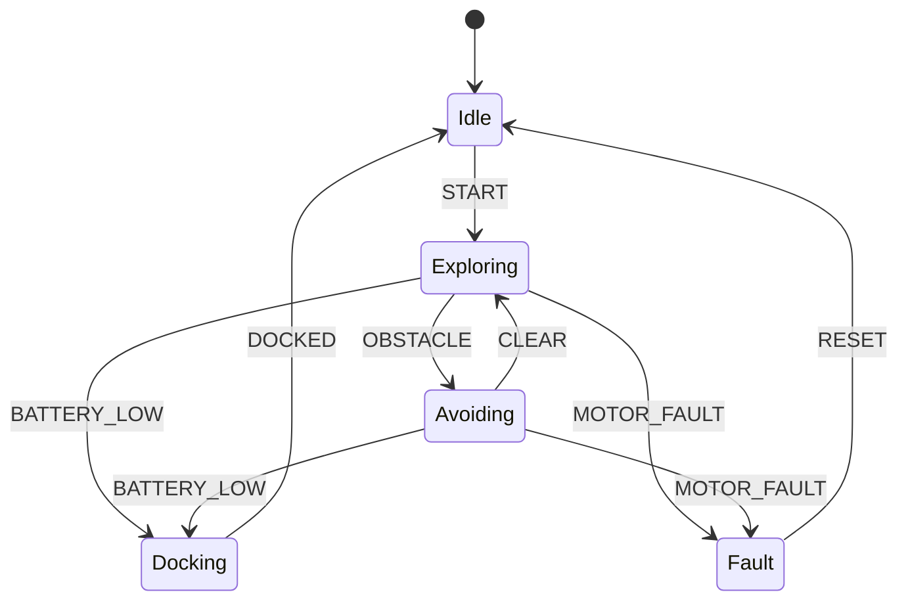

# State Machines in C

Almost every embedded and robotics program is a **finite state machine (FSM)**: a motor controller (idle → ramping → running → fault), a communication protocol parser, a battery charger, a robot's behaviour (explore → approach → grasp → return), a traffic light. Making the states explicit turns tangled `if` flags into a design you can draw, review, test exhaustively and certify. This lesson covers switch-based, table-driven and function-pointer FSMs, events and guards, entry and exit actions, hierarchical states, and testing.

## 1. States, events, transitions

An FSM is a set of **states**, a set of **events** (inputs), and a **transition function** `(state, event) → (next state, action)`. In a Mealy machine, outputs depend on state and event. In a Moore machine, they depend only on state.



> [!KEY]
> Write the diagram first. If you can't draw it, the code will be wrong. A state is a condition the system **stays in**, waiting for something. An event is something that **happens**.

## 2. The switch-based FSM

```c
typedef enum { ST_IDLE, ST_EXPLORE, ST_AVOID, ST_DOCK, ST_FAULT, ST_COUNT } State;
typedef enum { EV_START, EV_OBSTACLE, EV_CLEAR, EV_BATTERY_LOW, EV_DOCKED, EV_MOTOR_FAULT, EV_RESET, EV_COUNT } Event;

State step(State s, Event e) {
    if (e == EV_MOTOR_FAULT && s != ST_IDLE && s != ST_FAULT) return ST_FAULT;    /* global rule */
    switch (s) {
    case ST_IDLE:    return e == EV_START ? ST_EXPLORE : s;
    case ST_EXPLORE: return e == EV_OBSTACLE ? ST_AVOID : e == EV_BATTERY_LOW ? ST_DOCK : s;
    case ST_AVOID:   return e == EV_CLEAR ? ST_EXPLORE : e == EV_BATTERY_LOW ? ST_DOCK : s;
    case ST_DOCK:    return e == EV_DOCKED ? ST_IDLE : s;
    case ST_FAULT:   return e == EV_RESET ? ST_IDLE : s;
    default:         return ST_FAULT;              /* corrupted state: fail safe */
    }
}
```

This is simple and readable, and compile with `-Wswitch-enum` so that adding a state without handling it triggers a warning. It gets unwieldy beyond about 10 states.

## 3. The table-driven FSM

Put the transition function in **data**: a 2-D array indexed by `[state][event]`.

```c
typedef void (*Action)(void *ctx);
typedef struct { State next; Action action; } Transition;

static void start_motors(void *ctx);
static void turn_away(void *ctx);
static void stop_all(void *ctx);

#define STAY(s) { s, NULL }
static const Transition table[ST_COUNT][EV_COUNT] = {
    /*              START                    OBSTACLE              CLEAR                 BATTERY_LOW          DOCKED                MOTOR_FAULT             RESET */
    [ST_IDLE]    = {{ST_EXPLORE,start_motors},STAY(ST_IDLE),        STAY(ST_IDLE),        STAY(ST_IDLE),       STAY(ST_IDLE),        STAY(ST_IDLE),          STAY(ST_IDLE)},
    [ST_EXPLORE] = {STAY(ST_EXPLORE),        {ST_AVOID,turn_away},  STAY(ST_EXPLORE),     {ST_DOCK,NULL},      STAY(ST_EXPLORE),     {ST_FAULT,stop_all},    STAY(ST_EXPLORE)},
    /* ... */
};

State dispatch(State s, Event e, void *ctx) {
    if ((unsigned)s >= ST_COUNT || (unsigned)e >= EV_COUNT) return ST_FAULT;    /* validate indices */
    const Transition *t = &table[s][e];
    if (t->action) t->action(ctx);
    return t->next;
}
```

Benefits:
- O(1) dispatch with no branching logic.
- The table is `const`, so it lives in flash.
- It can be reviewed as a grid, generated from a spreadsheet or a tool such as SCXML or Stateflow, and every (state, event) cell is **explicitly** decided.

That last property is what safety standards want: no transition is forgotten.

## 4. State-function pointers

Each state is a function that handles an event and returns the next state function. It's idiomatic for protocol parsers:

```c
typedef struct Parser Parser;
typedef void *(*StateFn)(Parser *p, uint8_t byte);   /* returns the next StateFn (as void*) */

struct Parser { StateFn state; uint8_t len, idx, sum, buf[32]; int frames; };

static void *st_sync(Parser *p, uint8_t b);
static void *st_len(Parser *p, uint8_t b);
static void *st_data(Parser *p, uint8_t b);
static void *st_check(Parser *p, uint8_t b);

static void *st_sync(Parser *p, uint8_t b) { return b == 0xAA ? (void *)st_len : (void *)st_sync; }
static void *st_len(Parser *p, uint8_t b) {
    if (b == 0 || b > sizeof p->buf) return (void *)st_sync;      /* reject bad lengths */
    p->len = b; p->idx = 0; p->sum = 0; return (void *)st_data;
}
static void *st_data(Parser *p, uint8_t b) {
    p->buf[p->idx++] = b; p->sum += b;
    return p->idx == p->len ? (void *)st_check : (void *)st_data;
}
static void *st_check(Parser *p, uint8_t b) { if (b == p->sum) p->frames++; return (void *)st_sync; }

void parser_feed(Parser *p, uint8_t b) { p->state = (StateFn)p->state(p, b); }
```

C can't declare a function type that returns itself, hence the `void *` round trip. Converting between function and object pointers is allowed by POSIX, but not by ISO C. A strictly portable alternative wraps the function pointer in a struct.

## 5. Entry, exit and guards

Real behaviours need:
- **Entry actions**, run once when entering a state: start a timer, enable motors.
- **Exit actions**: stop the timer.
- **Guards**: a transition taken only if a condition holds, such as `[battery > 20%]`.
- **Internal events** from timeouts.

```c
void fsm_transition(Robot *r, State next) {
    if (next == r->state) return;               /* self-transition without exit/entry */
    on_exit[r->state](r);
    r->state = next;
    r->entered_at = r->now_ms;
    on_entry[next](r);
}

void fsm_tick(Robot *r) {                         /* called every 10 ms by the control loop */
    if (r->state == ST_AVOID && r->now_ms - r->entered_at > 2000)
        fsm_transition(r, ST_EXPLORE);            /* timeout event */
}
```

> [!TIP]
> Make **time an input**: pass `now_ms` in rather than calling a clock inside the FSM. Then tests can drive time deterministically, simulating 2 seconds in a microsecond.

## 6. Hierarchical state machines (statecharts)

When many states share transitions (every "active" state goes to `Fault` on `MOTOR_FAULT`), nest them. The inner states inherit the outer state's transitions. In C, check the specific state's handler first, and if it doesn't handle the event, defer to its parent. This is the design used by Quantum Leaps' QP framework, by UML statecharts, and by ROS's SMACH and FlexBE behaviour engines. **Behaviour trees** (used in Nav2) are an alternative for complex robot task logic.

## 7. Events from interrupts

ISRs shouldn't run the FSM. They post an event to a queue (a ring buffer, covered in the next lesson), and the main loop drains it:

```c
for (;;) {
    Event e;
    while (event_queue_pop(&q, &e)) robot.state = dispatch(robot.state, e, &robot);
    fsm_tick(&robot);
    wait_for_interrupt();
}
```

This run-to-completion model processes one event fully before the next, so there's no re-entrancy, and the FSM needs no locks.

## 8. Testing an FSM

Because the FSM is a pure function of (state, event, inputs), you can test it **exhaustively**: every state × event pair, checked against the specification table. Property tests help too: "from any reachable state, `MOTOR_FAULT` leads to `Fault` within one step", and "`Fault` is only left via `RESET`".

> [!EXAM]
> **Compare switch-based and table-driven FSMs.**
> A switch FSM encodes transitions in control flow. It's readable for small machines, and the compiler can warn about unhandled enum values, but transitions are scattered and grow as nested conditionals. A table-driven FSM stores (next state, action) for every (state, event) cell in a const array. That gives O(1) dispatch and data that lives in flash, and it forces an explicit decision for every combination, so the grid can be reviewed against the specification or generated by tools. Its cost is indirection, plus memory proportional to states × events.
