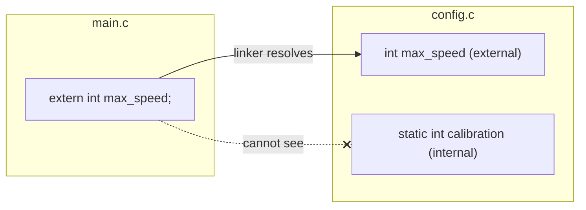

# Scope, Lifetime and Storage Classes

Three separate questions describe any C variable or function:

- **Scope**: where in the source code the name is visible.
- **Storage duration (lifetime)**: when the object exists in memory.
- **Linkage**: whether the same name in different files refers to the same entity.

The keywords `auto`, `static`, `extern` and `register` (the "storage-class specifiers") control them. `static` alone means two different things depending on where it's used, which is a favourite interview question. This lesson is also the foundation of multi-file programs: which names a module exposes, and which stay private.

## 1. Scope

| Scope | Declared | Visible |
|---|---|---|
| **block** | inside `{ }` (including function parameters) | from the declaration to the closing `}` |
| **file** | outside any function | from the declaration to the end of the file (translation unit) |
| **function prototype** | parameter names in a prototype | only within the prototype |
| **function** | labels (for `goto`) | the whole function |

An inner declaration **shadows** an outer one with the same name (`-Wshadow` warns).

## 2. Storage duration

| Duration | Objects | Exists | Initial value |
|---|---|---|---|
| **automatic** | locals (without `static`) | from block entry to block exit (on the stack) | **indeterminate** unless initialised |
| **static** | globals, and locals marked `static` | the whole program run (in the data or BSS segment) | **zero** unless initialised |
| **allocated** | `malloc` results | until `free` (on the heap) | indeterminate (`malloc`) or zero (`calloc`) |
| **thread** | `_Thread_local` / `thread_local` | the lifetime of the thread | zero |

## 3. `static` on a local variable: persistent state

```c
int next_id(void) {
    static int id = 0;     /* initialised ONCE, before the program starts; keeps its value between calls */
    return ++id;
}

next_id(); next_id();
printf("%d\n", next_id()); /* 3 */
```

The variable has **block scope** (invisible outside the function) but **static duration** (it lives forever). It's C's version of the Python closure counter. Beware: such hidden state makes a function non-reentrant and thread-unsafe.

## 4. Linkage and `extern`

| Linkage | Meaning | How |
|---|---|---|
| **external** | the name refers to the same entity across all files | the default for file-scope functions and variables |
| **internal** | the name is private to this file | `static` at file scope |
| **none** | each declaration is a separate entity | locals |

```c
/* config.c */
int max_speed = 300;               /* DEFINITION, external linkage */
static int calibration = 7;        /* internal: invisible to other files */
static void helper(void) { }       /* internal function: file-private */

/* main.c */
extern int max_speed;              /* DECLARATION: "defined in another file" */
void use(void) { max_speed = 250; }
```



> [!KEY]
> **`static` has two meanings:**
> - on a **local** variable, it changes the **lifetime** to the whole program (and keeps block scope)
> - at **file scope** (a global or a function), it changes the **linkage** to internal (file-private)
>
> Making every non-interface function and global `static` is C's main **encapsulation** tool: a module exposes only what its header declares.

## 5. Declaration vs definition for globals

```c
extern int count;      /* declaration only: no storage */
int count;             /* tentative definition (zero-initialised) */
int count = 5;         /* definition with an initialiser */
```

Put `extern` **declarations** in a header and exactly one **definition** in one `.c` file. Writing `int count = 0;` in a header that two `.c` files include gives a `multiple definition` link error.

## 6. `auto` and `register`

- `auto` is the default for locals and almost never written. (In C23 it gained type inference, as in C++.)
- `register` was a hint to keep a variable in a CPU register; you can't take its address. Modern compilers ignore the hint. Recognise it in old code, but don't write it.

## 7. Memory map (preview)

```text
high addresses
+------------------+
| stack            |  automatic variables, return addresses (grows down)
|        ↓         |
|        ↑         |
| heap             |  malloc'd memory (grows up)
+------------------+
| BSS              |  zero-initialised statics/globals
| data             |  initialised statics/globals
| text             |  machine code (read-only)
+------------------+
low addresses
```

The Memory Layout lesson goes deeper. For now: statics live in data/BSS for the whole run, and locals live on the stack only during their call.

## 8. Exam-ready answers

> [!EXAM]
> **Storage classes in C.** The storage-class specifiers `auto`, `register`, `static` and `extern` (plus `_Thread_local`) determine an identifier's storage duration and linkage. Automatic variables, the default for locals, are created on block entry and destroyed on exit, and are not initialised automatically. `register` requests fast access and forbids taking the address. `static` applied to a local variable gives it static storage duration, so it retains its value between calls and is initialised once, to zero by default. Applied to a file-scope variable or function, it gives internal linkage, restricting visibility to that translation unit. `extern` declares a variable or function defined elsewhere, giving it external linkage, so it can be shared across source files.

> [!EXAM]
> **Scope vs lifetime.** Scope is the region of program text in which an identifier is visible (block, file, function or prototype scope). Lifetime (storage duration) is the period during execution in which the object exists (automatic, static, allocated or thread). They are independent: a `static` local variable has block scope but static lifetime.

## 9. Cheat sheet

| Want | Write |
|---|---|
| value survives between calls | `static int n = 0;` inside the function |
| private global / helper | `static` at file scope |
| share a global across files | `extern int g;` in a `.h`, `int g = 0;` in one `.c` |
| zero-initialised table | file-scope array (static duration) |
| avoid | non-static globals unless truly shared |

> [!INTERVIEW]
> **"What does `static` mean in C?"** Two things. Inside a function, it gives the variable static storage duration (it persists across calls, is initialised once and zeroed by default) while keeping block scope. At file scope, it gives the identifier internal linkage, so the function or variable is visible only in that source file. C++ adds a third meaning: static class members.
