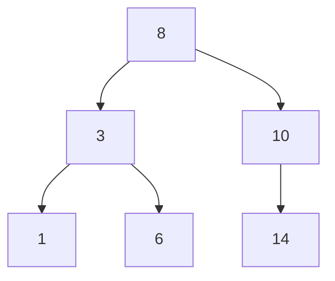

# Binary Trees and BSTs

A **binary tree** is a hierarchical structure where each node has at most two children. A **binary search tree** (BST) adds an ordering invariant (everything in the left subtree is smaller, everything in the right subtree is larger), which makes search, insert and delete O(height), and gives sorted iteration for free. Trees underlie file systems, databases (B-trees), expression parsers, decision trees in ML, and spatial indexes in robotics (k-d trees, octrees). In C, trees are the natural playground for recursion and careful memory management.

## 1. Nodes and traversals

```c
typedef struct TNode {
    int key;
    struct TNode *left, *right;
} TNode;
```



| Traversal | Order | Output for the tree above | Use |
|---|---|---|---|
| pre-order | node, left, right | 8 3 1 6 10 14 | copy or serialise a tree |
| **in-order** | left, node, right | **1 3 6 8 10 14** (sorted for a BST!) | sorted output |
| post-order | left, right, node | 1 6 3 14 10 8 | **free** a tree, evaluate expressions |
| level-order | by depth (BFS) | 8 3 10 1 6 14 | shortest paths, printing by level |

```c
void inorder(const TNode *t) {
    if (!t) return;
    inorder(t->left);
    printf("%d ", t->key);
    inorder(t->right);
}

void tree_free(TNode *t) {           /* post-order: children before the parent */
    if (!t) return;
    tree_free(t->left);
    tree_free(t->right);
    free(t);
}

int height(const TNode *t) {
    if (!t) return 0;
    int l = height(t->left), r = height(t->right);
    return 1 + (l > r ? l : r);
}
```

## 2. BST operations

```c
TNode *bst_search(TNode *t, int key) {          /* iterative: no recursion depth risk */
    while (t && t->key != key) t = key < t->key ? t->left : t->right;
    return t;
}

int bst_insert(TNode **root, int key) {        /* pointer-to-pointer again: no special case for an empty tree */
    TNode **link = root;
    while (*link) {
        if (key == (*link)->key) return 0;     /* duplicate: ignore */
        link = key < (*link)->key ? &(*link)->left : &(*link)->right;
    }
    TNode *n = calloc(1, sizeof *n);
    if (!n) return -1;
    n->key = key;
    *link = n;
    return 1;
}
```

### Deletion: three cases

```c
int bst_delete(TNode **root, int key) {
    TNode **link = root;
    while (*link && (*link)->key != key) link = key < (*link)->key ? &(*link)->left : &(*link)->right;
    TNode *n = *link;
    if (!n) return 0;
    if (!n->left) *link = n->right;            /* 0 or 1 child: splice it out */
    else if (!n->right) *link = n->left;
    else {                                     /* 2 children: replace with the in-order successor */
        TNode **s = &n->right;
        while ((*s)->left) s = &(*s)->left;    /* the minimum of the right subtree */
        TNode *succ = *s;
        *s = succ->right;                      /* detach the successor */
        succ->left = n->left;
        succ->right = n->right;
        *link = succ;
    }
    free(n);
    return 1;
}
```

## 3. Balance matters

The cost of every BST operation is the **height** h. For a balanced tree, h ≈ log₂ n (a million keys gives height about 20), but inserting **sorted** keys into a plain BST builds a linked list (h = n), and everything degrades to O(n), with recursive functions overflowing the stack.

| Tree | Balance rule | Used in |
|---|---|---|
| **AVL** | the heights of the two subtrees differ by at most 1 (rotations on insert/delete) | lookup-heavy workloads |
| **red-black** | colour rules give h ≤ 2 log₂(n+1) | `std::map`, the Linux kernel (`rbtree`), Java's `TreeMap` |
| **B-tree / B+ tree** | many keys per node, all leaves at the same depth | databases, file systems (disk-friendly) |
| treap / skip list | randomised | simple balanced alternatives |

Balancing is done with **rotations**: O(1) pointer rearrangements that preserve the in-order sequence:

```c
TNode *rotate_right(TNode *y) {
    TNode *x = y->left;
    y->left = x->right;
    x->right = y;
    return x;           /* the new subtree root */
}
```

## 4. Exam-ready answers

> [!EXAM]
> **Binary search trees.** A binary tree consists of nodes with at most two children; a binary search tree maintains the invariant that every key in a node's left subtree is smaller than the node's key and every key in its right subtree is larger. Search, insertion and deletion follow a single root-to-leaf path and take time proportional to the tree's height. Deleting a node with two children replaces it with its in-order successor (or predecessor). An in-order traversal visits keys in sorted order; pre-order traversal is used for copying and serialisation, and post-order for freeing nodes and evaluating expression trees. An unbalanced tree can degenerate to height n, giving linear-time operations, so self-balancing variants such as AVL and red-black trees use rotations to keep the height logarithmic.

## 5. Cheat sheet

| Need | Technique |
|---|---|
| sorted output | in-order traversal |
| free the tree | post-order |
| insert without special cases | walk a `TNode **link` |
| delete with two children | splice in the in-order successor |
| avoid stack overflow | iterative search/insert; balanced trees |
| guaranteed O(log n) | AVL / red-black (rotations) |
| range query [lo, hi] | in-order traversal, pruning subtrees outside the range |

> [!INTERVIEW]
> **"Check whether a binary tree is a valid BST."** Checking only `left->key < node->key < right->key` locally is wrong: a node deep in the left subtree could still exceed an ancestor. Recurse with bounds instead: `valid(t, lo, hi)` requires `lo < t->key < hi`, then checks `valid(t->left, lo, t->key)` and `valid(t->right, t->key, hi)`. Equivalently, do an in-order traversal and verify that the keys strictly increase. Both are O(n) time and O(h) space. Mention integer-limit sentinels (use pointers or a flag instead of `INT_MIN`), and how duplicates are handled.
