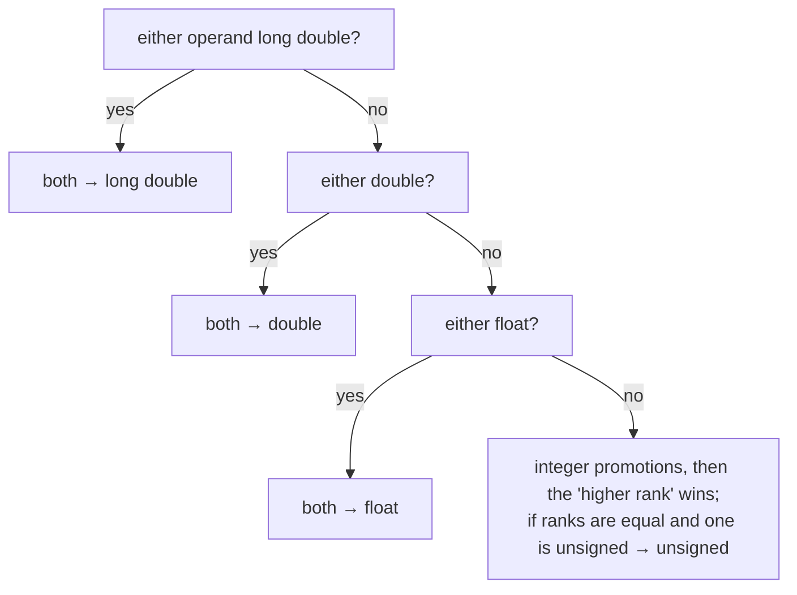

# Type Conversion and Promotion

C silently converts between numeric types all the time: when you mix types in an expression, assign one type to another, pass arguments, or compare signed with unsigned. These **implicit conversions** follow precise rules, and most of the nastiest C bugs (wrong averages, infinite loops, failed range checks, sign errors in sensor data) come from not knowing them. This lesson gives you the rules and the traps.

## 1. Integer promotion

In arithmetic, any type smaller than `int` (`char`, `short`, `bool`, small bit-fields) is first **promoted to `int`**:

```c
unsigned char a = 200, b = 100;
int s = a + b;          /* 300: both promoted to int first, so no 8-bit wrap */
unsigned char c = a + b;/* 44: computed as int 300, then converted back (300 mod 256) */
```

## 2. The usual arithmetic conversions

When the two operands of a binary operator have different types, both are converted to a common type:



```c
int i = 5;
double d = 2.0;
printf("%f\n", i / d);      /* 2.500000: i converted to double */
printf("%d\n", 7 / 2);      /* 3: both int */
```

## 3. Signed meets unsigned: the classic trap

> [!DANGER]
> When a signed and an unsigned operand of the same rank meet (e.g. `int` and `unsigned int`), the **signed value is converted to unsigned**. `-1` becomes 4294967295.
> ```c
> printf("%d\n", -1 < 0u);          /* 0  (false!) */
> unsigned len = 3;
> int i = -1;
> if (i < len) { ... }              /* NOT taken: i becomes huge */
> ```
> `sizeof` and `strlen` return `size_t` (unsigned), so `if (x - strlen(s) < 0)` is **never** true, and `for (size_t i = n - 1; i >= 0; i--)` never ends (`i >= 0` is always true for unsigned). `-Wall -Wextra` (`-Wsign-compare`) warns. Read the warnings.

Safe patterns:

```c
for (size_t i = n; i-- > 0; ) { ... }      /* counts down n-1 … 0 correctly */
if ((size_t)x < len) ...                   /* only after checking x >= 0 */
```

## 4. Conversions on assignment

Assigning converts the value to the target type:

| From → to | Result |
|---|---|
| a smaller integer to a larger one | value preserved (sign-extended or zero-extended) |
| any integer to **unsigned** | reduced modulo 2ᴺ (well-defined): `(unsigned char)300 == 44` |
| an out-of-range value to a **signed** integer | implementation-defined (gcc wraps), and C23 defines two's complement |
| floating → integer | **truncates toward zero**: `(int)3.99 == 3`, `(int)-3.7 == -3`; out of range is **UB** |
| integer → floating | may lose precision for big values (`float` has 24 mantissa bits) |
| `double` → `float` | rounds; may overflow to `inf` |

```c
int n = 3.99;          /* 3: truncation (gcc -Wconversion warns) */
float f = 16777217;    /* stored as 16777216: float can't represent every int */
```

## 5. Explicit casts

> [!SYNTAX]
> `(type) expression`

```c
int sum = 7, count = 2;
double avg = (double)sum / count;      /* 3.5: cast BEFORE dividing */
double wrong = (double)(sum / count);  /* 3.0: integer division already happened */
int rounded = (int)(x + 0.5);          /* round non-negative x to nearest */
```

A cast tells the compiler "I mean this conversion", which silences warnings. That means it can also hide bugs. Cast deliberately, and prefer fixing types over casting.

## 6. Default argument promotions

For variadic functions like `printf`, `char` and `short` arguments are promoted to `int`, and `float` to `double`. That's why `printf("%f", my_float)` works and why there's no separate `printf` specifier for `float`. `scanf` takes **pointers**, so no promotion happens there: `%f` reads a `float`, `%lf` a `double`.

## 7. Exam-ready answers

> [!EXAM]
> **Implicit type conversion in C.** In expressions, operands of types narrower than `int` undergo integer promotion to `int` (or `unsigned int`). For binary operators with operands of different types, the usual arithmetic conversions convert both to a common type: if either operand is floating point, both are converted to the widest floating type present; otherwise the integer of higher rank prevails, and when a signed and an unsigned type of equal rank meet, the signed operand is converted to unsigned. In assignment the value is converted to the type of the left operand; converting a floating value to an integer truncates toward zero, and converting to an unsigned type reduces the value modulo 2ᴺ. Explicit conversions are written with the cast operator `(type)expr`.

## 8. Cheat sheet

| Situation | Do |
|---|---|
| average of ints | `(double)sum / n` |
| loop down with `size_t` | `for (size_t i = n; i-- > 0;)` |
| compare an int with `strlen`/`sizeof` | check `x >= 0` first, then cast |
| big products | make one operand `long long` |
| round to nearest | `lround(x)` (`<math.h>`) |
| find hidden conversions | compile with `-Wall -Wextra -Wconversion` |

> [!INTERVIEW]
> **"Why does `if (strlen(s) - 5 < 0)` never execute even for short strings?"** `strlen` returns `size_t`, which is unsigned, so `strlen(s) - 5` is computed in unsigned arithmetic and wraps to a huge positive number when the string is shorter than 5. An unsigned value is never less than 0. Write `if (strlen(s) < 5)`.
