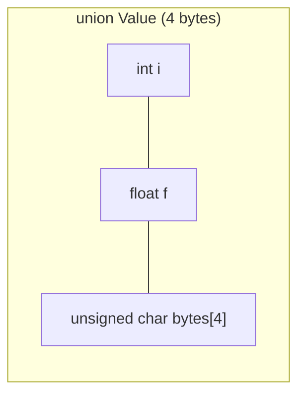

# Unions, Enums and typedef

Three more tools for defining types. A **union** stores **one of several** members in the same memory, which is used for memory-efficient variants, protocol parsing, and viewing bytes as different types. An **enum** gives names to integer constants (states, error codes, message types). **`typedef`** creates readable aliases, including for the notoriously cryptic function-pointer types. Together they make up the **tagged union**, C's version of `std::variant` and the core of interpreters, message dispatchers and state machines.

## 1. Unions

All members of a union **share the same memory**, starting at the same address. The union is as big as its largest member (plus alignment padding):

```c
union Value {
    int i;
    float f;
    unsigned char bytes[4];
};
printf("%zu\n", sizeof(union Value));   // 4

union Value v;
v.f = 1.0f;
printf("%08x\n", (unsigned)v.i);        // 3f800000: the IEEE-754 bits of 1.0f
```



> [!KEY]
> Only **one** member holds a meaningful value at a time: the one most recently written. Reading a *different* member reinterprets the bytes. C (unlike C++) explicitly permits this **type punning** through unions. It's the standard-sanctioned way to see a float's bit pattern (`memcpy` is the other). In C++ the same trick is undefined behaviour, so use `std::bit_cast` there.

## 2. Tagged unions

A bare union doesn't know which member is active. Pair it with an `enum` **tag**:

```c
typedef enum { V_INT, V_DOUBLE, V_STR } Kind;

typedef struct {
    Kind kind;               // the tag says which union member is valid
    union {
        long long i;
        double d;
        char *s;
    } as;                    // or an anonymous union (C11): access v.i directly
} Value;

void print_value(const Value *v) {
    switch (v->kind) {
        case V_INT:    printf("%lld\n", v->as.i); break;
        case V_DOUBLE: printf("%g\n", v->as.d); break;
        case V_STR:    printf("\"%s\"\n", v->as.s); break;
    }
}

Value a = {.kind = V_INT, .as.i = 42};
```

This is how dynamically typed interpreters represent values (CPython's objects, Lua's `TValue`), how message buses carry different message types, and how compilers store AST nodes. `sizeof(Value)` is the tag plus the *largest* member, not the sum.

## 3. Enumerations

```c
enum Color { RED, GREEN = 5, BLUE };         // RED=0, GREEN=5, BLUE=6 (continues from the previous value)
enum Color c = BLUE;

typedef enum {
    STATE_IDLE,
    STATE_MOVING,
    STATE_ERROR,
    STATE_COUNT            // trick: the number of states, handy for array sizes
} State;

const char *state_names[STATE_COUNT] = {"idle", "moving", "error"};
```

> [!WARNING]
> C enums are **weakly typed**: they're just `int` constants. `enum Color c = 42;` compiles, enum values from different enums mix freely, and enumerator names share one global namespace (two enums can't both have `RED`, hence the `STATE_` prefixes). gcc's `-Wswitch` warns when a `switch` on an enum misses a case, as long as there's no `default:`. That's a cheap exhaustiveness check, so leave `default` out for enum switches.

Enum vs `#define` constants: enums are known to the compiler and debugger (gdb prints `STATE_MOVING`, not 1), they're scoped like other identifiers, and switch warnings work with them. C23 adds a fixed underlying type: `enum E : uint8_t { ... }`.

## 4. typedef

`typedef` creates an **alias**, not a new type:

```c
typedef unsigned long long u64;
typedef struct Pose Pose;
typedef int Matrix3[3][3];               // array typedef
typedef double (*Unary)(double);         // pointer to a function taking a double and returning a double

Unary ops[] = {sin, cos, sqrt};          // far more readable than double (*ops[])(double)
typedef void (*Handler)(int event, void *ctx);
void register_handler(Handler h, void *ctx);
```

> [!TIP]
> Read declarations with the **spiral / right-left rule**: start at the name, go right, then left, then outward. `double (*ops[])(double)` reads "ops is an array of pointers to functions taking a double and returning a double". A typedef breaks it into named pieces.

Don't hide pointers behind typedefs (`typedef struct Node *NodePtr;`). It obscures ownership and `const` placement (`const NodePtr` is a constant pointer, not a pointer to const). Opaque handles in APIs are the accepted exception.

## 5. Exam-ready answers

> [!EXAM]
> **Unions.** A union is a user-defined type whose members all occupy the same storage, beginning at the same address; its size is at least that of its largest member. Only one member holds a value at a time, normally the last one written. Unions are used to save memory when alternatives are mutually exclusive, to reinterpret the representation of data (type punning, which C permits), and, combined with an enumeration tag recording the active member, to build tagged (discriminated) unions that represent values of several possible types.

> [!EXAM]
> **Enumerations and typedef.** An enumeration defines a set of named integer constants, which by default start at 0 and increase by one, though values may be specified explicitly; enumeration constants have type `int`, and enumerated types are compatible with integer types, so C provides little type checking for them. A `typedef` declaration introduces an alias for an existing type, used to simplify complex declarations such as function pointers, to abstract platform-dependent types, and to name structures without the `struct` keyword; it does not create a distinct type.

## 6. Cheat sheet

| Need | Code |
|---|---|
| overlapping storage | `union U { int i; float f; };` |
| "one of N types" | `struct { Kind kind; union { ... } as; }` |
| named constants | `enum { A, B = 5, C };` |
| count of enumerators | a trailing `X_COUNT` enumerator |
| exhaustive switch check | `-Wswitch`, with no `default` |
| function-pointer type | `typedef R (*Name)(Args);` |
| float bits | `union { float f; uint32_t u; }` or `memcpy` |

> [!INTERVIEW]
> **"What's the size of `struct { char tag; union { char c; double d; int i; } u; }` on x86-64?"** The union takes the size of its largest member, the 8-byte double, with 8-byte alignment. The struct is `char` (1) + 7 padding + union (8) = **16 bytes**. Follow-ups: ordering members from largest to smallest reduces padding, and the tag tells you which member is valid, because reading the wrong one silently reinterprets bytes.
