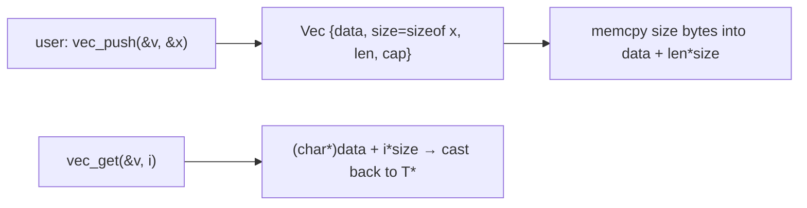

# void Pointers and Generic Code

C has no templates and no generics. Its tool for writing code that works on **any type** is `void *`, a pointer to "untyped memory" that can hold the address of any object. `malloc`, `memcpy`, `qsort` and `bsearch` are all built on it. Combined with an element **size** and function pointers, `void *` lets you write generic containers and algorithms, at the cost of type safety. This is exactly the problem that C++ templates later solved.

## 1. What `void *` is

```c
int x = 5;
double d = 2.5;
void *vp = &x;          /* any object pointer converts to void * implicitly */
vp = &d;
/* *vp;                 error: can't dereference void * (no type, so no size) */
double *dp = vp;        /* void * converts back implicitly in C (C++ needs a cast) */
printf("%.1f\n", *(double *)vp);    /* cast, then dereference */
```

> [!KEY]
> `void *` carries an address but **forgets the type**. To use the data you must convert back to the **correct** type. Converting to the wrong type and dereferencing is undefined behaviour, and nothing checks it for you.

Rules:

- Any object pointer ↔ `void *` converts implicitly (in C).
- No dereferencing and no arithmetic on `void *` in standard C. Cast to `char *` / `unsigned char *` to step through bytes.
- Function pointers are **not** guaranteed to convert to and from `void *` (POSIX allows it).

## 2. Generic functions: pointer + size

The pattern behind `memcpy` and `qsort`: treat elements as blocks of `size` bytes.

```c
#include <string.h>

void generic_swap(void *a, void *b, size_t size) {
    unsigned char tmp[64];             /* assumes size <= 64; a general version would malloc */
    memcpy(tmp, a, size);
    memcpy(a, b, size);
    memcpy(b, tmp, size);
}

int i = 1, j = 2;
double x = 1.5, y = 2.5;
generic_swap(&i, &j, sizeof i);
generic_swap(&x, &y, sizeof x);
```

A generic reverse that steps through bytes:

```c
void generic_reverse(void *base, size_t n, size_t size) {
    unsigned char *lo = base, *hi = (unsigned char *)base + (n - 1) * size;
    while (n > 1 && lo < hi) {
        generic_swap(lo, hi, size);
        lo += size;
        hi -= size;
    }
}
```

## 3. Generic algorithms with callbacks: `bsearch`

```c
#include <stdlib.h>

int cmp_int(const void *a, const void *b) {
    int x = *(const int *)a, y = *(const int *)b;
    return (x > y) - (x < y);
}

int sorted[] = {2, 3, 5, 7, 11, 13};
int key = 7;
int *found = bsearch(&key, sorted, 6, sizeof sorted[0], cmp_int);
if (found) printf("index %td\n", found - sorted);    /* index 3 */
```

## 4. A generic container: a dynamic array of anything

```c
#include <stdlib.h>
#include <string.h>

typedef struct {
    void  *data;
    size_t size;       /* bytes per element */
    size_t len, cap;
} Vec;

int vec_push(Vec *v, const void *elem) {
    if (v->len == v->cap) {
        size_t ncap = v->cap ? v->cap * 2 : 4;          /* geometric growth: amortised O(1) */
        void *p = realloc(v->data, ncap * v->size);
        if (!p) return -1;
        v->data = p;
        v->cap = ncap;
    }
    memcpy((char *)v->data + v->len * v->size, elem, v->size);
    v->len++;
    return 0;
}

void *vec_get(Vec *v, size_t i) {
    return (char *)v->data + i * v->size;               /* caller casts to the real type */
}
```

That's how Python's list (an array of `PyObject *`) and C++'s `std::vector` work underneath, minus type safety.



## 5. The cost: no type safety

> [!DANGER]
> - `vec_push(&v, &some_double)` into a vector of ints compiles fine and corrupts data.
> - A `qsort` comparator that casts to the wrong type sorts garbage.
> - Mistakes show up as wrong values or crashes far from the cause.
>
> Mitigations: wrap generic code in **type-specific inline functions** or macros (`int_vec_push(IntVec *, int)`), use C11 `_Generic` for type dispatch, and test with sanitizers. In C++, templates (`std::vector<int>`) give the same flexibility with full compile-time checking.

## 6. Exam-ready answers

> [!EXAM]
> **void pointers.** A `void *` is a generic pointer that can hold the address of any object type. Conversions between `void *` and other object pointer types are implicit in C. A `void *` cannot be dereferenced or used in pointer arithmetic directly; it must first be converted to a pointer of the appropriate type. Generic pointers allow type-independent functions and data structures, such as `malloc`, `memcpy`, `qsort` and `bsearch`, which operate on raw memory given an element size and, where needed, a comparison callback. Because the type information is lost, the programmer is responsible for converting back to the correct type; mistakes lead to undefined behaviour.

## 7. Cheat sheet

| Need | Code |
|---|---|
| hold any object address | `void *p = &x;` |
| use it | `*(T *)p` |
| step bytes | `(unsigned char *)p + offset` |
| copy n bytes | `memcpy(dst, src, n)` (no overlap) / `memmove` |
| sort / search anything | `qsort` / `bsearch` + a comparator |
| generic container | `void *data` + `size_t elem_size` |
| type safety | typed wrapper functions, or `_Generic` |

> [!INTERVIEW]
> **"How does `qsort` sort an array of structs it knows nothing about?"** It's given the base address as a `void *`, the number of elements, the element size and a comparison function. It computes element addresses as `(char *)base + i * size`, asks your comparator to order two elements (passing `const void *` pointers to them), and swaps elements byte-wise with `memcpy`-style copies. All the type knowledge lives in the comparator.
