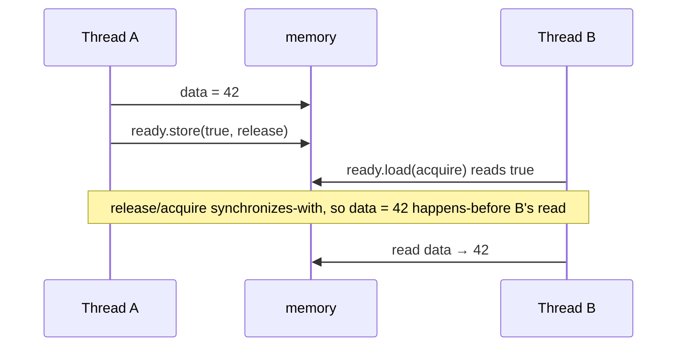

# Atomics and the Memory Model

Mutexes are heavyweight for tiny operations like incrementing a counter or setting a flag. **`std::atomic<T>`** provides indivisible operations on single variables, implemented with special CPU instructions (`lock xadd`, `cmpxchg`, `ldxr/stxr` on ARM). To use atomics correctly you must understand the **C++ memory model**: compilers and CPUs **reorder** memory operations, and atomics with **memory orders** define which reorderings other threads can observe. This is expert material, the foundation of lock-free programming and of how mutexes themselves are built.

## 1. `std::atomic<T>`

```cpp
#include <atomic>

std::atomic<int> counter{0};
std::atomic<bool> stop{false};

void worker() {
    while (!stop.load()) {
        counter.fetch_add(1);        // an indivisible read-modify-write: no lost updates
    }
}

counter++;                           // also atomic: operator++ maps to fetch_add(1)
counter += 5;
int old = counter.exchange(0);       // set it, and get the previous value
```

| Operation | Meaning |
|---|---|
| `load()`, `store(v)` | atomic read / write |
| `exchange(v)` | set and return the old value |
| `fetch_add/sub/and/or/xor(v)` | atomic read-modify-write, returning the old value |
| `compare_exchange_weak/strong(expected, desired)` | **CAS**: if the value equals `expected`, set it to `desired` and return true; otherwise copy the current value into `expected` and return false |
| `wait(old)`, `notify_one/all()` (C++20) | block until the value changes |

`std::atomic<T>::is_lock_free()` reports whether a real atomic instruction is used. For large `T` (e.g. a 32-byte struct), the library falls back to an internal lock, and on GCC that needs linking with `-latomic`.

> [!KEY]
> Atomicity applies to **one variable at a time**. Two separate atomics updated "together" aren't atomic as a pair. Another thread can observe one updated and not the other. Use a mutex (or pack both into one atomic word) for multi-variable invariants.

## 2. Why reordering happens

Compilers reorder independent instructions and keep values in registers. CPUs execute out of order and buffer stores (store buffers), and on ARM and POWER even loads and stores to different addresses can become visible in different orders on different cores. In a single thread you never notice: the "as-if" rule preserves single-threaded behaviour. Across threads, without synchronisation, you can see effects out of order.

```cpp
int data = 0;
std::atomic<bool> ready{false};

// thread A                       // thread B
data = 42;                        while (!ready.load()) {}
ready.store(true);                assert(data == 42);   // guaranteed ONLY with the right memory orders
```

## 3. Memory orders

| Order | Guarantees | Typical use |
|---|---|---|
| `memory_order_seq_cst` (the **default**) | a single total order of all seq_cst operations that every thread agrees on | when in doubt; the easiest to reason about |
| `memory_order_acquire` (loads) / `memory_order_release` (stores) | **happens-before**: everything written before a release-store is visible to a thread whose acquire-load reads that value | message passing, locks, publishing data |
| `memory_order_acq_rel` | both, for read-modify-write operations | CAS loops in lock-free structures |
| `memory_order_relaxed` | atomicity only: no ordering with other memory | statistics counters, reference counts (increments) |

```cpp
// publishing data with release/acquire
data = 42;                                         // a plain write
ready.store(true, std::memory_order_release);      // "everything above is published"

while (!ready.load(std::memory_order_acquire)) {}  // "if I see true, I see everything published before it"
assert(data == 42);                                // guaranteed
```



> [!DANGER]
> `memory_order_relaxed` for the flag in this example would allow B to see `ready == true` and still read `data == 0` (on ARM this really happens). Use relaxed only when the atomic carries no information about other memory, such as a pure event counter read after all the threads are joined.

## 4. `volatile` is not for threads

`volatile` prevents the compiler from optimising away accesses (for memory-mapped hardware registers), but it gives **no atomicity and no inter-thread ordering**. Using `volatile bool` as a thread flag is a data race, which is undefined behaviour. Use `std::atomic<bool>`.

## 5. False sharing

Two atomics on the **same cache line** (64 bytes on x86), updated by different cores, make the cache line bounce between cores, which can be 10–100× slower, even though the variables are logically independent:

```cpp
struct Counters {
    alignas(std::hardware_destructive_interference_size) std::atomic<long> a;   // 64 on x86-64
    alignas(std::hardware_destructive_interference_size) std::atomic<long> b;   // its own cache line
};
```

Per-thread counters combined at the end avoid contention entirely.

## 6. Exam-ready answers

> [!EXAM]
> **Atomics and the C++ memory model.** `std::atomic<T>` provides operations on a single object that are indivisible and free of data races, including loads, stores, exchanges, fetch-and-modify operations and compare-and-exchange, which updates the value only if it equals an expected value. Because compilers and processors reorder memory operations, the memory model defines visibility between threads through happens-before relationships: a release store synchronizes with an acquire load that reads the stored value, making all writes before the release visible after the acquire. Sequentially consistent ordering, the default, additionally imposes a single total order on such operations, while relaxed ordering guarantees only atomicity. Atomicity covers individual objects, not invariants spanning several variables. `volatile` provides neither atomicity nor inter-thread ordering. Contended atomics sharing a cache line suffer from false sharing.

## 7. Cheat sheet

| Need | Code |
|---|---|
| a shared counter | `std::atomic<long> c; c.fetch_add(1, std::memory_order_relaxed);` |
| a stop flag | `std::atomic<bool> stop;` (`store`/`load` with the default seq_cst) |
| publish data | the writer does `store(release)`, the reader `load(acquire)` |
| conditional update | `compare_exchange_weak` in a loop |
| check hardware support | `std::atomic<T>::is_always_lock_free` |
| avoid false sharing | `alignas(std::hardware_destructive_interference_size)` |
| find races | `-fsanitize=thread` |

> [!INTERVIEW]
> **"Explain acquire-release semantics with an example."** A producer writes a payload with ordinary stores, then sets an atomic flag with `memory_order_release`. A consumer spins on the flag with `memory_order_acquire`. When the consumer's acquire-load reads the value written by the release-store, the two synchronize-with each other, so every write the producer made before the release (the payload) happens-before every read the consumer makes after the acquire, and the consumer is guaranteed to see the complete payload. With relaxed ordering there's no such guarantee, and on weakly ordered CPUs like ARM the consumer could see the flag but stale data. Mutex lock and unlock are acquire and release operations, which is why data protected by a mutex is visible correctly.
