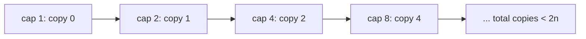

# Complexity Analysis and Problem-Solving Setup

Before you learn a single data structure, you need two skills that every later lesson relies on:

1. **Predicting how fast code runs**, before you run it. This is *complexity analysis*. It tells you whether an idea is good enough, and it is the first thing every interviewer asks about your solution.
2. **A reliable working setup:** fast input/output, the right integer types, and a way to test your code so bugs can't hide.

This lesson assumes no prior DSA knowledge. Take your time with the examples. Every later topic uses this vocabulary.

## 1. Why we measure algorithms

An **algorithm** is a precise sequence of steps that solves a problem. Most problems have many algorithms, and some are millions of times faster than others.

Suppose you must check whether an array of `n` numbers contains two values that sum to `k`.

- **Idea A:** try every pair. That's `n·(n−1)/2` checks.
- **Idea B:** sort, then walk two pointers inward. That's about `n·log₂n` steps for sorting plus `n` steps for the walk.

For n = 1,000,000:

| Idea | Steps | Time at ~10⁸ steps/s |
|---|---|---|
| A (all pairs) | ≈ 5·10¹¹ | ≈ 1.4 hours |
| B (sort + two pointers) | ≈ 2·10⁷ | ≈ 0.2 seconds |

The computer didn't get faster; the *idea* did. Complexity analysis is how we compare ideas without writing and timing each one.

## 2. Counting steps

We count **basic operations**: comparisons, arithmetic, assignments, array accesses. Each takes roughly constant time. We care about how the count **grows with the input size `n`**.

**Example 1: one loop**

```cpp
long long sum = 0;
for (int i = 0; i < n; ++i)      // runs n times
    sum += a[i];                 // 1 operation each time
```

About `n` operations: it grows *linearly*.

**Example 2: two nested loops**

```cpp
for (int i = 0; i < n; ++i)
    for (int j = 0; j < n; ++j)  // n times for EACH i
        c += a[i] * b[j];
```

`n · n = n²` operations. Doubling `n` makes it 4× slower.

**Example 3: dependent nested loops**

```cpp
for (int i = 0; i < n; ++i)
    for (int j = i + 1; j < n; ++j)   // n-1, n-2, ..., 1, 0 times
        check(a[i], a[j]);
```

`(n−1) + (n−2) + … + 1 = n(n−1)/2`. That's about `n²/2`, which is still "quadratic".

**Example 4: a loop that halves**

```cpp
int steps = 0;
for (int x = n; x > 1; x /= 2)   // n, n/2, n/4, ..., 1
    ++steps;
```

How many times can you halve `n` before reaching 1? That's `log₂ n` times. For n = 10⁹ it's only about 30. **Logarithms appear whenever the problem size is divided by a constant at each step.**

**Example 5: a loop with an inner halving loop**

```cpp
for (int i = 0; i < n; ++i)          // n times
    for (int x = n; x > 1; x /= 2)   // log n times
        work();
```

That's `n · log n` operations.

**Example 6: the harmonic pattern** (it surprises many people)

```cpp
for (int i = 1; i <= n; ++i)
    for (int j = i; j <= n; j += i)  // n/i times
        work();
```

The total is `n/1 + n/2 + n/3 + … + n/n = n·(1 + 1/2 + … + 1/n) ≈ n·ln n`. So it's `O(n log n)`, not `O(n²)`. This pattern appears in sieves and divisor problems.

## 3. Big-O, Big-Ω and Big-Θ

Exact counts like `3n² + 5n + 20` are messy, and the constants depend on the machine anyway. So we keep only the part that **dominates for large n**.

> [!DEFINITION] Big-O (upper bound)
> `f(n) = O(g(n))` if there are constants `c > 0` and `n₀` such that `f(n) ≤ c·g(n)` for all `n ≥ n₀`.
> In words: *eventually, f grows no faster than g, up to a constant factor.*

- **Big-Ω (lower bound):** `f(n) ≥ c·g(n)` eventually. *f grows at least as fast as g.*
- **Big-Θ (tight bound):** both at once. *f grows exactly like g.*

In everyday speech (and in interviews) people say "O(n²)" when they mean the tight bound Θ(n²). That's fine, as long as you know the difference.

**Simplification rules:**

1. Drop constant factors: `5n → O(n)`, `n/2 → O(n)`.
2. Drop lower-order terms: `n² + 100n + 7 → O(n²)`.
3. The base of a logarithm doesn't matter: `log₂ n` and `log₁₀ n` differ by a constant factor, so we just write `O(log n)`.
4. Different inputs get different letters: two arrays of sizes `n` and `m` give `O(n + m)` or `O(n·m)`, never just `O(n)`.

**The common complexity classes, from fastest to slowest:**

| Class | Name | n = 10⁶ (rough steps) | Typical source |
|---|---|---|---|
| O(1) | constant | 1 | array index, hash lookup |
| O(log n) | logarithmic | 20 | binary search, balanced tree |
| O(√n) | square root | 1,000 | trial division |
| O(n) | linear | 10⁶ | one pass |
| O(n log n) | linearithmic | 2·10⁷ | sorting, divide and conquer |
| O(n²) | quadratic | 10¹² ✗ | all pairs |
| O(n³) | cubic | 10¹⁸ ✗ | all triples, Floyd–Warshall |
| O(2ⁿ) | exponential | ✗✗ | all subsets |
| O(n!) | factorial | ✗✗✗ | all orderings |

## 4. Rules for analysing code

1. **Statements in sequence add:** `O(n) + O(n²) = O(n²)`.
2. **Nested loops multiply**, but only if the inner loop count doesn't shrink in a special way (see Example 6).
3. **Function calls cost whatever the function costs.** `std::sort` is `O(n log n)`, `vector::insert` at the front is `O(n)`, and `std::map::find` is `O(log n)`.
4. **Hidden loops count.** `s = s + c` on a `std::string` copies the whole string, which is O(length). Doing it in a loop gives O(n²). Use `s += c` (amortised O(1)) instead.

```cpp
// Looks linear, is quadratic: erase from the front shifts every remaining element
while (!v.empty()) v.erase(v.begin());     // O(n) each time → O(n²) total
```

## 5. Best, worst, average and amortised

The same algorithm can take different time on different inputs of the same size.

- **Worst case:** the maximum over all inputs of size `n`. This is the usual guarantee.
- **Best case:** the minimum. Insertion sort on already-sorted data is O(n). It's rarely useful on its own.
- **Average case:** the expected time over random inputs. Quicksort averages O(n log n), but its worst case is O(n²).
- **Amortised:** the average cost per operation over a whole *sequence* of operations, guaranteed even in the worst case.

**The classic amortised example is `std::vector::push_back`.** When the vector is full, it allocates double the capacity and copies everything over. A single `push_back` can therefore cost O(n). But over `n` pushes, the copies total `1 + 2 + 4 + … + n/2 + n < 2n`. That's O(n) for all pushes together, so **O(1) amortised per push**.



> [!KEY]
> Amortised O(1) is a *guarantee* about sequences, not a probability. Average-case O(1), as in a hash table, depends on the input or hash being well-behaved.

## 6. Analysing recursion: recurrences

A recursive function's cost is described by a **recurrence**, an equation that defines `T(n)` in terms of `T` on smaller inputs.

| Algorithm | Recurrence | Solution |
|---|---|---|
| Binary search | T(n) = T(n/2) + O(1) | O(log n) |
| Merge sort | T(n) = 2T(n/2) + O(n) | O(n log n) |
| Naive Fibonacci | T(n) = T(n−1) + T(n−2) + O(1) | O(φⁿ) ≈ O(1.618ⁿ) |
| Sum of an array, recursively | T(n) = T(n−1) + O(1) | O(n) |

**The recursion-tree method.** Draw the calls as a tree, write the work done at each level, and add up the levels.

For merge sort, level 0 is one call doing `n` work, and level 1 is two calls each doing `n/2` work, which is `n` in total. Every level does `n` work, and there are `log₂ n` levels, so the total is `n log n`.

```text
level 0:            n                → n
level 1:      n/2       n/2          → n
level 2:   n/4  n/4  n/4  n/4        → n
...          (log₂ n levels)         → n · log n
```

**The Master Theorem** handles recurrences of the form `T(n) = a·T(n/b) + Θ(n^d)`, where `a ≥ 1` subproblems each have size `n/b`, and `n^d` is the work done outside the recursive calls. Compare `d` with `log_b a`:

| Case | Condition | Result | Intuition |
|---|---|---|---|
| 1 | d < log_b a | Θ(n^(log_b a)) | the leaves dominate (many subproblems) |
| 2 | d = log_b a | Θ(n^d · log n) | every level does equal work |
| 3 | d > log_b a | Θ(n^d) | the root's work dominates |

Examples:

- **Merge sort:** a = 2, b = 2, d = 1. Then log₂2 = 1 = d, which is case 2: Θ(n log n).
- **Binary search:** a = 1, b = 2, d = 0. Then log₂1 = 0 = d, which is case 2: Θ(log n).
- **Karatsuba multiplication:** a = 3, b = 2, d = 1. Then log₂3 ≈ 1.585 > 1, which is case 1: Θ(n^1.585).
- **T(n) = 2T(n/2) + n²:** d = 2 > 1, which is case 3: Θ(n²).

## 7. Space complexity

Memory counts too. **Auxiliary space** is the extra memory beyond the input itself.

- An in-place reversal uses O(1) extra space.
- Copying into a new vector uses O(n).
- **Recursion uses stack space:** each pending call keeps a stack frame. A recursion depth of `n` uses O(n) memory, and at depth around 10⁵–10⁶ the program crashes with a stack overflow. Typical stacks are 1–8 MB.

## 8. From constraints to algorithm

Problem statements give limits like `1 ≤ n ≤ 2·10⁵`. Combined with the rule of thumb **"~10⁸ simple operations per second in C++"**, the limits tell you what complexity the intended solution has, often before you understand the problem.

| n up to | Target complexity | Typical techniques |
|---|---|---|
| 10–11 | O(n!) | permutations, brute force |
| 20–25 | O(2ⁿ · n) | subsets, bitmask DP |
| 100–500 | O(n³) | triple loops, interval DP, Floyd–Warshall |
| 2,000–5,000 | O(n²) | DP over pairs, all pairs |
| 10⁵–10⁶ | O(n log n) | sorting, binary search, heaps, segment trees |
| 10⁷–10⁸ | O(n) | one pass, two pointers, prefix sums |
| 10⁹–10¹⁸ | O(log n) or O(√n) | math, binary search, fast exponentiation |

> [!TIP]
> Read the constraints **first**. If n ≤ 20, the problem is almost certainly asking for exponential search, and a clever polynomial idea isn't needed.

## 9. A C++ setup you can trust

**Fast input/output:**

```cpp
#include <bits/stdc++.h>          // includes the whole standard library (GCC): convenient for practice
using namespace std;

int main() {
    ios::sync_with_stdio(false);  // big speed-up for cin/cout
    cin.tie(nullptr);             // don't flush cout before every cin
    int n; cin >> n;
    vector<long long> a(n);
    for (auto& x : a) cin >> x;
    cout << *max_element(a.begin(), a.end()) << '\n';   // '\n', not endl (endl flushes = slow)
}
```

**Choosing integer types.** Overflow is the #1 silent bug in DSA code.

| Type | Range | Use for |
|---|---|---|
| `int` | ±2.1·10⁹ | indices, counts below 2·10⁹ |
| `long long` | ±9.2·10¹⁸ | sums, products, anything that might exceed 2·10⁹ |
| `__int128` | ±1.7·10³⁸ | the product of two `long long`s before taking a modulus |

```cpp
int a = 100000, b = 100000;
long long wrong = a * b;          // multiplies in int → overflow (undefined behaviour)
long long right = 1LL * a * b;    // promote first
long long s = accumulate(v.begin(), v.end(), 0LL);   // 0LL, not 0: the initial value sets the sum's type
```

**Constants worth memorising:**

```cpp
const long long INF = (long long)4e18;   // "infinity" for long long distances
const int MOD = 1'000'000'007;           // the usual prime modulus

long long power_mod(long long b, long long e, long long m) {   // O(log e)
    long long r = 1 % m; b %= m;
    while (e > 0) {
        if (e & 1) r = (__int128)r * b % m;
        b = (__int128)b * b % m;
        e >>= 1;
    }
    return r;
}
```

## 10. Testing like a professional: stress testing

Sample tests are tiny. Hidden tests find the bugs. The strongest habit you can build is **stress testing**:

1. Write a **brute-force** solution: slow but obviously correct, for example by trying everything.
2. Write a **generator** that prints small random inputs.
3. Run both solutions on thousands of random inputs and stop at the first difference.

```bash
for i in $(seq 1 1000); do
  python3 gen.py $i > in.txt
  ./fast < in.txt > out1.txt
  ./brute < in.txt > out2.txt
  cmp -s out1.txt out2.txt || { echo "Mismatch on test $i"; cat in.txt; break; }
done
```

The first failing input is usually tiny (n = 3 or 4), which makes the bug easy to see. Every problem in this course was built and checked this way.

**Other debugging tools:**

- Compile with `-fsanitize=address,undefined` to catch out-of-bounds access and overflow at the line where it happens.
- Use `-D_GLIBCXX_DEBUG` to add checked iterators and bounds-checked `vector::operator[]`.

## 11. A problem-solving framework (use it every time)

1. **Understand.** Restate the problem in your own words, and read the constraints.
2. **Work examples by hand,** including edge cases: empty input, one element, all equal, negative numbers, maximum sizes.
3. **Brute force first.** State it and its complexity. In an interview, *say it out loud*.
4. **Find the bottleneck.** Which work is repeated? Can sorting, hashing, precomputation or a better data structure remove it?
5. **Check the complexity against the constraints** (section 8).
6. **Code it cleanly,** with good names and small helper functions.
7. **Test** with your examples, then the edge cases, then stress tests.

## 12. Common mistakes

- **Calling something O(n) when a hidden O(n) operation runs inside the loop** (string concatenation, `vector::erase`, `list` indexing).
- **Forgetting that `n·m` isn't `n²`.** Name each input size.
- **Overflow in intermediate results:** `int * int`, `accumulate(..., 0)`, `mid = (lo + hi) / 2` with huge values (use `lo + (hi − lo) / 2`).
- **Deep recursion** (depth 10⁶) causing a stack overflow. Convert it to iteration.
- **Using `endl` in loops,** or mixing `scanf` with `cin` after `sync_with_stdio(false)`.

## 13. Interview questions

> [!INTERVIEW] "What is the time complexity of your solution?"
> Give **time and space**, name the variables ("O(n log n) time for the sort, O(n) extra space for the hash map"), and say which part dominates. If there's a worst case different from the average case (hash tables, quicksort), mention it.

> [!EXAM] Why is `vector::push_back` O(1) when it sometimes copies the whole array?
> The capacity grows geometrically (doubling). Over n pushes, the total number of element copies is at most 1 + 2 + 4 + … + n < 2n, so the total work is O(n) and the **amortised** cost per push is O(1), even though an individual push can take O(n).

> [!EXAM] Solve T(n) = 4T(n/2) + n.
> a = 4, b = 2, d = 1. Then log₂4 = 2 > d = 1, which is case 1 of the Master Theorem, so T(n) = Θ(n²).

## Check your understanding

1. What is the complexity of `for (i = 1; i < n; i *= 3) for (j = 0; j < i; ++j) work();`?
2. Your solution is O(n²) and n ≤ 2·10⁵. Will it pass in 1 second?
3. Why can't comparison-based sorting beat O(n log n)?

<details><summary>Answers</summary>

1. The inner loop runs 1 + 3 + 9 + … + (the largest power of 3 below n) times. That geometric series is less than 1.5n, so the whole thing is **O(n)**, not O(n log n).
2. No. That's 4·10¹⁰ operations, about 400 seconds. You need O(n log n) or better.
3. There are n! possible orderings, and each comparison has 2 outcomes, so you need at least log₂(n!) ≈ n log₂ n comparisons to tell all orderings apart (the decision-tree argument). Counting sort and radix sort avoid the bound because they don't compare elements.

</details>
