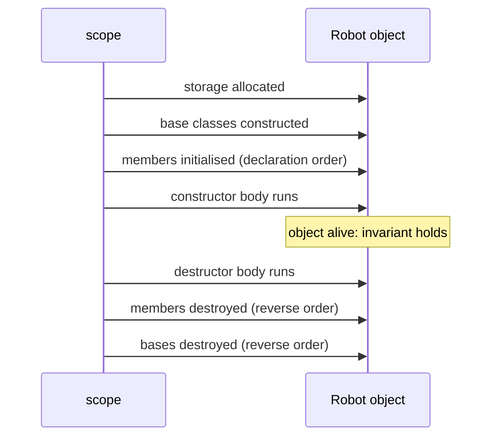

# Constructors and Destructors

A constructor's job is to establish the class **invariant**: after construction, the object must be fully valid. A destructor's job is to release whatever the object owns (RAII). C++ gives you many constructor tools, including member initialiser lists, delegating constructors, `explicit`, default member initialisers and `= default`/`= delete`, and has precise rules about initialisation order that catch people out. This lesson makes construction completely predictable.

## 1. Constructors and the member initialiser list

```cpp
class Robot {
public:
    Robot(std::string name, double max_speed)
        : name_(std::move(name)),            // member initialiser list: initialises members DIRECTLY
          max_speed_(max_speed) {            // runs BEFORE the constructor body
        if (max_speed_ <= 0) throw std::invalid_argument("max_speed must be > 0");
    }
private:
    std::string name_;
    double max_speed_;
    double speed_ = 0.0;                     // default member initialiser (used if the list omits it)
};
```

> [!KEY]
> Initialise members in the **initialiser list**, not by assigning in the body:
> - **Assigning in the body** default-constructs each member first, then assigns: wasted work.
> - **`const` members, reference members, and members without a default constructor** can *only* be initialised in the list.
>
> ```cpp
> Robot(std::string n) { name_ = n; }          // default-construct + assign (worse)
> Robot(std::string n) : name_(std::move(n)) {}   // construct once (right)
> ```

## 2. Initialisation order: declaration order, not list order

> [!DANGER]
> Members are initialised in the order they're **declared in the class**, regardless of the order in the initialiser list:
> ```cpp
> struct Init {
>     int a;
>     int b;
>     Init(int v) : b(v), a(b + 1) {}   // a is initialised FIRST, reading b while it's uninitialised: garbage!
> };
> ```
> gcc warns with `-Wreorder`. Write the list in declaration order, and never make one member's initialiser depend on a later member.

Base classes are initialised before members, and destruction happens in the exact reverse order.

## 3. Kinds of constructors

| Constructor | Signature | Notes |
|---|---|---|
| default | `T()` | generated if you declare no constructors at all |
| parameterised | `T(args)` | |
| copy | `T(const T&)` | Rule of Five |
| move | `T(T&&) noexcept` | Rule of Five |
| delegating | `T() : T(0, 0) {}` | calls another constructor of the same class |
| converting | a single-argument non-`explicit` constructor | enables implicit conversions |

```cpp
class Rect {
public:
    Rect(double w, double h) : w_(w), h_(h) {}
    explicit Rect(double side) : Rect(side, side) {}     // delegating constructor
    Rect() : Rect(1.0) {}
private:
    double w_, h_;
};
```

## 4. `explicit`: stopping surprise conversions

```cpp
class Meters {
public:
    Meters(double v) : v_(v) {}        // NOT explicit: a converting constructor
    double v_;
};
void move_by(Meters m);
move_by(5.0);                           // silently converts 5.0 → Meters: is that seconds? feet?

class SafeMeters {
public:
    explicit SafeMeters(double v) : v_(v) {}
    double v_;
};
void safe_move(SafeMeters m);
// safe_move(5.0);                     // error: no implicit conversion
safe_move(SafeMeters{5.0});             // the intent is explicit
```

> [!TIP]
> Make **every single-argument constructor `explicit`** unless the implicit conversion is genuinely natural (as with `std::string` from `const char*`). Strongly typed units like this catch real bugs: the Mars Climate Orbiter was lost to a units mix-up.

## 5. Destructors

```cpp
class Logger {
public:
    explicit Logger(const std::string& path) : file_(path) {}
    ~Logger() { file_ << "closing\n"; }    // no parameters, no return type, one per class
private:
    std::ofstream file_;
};
```

- It runs automatically at the end of the object's lifetime: scope end, `delete`, a container erasing it, or the end of the program for statics.
- It's implicitly `noexcept`. **Never let exceptions escape a destructor.**
- In a class meant to be a polymorphic base, make the destructor **`virtual`** (Virtual Functions lesson).
- With the Rule of Zero, you usually don't write one at all.

## 6. Aggregates and designated initialisers

A simple struct with public members and no constructors is an **aggregate**, initialised directly with braces:

```cpp
struct Pose { double x = 0, y = 0, theta = 0; };
Pose a{1.0, 2.0, 0.5};
Pose b{.x = 1.0, .theta = 0.5};        // C++20 designated initialisers (in declaration order)
```

## 7. Object lifetime summary



If a constructor throws, the object never existed: members already constructed are destroyed, and the destructor of the half-built object is **not** called. That's why RAII members matter.

## 8. Exam-ready answers

> [!EXAM]
> **Constructors.** A constructor is a special member function with the class's name and no return type that initialises a newly created object and establishes its invariants. The member initialiser list initialises bases and members directly before the constructor body runs, and is required for `const` members, references and members without default constructors; members are initialised in their order of declaration, not the order in the list. A default constructor is implicitly declared only if no other constructor is declared. Delegating constructors call another constructor of the same class. A single-argument constructor not marked `explicit` acts as an implicit conversion. If a constructor throws, already-constructed members are destroyed and the object is considered never to have existed.

> [!EXAM]
> **Destructors.** A destructor, `~ClassName()`, is called automatically when an object's lifetime ends and releases the resources it owns. It takes no arguments, cannot be overloaded, and is implicitly `noexcept`. Members and bases are destroyed after the destructor body, in reverse order of construction. Base classes intended for polymorphic deletion require a virtual destructor.

## 9. Cheat sheet

| Need | Code |
|---|---|
| initialise members | `T(int a) : a_(a) {}` (in declaration order) |
| default value | `int speed_ = 0;` in the class |
| reuse a constructor | `T() : T(0) {}` |
| block implicit conversion | `explicit T(int)` |
| compiler's version | `T() = default;` |
| forbid | `T(const T&) = delete;` |
| aggregate | `struct P { int x, y; }; P p{1, 2};` |

> [!INTERVIEW]
> **"What's printed by `struct S { int a, b; S() : b(1), a(b + 1) {} };` for `a`?"** Garbage (undefined behaviour). `a` is declared first, so it's initialised first, from the not-yet-initialised `b`. The initialiser list's written order is irrelevant, and `-Wreorder` exists to flag exactly this.
