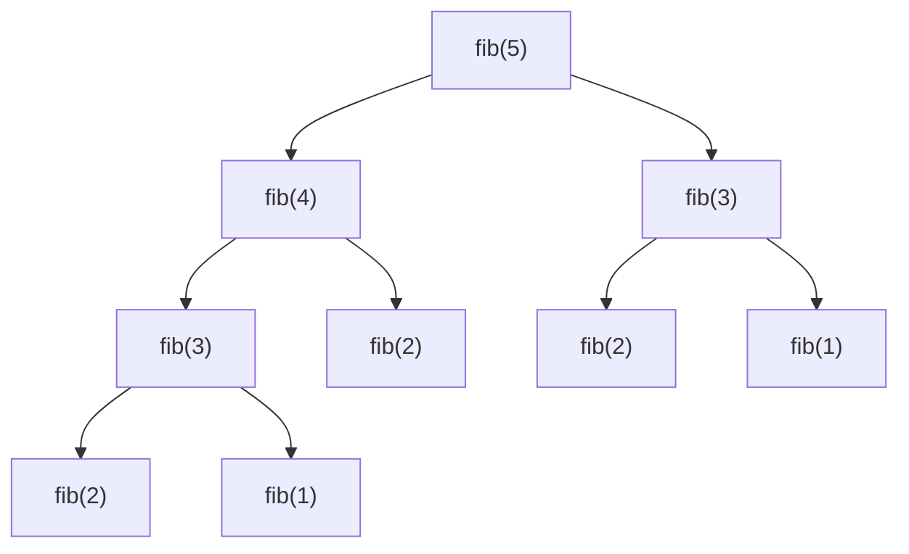

# Recursion from Zero

Recursion is the engine behind trees, graphs, backtracking, divide and conquer and dynamic programming. If recursion feels like magic, every one of those topics will too. This lesson makes it mechanical: you'll learn exactly what the computer does, how to design a recursive function in three steps, and how to turn recursion into a loop when you need to.

## 1. What recursion is

A function is **recursive** when it calls itself on a *smaller* version of the same problem.

```cpp
long long factorial(int n) {
    if (n == 0) return 1;              // base case: the answer is known directly
    return n * factorial(n - 1);       // recursive case: shrink the problem, then use the result
}
```

`factorial(4)` means "4 × factorial(3)", which is "4 × 3 × factorial(2)", and so on, until `factorial(0)` returns 1 and all the waiting multiplications finish.

Every correct recursive function has two parts:

1. **Base case(s):** inputs small enough to answer immediately. Without one, the recursion never stops.
2. **Recursive case:** reduce the input toward a base case, call the function, and combine the results.

## 2. What the computer actually does: the call stack

Each function call gets a **stack frame**: a block of memory holding its parameters, local variables, and where to return to. Frames are pushed when a call starts and popped when it returns.

```text
factorial(4)                      stack (top at the bottom)
 └─ waits for factorial(3)        [f(4): n=4]
     └─ waits for factorial(2)    [f(4)] [f(3): n=3]
         └─ waits for f(1)        [f(4)] [f(3)] [f(2): n=2]
             └─ waits for f(0)    [f(4)] [f(3)] [f(2)] [f(1)]
                 returns 1        [f(4)] [f(3)] [f(2)] [f(1)] [f(0)] → pop
             returns 1·1 = 1      ... pop
         returns 2·1 = 2
     returns 3·2 = 6
 returns 4·6 = 24
```

Two consequences you must remember:

- **Each call has its own copy of its local variables.** The `n` in `f(3)` and the `n` in `f(4)` are different variables.
- **Depth costs memory.** A recursion `d` levels deep holds `d` frames. The default stack (1–8 MB) overflows somewhere around 10⁵–10⁶ frames, and the program crashes with "Segmentation fault".

## 3. The "leap of faith": how to design a recursive function

Don't trace every call in your head. Instead:

1. **Define precisely what the function returns.** Example: "`sum(v, i)` returns the sum of `v[i..end]`."
2. **Assume it already works for smaller inputs.** This is the *leap of faith*, and it is the same idea as mathematical induction.
3. **Use that assumption to solve the current input:** `sum(v, i) = v[i] + sum(v, i+1)`.
4. **Handle the smallest input directly:** `sum(v, v.size()) = 0`.

```cpp
long long sum(const vector<int>& v, size_t i) {
    if (i == v.size()) return 0;           // empty suffix
    return v[i] + sum(v, i + 1);           // trust the smaller call
}
```

> [!KEY]
> If the base case is right, and every recursive case moves toward it and combines correctly, the function is correct. This is a proof by induction, and it is exactly how you should explain recursive code in an interview.

## 4. Patterns of recursion

### 4.1 Linear recursion: one call per level

Examples: sum, factorial, reversing a string, counting digits.

```cpp
int count_digits(long long n) { return n < 10 ? 1 : 1 + count_digits(n / 10); }

bool is_palindrome(const string& s, int l, int r) {
    if (l >= r) return true;                       // 0 or 1 characters left
    return s[l] == s[r] && is_palindrome(s, l + 1, r - 1);
}
```

Time O(n), stack depth O(n).

### 4.2 Divide in half: logarithmic depth

```cpp
long long power(long long b, int e) {              // b^e in O(log e)
    if (e == 0) return 1;
    long long half = power(b, e / 2);              // ONE call, reused twice
    return (e % 2 == 0) ? half * half : half * half * b;
}
```

If you wrote `power(b, e/2) * power(b, e/2)`, there would be **two** calls per level, and the time would become O(e) instead of O(log e). Always compute a repeated subresult once.

### 4.3 Tree recursion: several calls per level

```cpp
long long fib(int n) { return n < 2 ? n : fib(n - 1) + fib(n - 2); }
```



The tree roughly doubles at each level, which gives about O(1.618ⁿ) calls. `fib(3)` is computed twice and `fib(2)` three times. **Storing the results (memoisation)** makes it O(n). That is the seed of dynamic programming:

```cpp
long long memo[91];  bool known[91];
long long fib_memo(int n) {
    if (n < 2) return n;
    if (known[n]) return memo[n];
    known[n] = true;
    return memo[n] = fib_memo(n - 1) + fib_memo(n - 2);
}
```

### 4.4 Recursion on structures

Nested data (lists inside lists, expressions, trees, file systems) is naturally recursive: *a structure is either simple, or made of smaller structures of the same kind.*

```cpp
// evaluate a prefix expression like "+ * 2 3 4"  =  (2*3)+4
long long eval(istringstream& in) {
    string tok; in >> tok;
    if (isdigit(tok[0])) return stoll(tok);        // base: a number
    long long a = eval(in), b = eval(in);          // operands are themselves expressions
    return tok == "+" ? a + b : tok == "-" ? a - b : a * b;
}
```

Notice `long long a = eval(in), b = eval(in);`. Here the comma **declares two variables in order**, so `a` really is evaluated first. Writing `f(eval(in), eval(in))` instead would be a bug, because C++ does not specify the evaluation order of function arguments.

### 4.5 Generating all possibilities

Recursion makes it easy to enumerate choices: *decide the first position, then recursively fill the rest.*

```cpp
void binary_strings(string& cur, int n) {
    if ((int)cur.size() == n) { cout << cur << '\n'; return; }
    for (char c : {'0', '1'}) {
        cur.push_back(c);          // choose
        binary_strings(cur, n);    // explore
        cur.pop_back();            // un-choose
    }
}
```

This choose → explore → un-choose shape is **backtracking**, which has a whole topic later.

## 5. A classic: the Tower of Hanoi

Move `n` disks from peg A to peg C using peg B. You may only move the top disk, and a larger disk may never sit on a smaller one.

**Leap of faith:** assume you can move `n−1` disks anywhere. Then:

1. move the top `n−1` disks from A to B (using C)
2. move the largest disk from A to C
3. move the `n−1` disks from B to C (using A)

```cpp
void hanoi(int n, char from, char via, char to) {
    if (n == 0) return;
    hanoi(n - 1, from, to, via);
    cout << from << "->" << to << '\n';
    hanoi(n - 1, via, from, to);
}
```

The move count satisfies `M(n) = 2M(n−1) + 1`, which gives `M(n) = 2ⁿ − 1`. The solution is exponential, and it is provably optimal.

## 6. Recursion → iteration

You convert recursion to a loop when the depth could overflow the stack, or for speed.

**Tail recursion** is when the recursive call is the very last thing the function does. It converts directly into a loop:

```cpp
long long gcd_rec(long long a, long long b) { return b == 0 ? a : gcd_rec(b, a % b); }
long long gcd_loop(long long a, long long b) { while (b) { a %= b; swap(a, b); } return a; }
```

**General recursion** becomes a loop with an **explicit stack** (a `std::vector` you push and pop yourself). It lives on the heap, so its size is limited only by memory.

```cpp
// sum of a nested structure without recursion
struct Item { bool is_list; long long value; vector<Item> children; };
long long total(const Item& root) {
    long long s = 0;
    vector<const Item*> st{&root};
    while (!st.empty()) {
        const Item* it = st.back(); st.pop_back();
        if (!it->is_list) s += it->value;
        else for (auto& c : it->children) st.push_back(&c);
    }
    return s;
}
```

**Recurrences that only look back a fixed distance** (like Josephus or Fibonacci) can usually be computed **bottom-up** with a plain loop and O(1) memory:

```cpp
// Josephus: n people in a circle, every k-th is removed; J(1) = 0, J(n) = (J(n-1) + k) % n
int josephus(int n, int k) { int j = 0; for (int m = 2; m <= n; ++m) j = (j + k) % m; return j; }
```

## 7. Complexity of recursive functions

Count **(number of calls) × (work per call)**, or write a recurrence (see the Complexity lesson).

| Function | Calls | Work per call | Total |
|---|---|---|---|
| factorial(n) | n | O(1) | O(n) |
| power(b, e), with half reused | log e | O(1) | O(log e) |
| fib(n), naive | ≈1.6ⁿ | O(1) | exponential |
| hanoi(n) | 2ⁿ | O(1) | O(2ⁿ) |
| all binary strings | 2ⁿ leaves | O(n) to print | O(n·2ⁿ) |

**Space = maximum depth × frame size**, plus anything you allocate.

## 8. Common mistakes

- **A missing or wrong base case.** You get infinite recursion and a stack overflow. Test `n = 0` and `n = 1` explicitly.
- **Not shrinking the input** (calling `f(n)` from `f(n)`, or `f(n/2)` when `n` can be 1 and `n/2` rounds back up in some formula).
- **Recomputing the same subproblem** (naive Fibonacci, `power` with two calls). Memoise, or reuse a variable.
- **Passing big objects by value** (`vector<int> v` copies the whole vector at every call). Pass by `const&`, and use indices instead of making sub-vectors.
- **Relying on argument evaluation order** with stateful calls (`f(read(), read())`).
- **Very deep recursion on large inputs** (a linked list of 10⁶ nodes). Use iteration.

## 9. Interview questions

> [!INTERVIEW] "Explain why your recursive solution is correct."
> State what the function returns, show the base case is right, and show that if the smaller calls return correct results, the combination is correct. That's induction. Then give the time (calls × work) and the space (depth).

> [!EXAM] What is tail recursion, and does C++ guarantee tail-call optimisation?
> A call is a tail call when nothing remains to be done after it returns. Compilers such as GCC at `-O2` often turn tail recursion into a loop, but the C++ standard does **not** guarantee it. Don't rely on it for deep recursion: write the loop yourself.

## Check your understanding

1. What does `f(5)` return, and how deep does the stack go? `int f(int n) { return n <= 1 ? n : f(n-1) + 2; }`
2. Why is `power(b, e/2) * power(b, e/2)` slower than reusing `half`?
3. Write the recurrence for the number of moves in the Tower of Hanoi.

<details><summary>Answers</summary>

1. f(1) = 1, f(2) = 3, f(3) = 5, f(4) = 7, f(5) = 9. The depth is 5 frames.
2. It makes two calls per level instead of one: T(e) = 2T(e/2) + 1, which is O(e), compared with T(e) = T(e/2) + 1, which is O(log e).
3. M(n) = 2M(n−1) + 1 with M(0) = 0, so M(n) = 2ⁿ − 1.

</details>
