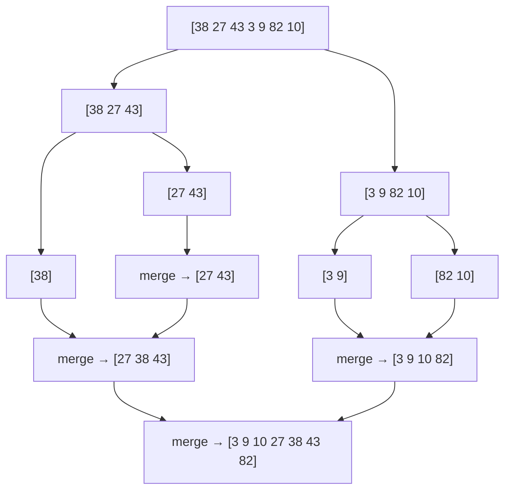

# Sorting Algorithms from Scratch

Sorting is the most-used algorithm in computing, and the most common first step in solving a problem. Once data is sorted, duplicates sit next to each other, binary search works, two pointers work, and greedy choices become obvious.

This lesson builds every major sorting algorithm by hand, so you understand what `std::sort` does for you and can adapt the ideas. Merge-style counting, quickselect and bucket tricks appear in many interview problems.

## 1. Vocabulary

- **Comparison sort:** decides the order only by comparing pairs (`a < b`).
- **Stable:** equal elements keep their original relative order. This matters when you sort records by one key after another.
- **In-place:** uses O(1) (or O(log n)) extra memory.
- **Adaptive:** runs faster on nearly sorted input.

| Algorithm | Best | Average | Worst | Extra space | Stable |
|---|---|---|---|---|---|
| Bubble | O(n) | O(n²) | O(n²) | O(1) | yes |
| Selection | O(n²) | O(n²) | O(n²) | O(1) | no |
| Insertion | O(n) | O(n²) | O(n²) | O(1) | yes |
| Merge | O(n log n) | O(n log n) | O(n log n) | O(n) | yes |
| Quick | O(n log n) | O(n log n) | O(n²) | O(log n) | no |
| Heap | O(n log n) | O(n log n) | O(n log n) | O(1) | no |
| Counting | O(n + k) | O(n + k) | O(n + k) | O(n + k) | yes |
| Radix (base b) | O(d(n + b)) | same | same | O(n + b) | yes |

## 2. The simple quadratic sorts

### Bubble sort

Repeatedly swap adjacent out-of-order pairs. After pass `p`, the largest `p` elements are in their final places at the end. If a pass makes no swap, the array is sorted, so stop early.

```cpp
void bubble(vector<int>& a) {
    for (size_t pass = 0; pass + 1 < a.size(); ++pass) {
        bool swapped = false;
        for (size_t j = 0; j + 1 < a.size() - pass; ++j)
            if (a[j] > a[j + 1]) { swap(a[j], a[j + 1]); swapped = true; }
        if (!swapped) break;
    }
}
```

### Selection sort

For each position `i`, find the minimum of `a[i..]` and swap it into place. It always makes Θ(n²) comparisons, but only n−1 swaps, which is useful when writes are expensive. It isn't stable, because the long-distance swap can jump an element over an equal one.

### Insertion sort

Grow a sorted prefix. Take the next element and shift larger elements right until its slot appears, just like sorting cards in your hand.

```cpp
void insertion(vector<int>& a) {
    for (size_t i = 1; i < a.size(); ++i) {
        int key = a[i];
        size_t j = i;
        while (j > 0 && a[j - 1] > key) { a[j] = a[j - 1]; --j; }   // shift right
        a[j] = key;
    }
}
```

Dry run on `[5, 2, 4, 6, 1]`:

```text
i=1  key=2   [2 5 | 4 6 1]   (5 shifted)
i=2  key=4   [2 4 5 | 6 1]   (5 shifted)
i=3  key=6   [2 4 5 6 | 1]   (nothing shifted)
i=4  key=1   [1 2 4 5 6]     (6,5,4,2 shifted)
```

> [!KEY]
> The number of shifts insertion sort makes equals the number of **inversions** (pairs `i < j` with `a[i] > a[j]`). Nearly sorted data has few inversions, which is why insertion sort is O(n) there. That's also why `std::sort` switches to insertion sort for small ranges.

## 3. Merge sort: divide and conquer

1. Split the array in half.
2. Sort each half recursively.
3. **Merge** the two sorted halves by repeatedly taking the smaller front element.

```cpp
void merge_sort(vector<int>& a, vector<int>& tmp, int l, int r) {   // sorts a[l..r)
    if (r - l <= 1) return;
    int m = l + (r - l) / 2;
    merge_sort(a, tmp, l, m);
    merge_sort(a, tmp, m, r);
    int i = l, j = m, k = l;
    while (i < m && j < r) tmp[k++] = (a[j] < a[i]) ? a[j++] : a[i++];  // take LEFT on ties → stable
    while (i < m) tmp[k++] = a[i++];
    while (j < r) tmp[k++] = a[j++];
    copy(tmp.begin() + l, tmp.begin() + r, a.begin() + l);
}
```



- **Time:** T(n) = 2T(n/2) + O(n), which is Θ(n log n) in every case (Master Theorem, case 2).
- **Space:** O(n) for the temporary buffer. Allocate it once and pass it down. Don't allocate inside every call.
- **Stable:** yes, as long as ties take from the left half.
- **Why it matters beyond sorting:** during the merge you know exactly how many left elements are bigger than each right element. That counts inversions in O(n log n) (Divide and Conquer topic). It is also the standard way to sort linked lists and data too big for memory (external sorting).

## 4. Quicksort: partition around a pivot

1. Pick a **pivot**.
2. **Partition**: rearrange so that everything less than the pivot comes before it and everything greater after it. The pivot is then in its final position.
3. Recurse on the two sides.

**Lomuto partition** (the easiest to write, with the pivot at the last position):

```cpp
int lomuto(vector<int>& a, int lo, int hi) {           // partition a[lo..hi], pivot = a[hi]
    int pivot = a[hi], i = lo;                          // a[lo..i-1] < pivot
    for (int j = lo; j < hi; ++j)
        if (a[j] < pivot) swap(a[i++], a[j]);
    swap(a[i], a[hi]);                                  // pivot into its final place
    return i;
}
void quicksort(vector<int>& a, int lo, int hi) {
    if (lo >= hi) return;
    int p = lomuto(a, lo, hi);
    quicksort(a, lo, p - 1);
    quicksort(a, p + 1, hi);
}
```

Dry run on `[3, 7, 1, 6, 4]` with pivot 4:

```text
j=0: 3<4 → swap(a[0],a[0]), i=1   [3 7 1 6 4]
j=1: 7   → skip                   [3 7 1 6 4]
j=2: 1<4 → swap(a[1],a[2]), i=2   [3 1 7 6 4]
j=3: 6   → skip
final: swap(a[2],a[4])            [3 1 4 6 7]   pivot 4 at index 2
```

**The worst case and how to avoid it.** If the pivot is always the smallest or largest element (a sorted input with a last-element pivot), one side is empty every time, and T(n) = T(n−1) + O(n) = Θ(n²). The fixes:

- **Random pivot:** swap a random element into the pivot position. The expected time is O(n log n) for every input.
- **Three-way partition (Dutch national flag):** split into `< pivot`, `== pivot` and `> pivot`. Without it, arrays full of equal values degrade to O(n²).

```cpp
void quicksort3(vector<int>& a, int lo, int hi, mt19937& rng) {   // a[lo..hi]
    if (lo >= hi) return;
    int pivot = a[lo + rng() % (hi - lo + 1)];
    int lt = lo, i = lo, gt = hi;                        // [lo,lt) < p, [lt,i) == p, (gt,hi] > p
    while (i <= gt) {
        if (a[i] < pivot) swap(a[lt++], a[i++]);
        else if (a[i] > pivot) swap(a[i], a[gt--]);
        else ++i;
    }
    quicksort3(a, lo, lt - 1, rng);
    quicksort3(a, gt + 1, hi, rng);
}
```

**Quickselect.** To find the k-th smallest element, partition once, then recurse into **only** the side that contains position k. The expected time is O(n). `std::nth_element` implements this.

## 5. Heap sort

A **binary max-heap** is an array where `a[i] ≥ a[2i+1]` and `a[i] ≥ a[2i+2]`: every parent is at least as large as its children. Its root `a[0]` is the maximum.

1. **Build the heap bottom-up:** call `sift_down` on `i = n/2 − 1 … 0`. This takes O(n) total, not O(n log n), because most nodes are near the bottom and sift only a little.
2. Repeatedly swap the root (the current maximum) with the last element of the heap, shrink the heap by one, and `sift_down(0)`.

```cpp
void sift_down(vector<int>& a, int i, int n) {          // heap is a[0..n)
    while (true) {
        int big = i, l = 2 * i + 1, r = 2 * i + 2;
        if (l < n && a[l] > a[big]) big = l;
        if (r < n && a[r] > a[big]) big = r;
        if (big == i) return;
        swap(a[i], a[big]);
        i = big;
    }
}
void heap_sort(vector<int>& a) {
    int n = a.size();
    for (int i = n / 2 - 1; i >= 0; --i) sift_down(a, i, n);   // build: O(n)
    for (int end = n - 1; end > 0; --end) {
        swap(a[0], a[end]);                                     // max to its final place
        sift_down(a, 0, end);
    }
}
```

Heap sort is guaranteed O(n log n) with O(1) extra space, but it is not stable and is cache-unfriendly. It's the fallback inside `std::sort` (introsort) when quicksort recursion gets too deep.

## 6. Beating n log n: non-comparison sorts

The **lower bound**: there are n! orderings, and each comparison gives one bit of information, so any comparison sort needs at least log₂(n!) ≈ n log₂ n comparisons in the worst case. To go faster, *don't compare*. Use the values themselves as indices.

**Counting sort** (values in `[0, k)`):

```cpp
vector<int> counting_sort(const vector<int>& a, int k) {
    vector<int> cnt(k + 1, 0);
    for (int x : a) ++cnt[x + 1];
    for (int v = 0; v < k; ++v) cnt[v + 1] += cnt[v];        // cnt[v] = first output slot for value v
    vector<int> out(a.size());
    for (int x : a) out[cnt[x]++] = x;                        // left-to-right keeps it stable
    return out;
}
```

**Radix sort** applies a stable counting sort digit by digit, **least significant digit first**. With base 256 on 32-bit keys that's 4 passes: O(4·(n + 256)).

**Bucket / pigeonhole ideas.** Spread values into buckets by range. "Maximum gap between sorted neighbours" in O(n) uses `n−1` buckets: the largest gap can't be inside a single bucket, so you only need each bucket's min and max.

## 7. Sorting in practice with the STL

| Need | Use |
|---|---|
| sort, any order | `sort(v.begin(), v.end())`: introsort, O(n log n) worst case |
| keep the order of equal elements | `stable_sort`: merge sort, O(n log n) |
| only the k smallest, in order | `partial_sort(v.begin(), v.begin() + k, v.end())` |
| the k-th element, and partition around it | `nth_element(v.begin(), v.begin() + k, v.end())`: O(n) average |
| descending order | `sort(v.rbegin(), v.rend())` or `sort(..., greater<>())` |
| by custom keys | a comparator or a key tuple (below) |

**Comparators** must define a **strict weak ordering**: `comp(a, a)` must be false, and the order must be consistent and transitive. Writing `<=` instead of `<` is undefined behaviour, and it can crash `std::sort`.

```cpp
struct Student { string name; int score, age; };
sort(v.begin(), v.end(), [](const Student& x, const Student& y) {
    if (x.score != y.score) return x.score > y.score;   // score descending
    if (x.age != y.age) return x.age < y.age;           // then age ascending
    return x.name < y.name;                             // then name
});
// or compare key tuples:
sort(v.begin(), v.end(), [](auto& x, auto& y) {
    return tuple(-x.score, x.age, x.name) < tuple(-y.score, y.age, y.name);
});
```

**Sorting indices instead of objects** keeps track of where elements came from:

```cpp
vector<int> idx(n); iota(idx.begin(), idx.end(), 0);
sort(idx.begin(), idx.end(), [&](int i, int j) { return a[i] < a[j]; });
```

## 8. Sorting as a problem-solving tool

- **Cycle decomposition.** To sort a permutation with the fewest swaps, follow `i → where a[i] belongs`. Each cycle of length L needs L−1 swaps.
- **Custom order** ("largest number from concatenation"): compare `a+b` with `b+a`.
- **Sort, then sweep:** intervals, meeting rooms, closest pair in 1D, grouping anagrams (sort each word).
- **Sort + two pointers or binary search:** pair sums, triplets, "count pairs with difference ≤ k".

## 9. Common mistakes

- **`<=` in a comparator,** which breaks strict weak ordering and is undefined behaviour.
- **Lomuto quicksort with a fixed pivot on sorted or equal data,** which is O(n²). Randomise and use three-way partitioning.
- **Merge sort allocating a new vector in every call.** It still works, but it's slow. Allocate the buffer once.
- **Forgetting stability** when sorting by several keys in sequence. Use `stable_sort` or a single combined comparator.
- **Overflow in comparators,** such as `return a - b < 0` with large ints.

## 10. Interview questions

> [!INTERVIEW] "Which sort would you use, and why?"
> In real code, `std::sort` (introsort): O(n log n) worst case, very fast, in place. Use `stable_sort` when equal keys must keep their order. Use counting or radix sort for small integer keys, and merge sort for linked lists or external data. Know that quicksort's average is O(n log n) but its worst case is O(n²), and that randomisation fixes that in expectation.

> [!EXAM] Why must comparison sorting take Ω(n log n) comparisons?
> A comparison sort is a binary decision tree whose leaves are the n! possible orderings. A binary tree with n! leaves has height at least log₂(n!), and Stirling's formula gives log₂(n!) = Θ(n log n). So some input needs that many comparisons.

## Check your understanding

1. Which of bubble, selection, insertion, merge, quick and heap sort are stable?
2. Insertion sort on `[4, 3, 2, 1]` makes how many shifts?
3. Why is building a heap bottom-up O(n)?

<details><summary>Answers</summary>

1. Bubble, insertion and merge (with left-on-ties) are stable. Selection, quick and heap are not, in their standard forms.
2. 6: every pair is an inversion, and there are 4·3/2 = 6 pairs.
3. A node at height h sifts at most h levels, and only about n/2^(h+1) nodes have height h. The sum Σ h·n/2^(h+1) converges to O(n).

</details>
