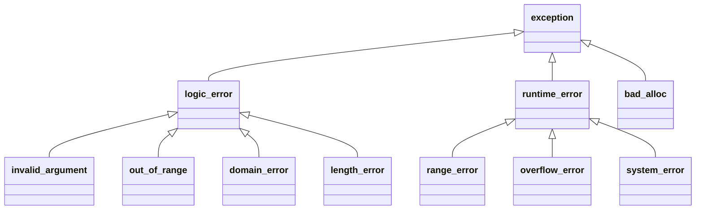

# Exceptions and Exception Safety

C++ reports errors that a function can't handle locally by **throwing exceptions**. Control jumps to the nearest matching `catch`, and **every local object on the way is destroyed** (stack unwinding). Combined with RAII, that gives error handling that can't leak resources and can't be silently ignored. The professional skill isn't writing `try`/`catch`, it's writing code that stays **correct when an exception passes through it**: the exception-safety guarantees. This lesson covers both.

## 1. throw, try, catch

```cpp
#include <stdexcept>

double safe_div(double a, double b) {
    if (b == 0) throw std::invalid_argument("division by zero");
    return a / b;
}

try {
    double r = safe_div(1, 0);
    std::cout << r;                                  // skipped
} catch (const std::invalid_argument& e) {           // catch by const reference
    std::cerr << "bad input: " << e.what() << '\n';
} catch (const std::exception& e) {                  // more general handlers later
    std::cerr << "error: " << e.what() << '\n';
} catch (...) {                                      // anything at all (rarely appropriate)
    std::cerr << "unknown error\n";
    throw;                                           // rethrow the SAME exception object
}
```

> [!KEY]
> - **Throw by value, catch by `const&`.** Catching by value copies and **slices** derived exceptions (`catch (std::exception e)` loses the derived type and its `what()`).
> - Handlers are tried **in order**, so put derived types before base types.
> - `throw;` rethrows the current exception unchanged. `throw e;` throws a sliced copy.

## 2. The standard hierarchy



| Class | Meaning | Thrown by |
|---|---|---|
| `logic_error` family | a precondition violated: a bug in the caller | `vector::at` (`out_of_range`), `std::stoi` (`invalid_argument`) |
| `runtime_error` family | a failure detectable only at run time | your I/O and parsing code, `std::system_error` (`errno`-style codes) |
| `bad_alloc` | `new` failed | operator new |
| `bad_cast`, `bad_variant_access`, `bad_optional_access` | misuse of a vocabulary type | `dynamic_cast<T&>`, `std::get`, `optional::value()` |

Custom exceptions derive from a standard class and carry context:

```cpp
class SensorError : public std::runtime_error {
public:
    SensorError(std::string sensor, const std::string& msg)
        : std::runtime_error(sensor + ": " + msg), sensor_(std::move(sensor)) {}
    const std::string& sensor() const noexcept { return sensor_; }
private:
    std::string sensor_;
};
```

## 3. Stack unwinding and RAII

When an exception propagates, destructors of all fully constructed local objects run in reverse order. That's why RAII makes exception-safe code natural:

```cpp
void log_reading(const std::string& path, Sensor& s) {
    std::ofstream f(path);                 // closed by its destructor
    std::lock_guard lock(s.mutex());       // unlocked by its destructor
    auto buf = std::make_unique<char[]>(4096);   // freed by its destructor
    f << s.read();                         // if read() throws, all three are released
}
```

> [!DANGER]
> - **Never let an exception escape a destructor.** Destructors are implicitly `noexcept`, so escaping calls `std::terminate`. If two exceptions were active during unwinding, the program would terminate anyway.
> - If a constructor throws, the object never existed: its destructor **doesn't run**, but already-constructed members and bases are destroyed. Raw owning pointers in the class would leak, so use RAII members.
> - An exception that escapes `main` (or a thread function) calls `std::terminate`, so nothing is unwound reliably.

## 4. The exception-safety guarantees

Every function should document which guarantee it gives if an exception occurs inside it:

| Guarantee | Promise | Example |
|---|---|---|
| **no-throw** | never throws | destructors, `swap`, move operations, `std::vector::size` |
| **strong** | commit or rollback: if it throws, state is **unchanged** | `vector::push_back` (when the element's move is `noexcept` or copyable) |
| **basic** | no leaks, invariants hold, but the state may have changed | most operations |
| none | anything can happen: avoid | |

### Copy-and-swap: the strong guarantee for free

```cpp
Config& Config::operator=(const Config& other) {
    Config tmp(other);        // may throw: *this is untouched
    swap(*this, tmp);         // noexcept: commit
    return *this;             // tmp's destructor frees the old state
}
```

The general recipe for the strong guarantee: **do all the work that can throw on the side, then commit with non-throwing operations.**

## 5. `noexcept`

```cpp
void swap(Buffer& a, Buffer& b) noexcept;          // promise: never throws
Buffer(Buffer&& other) noexcept;                   // enables the fast moves in std::vector
template <class T> void f() noexcept(std::is_nothrow_move_constructible_v<T>);   // conditional
static_assert(noexcept(std::declval<std::vector<int>&>().size()));             // the operator tests it
```

If a `noexcept` function throws anyway, `std::terminate` is called: there's no unwinding. Mark functions `noexcept` when they truly can't throw, especially **move operations, swap and destructors**. `std::vector` reallocation uses `std::move_if_noexcept`, so a throwing move constructor makes it copy instead.

## 6. When to use exceptions, and when not

| Use exceptions for | Use return values (`optional`, `expected`, error codes) for |
|---|---|
| rare, unexpected failures the caller can't handle locally | expected outcomes (not found, invalid user input, end of data) |
| constructor failures (constructors have no return value) | hot paths where failure is frequent |
| deep call stacks where the error must propagate far | real-time code with strict timing (the throw path is slow and unbounded) |

Many embedded, game and safety-critical codebases compile with `-fno-exceptions` (no throw-path cost, deterministic timing) and use `std::expected` and error codes instead (next lesson). The cost model: zero cost when nothing is thrown (on table-based ABIs), but a throw is slow, microseconds or more.

## 7. Exam-ready answers

> [!EXAM]
> **Exceptions and exception safety.** An exception is thrown with `throw` and handled by the first matching `catch` clause of an enclosing `try` block; during propagation the stack is unwound, destroying all fully constructed automatic objects in reverse order, so resources managed by RAII objects are released. Exceptions should be thrown by value and caught by reference to avoid slicing, with handlers ordered from most to least derived; `throw;` rethrows the current exception. The standard hierarchy derives from `std::exception`, distinguishing `logic_error` (precondition violations) from `runtime_error`. Exception-safety guarantees classify behaviour on failure: the no-throw guarantee (never throws), the strong guarantee (the operation succeeds or has no effect, as in copy-and-swap), and the basic guarantee (no leaks and invariants preserved). Destructors must not throw. `noexcept` declares that a function does not throw (violations call `std::terminate`) and enables optimisations such as moving elements during vector reallocation.

## 8. Cheat sheet

| Need | Code |
|---|---|
| report a precondition error | `throw std::invalid_argument("...")` |
| catch | `catch (const std::exception& e) { e.what(); }` |
| rethrow unchanged | `throw;` |
| custom exception | derive from `std::runtime_error` |
| strong guarantee | compute on the side, then commit with a `noexcept` swap |
| never throws | `noexcept` (moves, swap, destructors) |
| check at compile time | `static_assert(noexcept(expr))` |
| carry an exception across threads | `std::exception_ptr`, `std::rethrow_exception` |

> [!INTERVIEW]
> **"What are the exception-safety guarantees, and how do you achieve the strong guarantee?"** The basic guarantee means no resource leaks and objects stay in a valid (but unspecified) state. The strong guarantee means transactional: if an exception occurs, program state is as if the call never happened. No-throw means it never throws at all. The strong guarantee comes from doing everything that might throw on copies or temporaries without touching visible state, then committing through non-throwing operations: the copy-and-swap idiom for assignment, or building a new vector and swapping it in. RAII gives the basic guarantee almost automatically. Also mention that move constructors should be `noexcept`, so `std::vector` can keep its strong guarantee while still moving.
