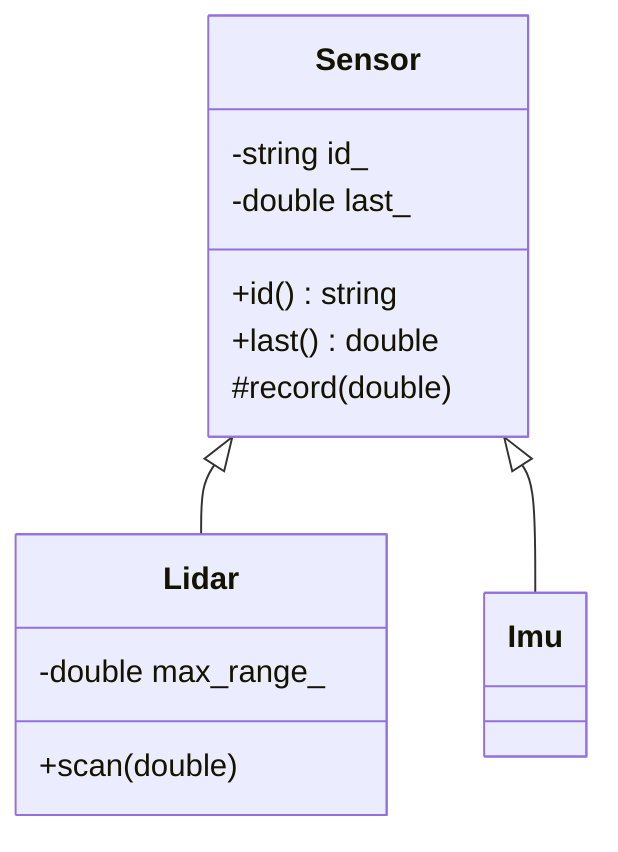
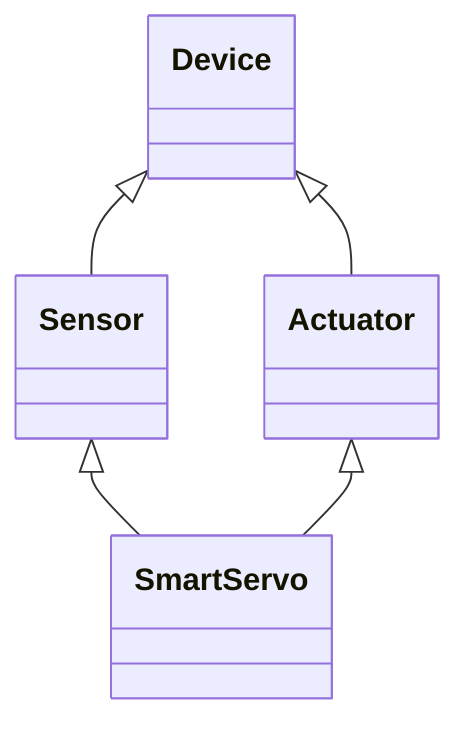

# Inheritance

Inheritance creates a new class (the **derived** class) from an existing one (the **base**), reusing its members and, with `public` inheritance, declaring that **a derived object *is a* base object** that can be used wherever a base is expected. C++ inheritance has more machinery than Python's: access modes on the inheritance itself, an exact construction order, **object slicing**, name hiding, and multiple inheritance with its diamond problem. This lesson covers the mechanics. The next one adds virtual functions, which make inheritance polymorphic.

## 1. Syntax and the "is-a" relationship

```cpp
class Sensor {
public:
    explicit Sensor(std::string id) : id_(std::move(id)) {}
    const std::string& id() const { return id_; }
    double last() const { return last_; }
protected:                                  // visible to derived classes, hidden from everyone else
    void record(double v) { last_ = v; ++samples_; }
private:
    std::string id_;
    double last_ = 0;
    int samples_ = 0;
};

class Lidar : public Sensor {               // Lidar IS-A Sensor
public:
    Lidar(std::string id, double max_range)
        : Sensor(std::move(id)),            // base constructed FIRST, via the init list
          max_range_(max_range) {}
    void scan(double d) { record(std::min(d, max_range_)); }   // uses protected base member
    // samples_ is private to Sensor: NOT accessible here
private:
    double max_range_;
};

Lidar l("front", 12.0);
l.scan(30);
std::cout << l.id() << ' ' << l.last();     // front 12: inherited public interface
Sensor& s = l;                              // a derived object binds to a base reference
```



> [!KEY]
> - `private` members of the base **exist** inside every derived object, but the derived class can't access them by name. Only `public` and `protected` members are accessible.
> - Use `protected` sparingly. Protected *data* couples every derived class to the base's representation. Protected *functions* (hooks like `record`) are fine.

## 2. Inheritance access modes

| Base member | `public` inheritance | `protected` inheritance | `private` inheritance |
|---|---|---|---|
| public | public | protected | private |
| protected | protected | protected | private |
| private | inaccessible | inaccessible | inaccessible |

- **`public`** is the normal "is-a" inheritance. Over 95% of real use is public.
- **`private`** means "implemented-in-terms-of": the derived class reuses the base's code without exposing the base's interface, and **can't** be converted to a base reference from outside. Usually composition is clearer.
- `class D : B` defaults to **private** inheritance and `struct D : B` defaults to **public**. Always write the keyword.

## 3. Construction and destruction order

```cpp
struct Member { Member() { std::cout << "Member "; } ~Member() { std::cout << "~Member "; } };
struct Base   { Base()   { std::cout << "Base "; }   ~Base()   { std::cout << "~Base "; } };
struct Der : Base {
    Member m;
    Der() { std::cout << "Der "; }
    ~Der() { std::cout << "~Der "; }
};
{ Der d; }
// Base Member Der ~Der ~Member ~Base
```

> [!KEY]
> Construction goes **base → members (in declaration order) → derived constructor body**. Destruction is the exact reverse. A derived constructor that doesn't name a base constructor in its initialiser list calls the base's **default** constructor. If there isn't one, that's a compile error.

### Inheriting constructors

```cpp
class TimedLidar : public Lidar {
public:
    using Lidar::Lidar;          // inherit all of Lidar's constructors (C++11)
};
TimedLidar t("rear", 8.0);
```

## 4. Object slicing

> [!DANGER]
> Copying a derived object **into a base object by value** copies only the base part. The derived members and the derived behaviour are "sliced off":
> ```cpp
> Lidar l("front", 12.0);
> Sensor s = l;                    // slicing: s is a plain Sensor, max_range_ is gone
> std::vector<Sensor> v;
> v.push_back(l);                  // sliced again
> void log(Sensor s);              // pass-by-value slices every Lidar passed in
> ```
> Polymorphic objects must be handled through **references or pointers** (`Sensor&`, `Sensor*`, `std::unique_ptr<Sensor>`), and containers of them hold `std::vector<std::unique_ptr<Sensor>>`. Slicing is silent: no error, no warning, just wrong behaviour once virtual functions are involved.

## 5. Name hiding

A member function in the derived class **hides every base function with the same name**, even ones with different parameters:

```cpp
struct Base { void set(int) {} void set(double) {} };
struct Der : Base {
    void set(std::string) {}     // hides BOTH Base::set overloads
};
Der d;
// d.set(5);                     // error: no matching function, since Base::set is hidden
struct Der2 : Base {
    using Base::set;             // bring the base overloads back into scope
    void set(std::string) {}
};
```

Name lookup stops at the first scope where it finds the name, and only then does overload resolution run.

## 6. Multiple inheritance

```cpp
class Named    { public: std::string name; };
class Powered  { public: double watts = 0; void power_on() {} };
class Arm : public Named, public Powered { };   // inherits both

Arm a;
a.name = "ur5"; a.watts = 300; a.power_on();
```

It's legitimate and common for **interfaces** (abstract classes with only pure virtual functions: next lesson). Inheriting *state* from several bases gets complicated quickly.

### The diamond problem



```cpp
struct Device   { int id = 0; };
struct Sensor   : Device {};
struct Actuator : Device {};
struct SmartServo : Sensor, Actuator {};

SmartServo s;
// s.id = 3;               // error: ambiguous. There are TWO Device subobjects!
s.Sensor::id = 3;          // you have to name the path
```

**Virtual inheritance** makes the derived classes share a single base subobject:

```cpp
struct Sensor   : virtual Device {};
struct Actuator : virtual Device {};
struct SmartServo : Sensor, Actuator {};    // ONE Device; s.id is unambiguous
```

Its costs are an extra pointer or offset per object, slower access to the virtual base, and the **most-derived class has to construct the virtual base directly**. The internals are in the vtables lesson. Most designs avoid the diamond entirely by inheriting stateless interfaces.

## 7. When to inherit, and when to compose

> [!TIP]
> - Inherit (publicly) only for a true **is-a** relation where the derived class honours every promise the base makes (the Liskov Substitution Principle, Master OOP). A `Square` that inherits `Rectangle` and breaks `set_width` is the classic violation.
> - For code reuse without substitutability, use **composition**: hold the helper as a member. "Prefer composition over inheritance."

## 8. Exam-ready answers

> [!EXAM]
> **Inheritance in C++.** Inheritance derives a new class from one or more base classes, reusing their members. Under public inheritance, the base's public and protected members keep their access in the derived class, and a derived object can be used wherever a base object is expected (an "is-a" relationship); protected and private inheritance reduce the access of inherited members and do not expose the conversion to outside code. Private base members are inherited but not accessible. Objects are constructed base first, then members in declaration order, then the derived constructor body, and destroyed in reverse. Copying a derived object into a base object by value causes object slicing, losing the derived part. C++ supports multiple inheritance, where the diamond problem (a base inherited along two paths) is resolved by virtual inheritance so that only one shared base subobject exists.

## 9. Cheat sheet

| Need | Code |
|---|---|
| is-a | `class D : public B` |
| call a base constructor | `D(args) : B(args), m_(...) {}` |
| reuse base constructors | `using B::B;` |
| unhide base overloads | `using B::f;` |
| call a base version | `B::f();` inside `D` |
| one shared base | `class X : virtual public B` |
| avoid slicing | `B&`, `B*`, `unique_ptr<B>` |

> [!INTERVIEW]
> **"What is object slicing and how do you prevent it?"** Slicing happens when a derived object is copied into a base-class object by value (assignment, pass-by-value, a `vector<Base>`): only the base subobject is copied, so derived data and overridden behaviour are lost. Prevent it by passing and storing polymorphic objects by reference or (smart) pointer, and by making the base's copy operations `protected` or `= delete`d so accidental copies fail to compile. Abstract base classes can't be instantiated, which also blocks slicing.
