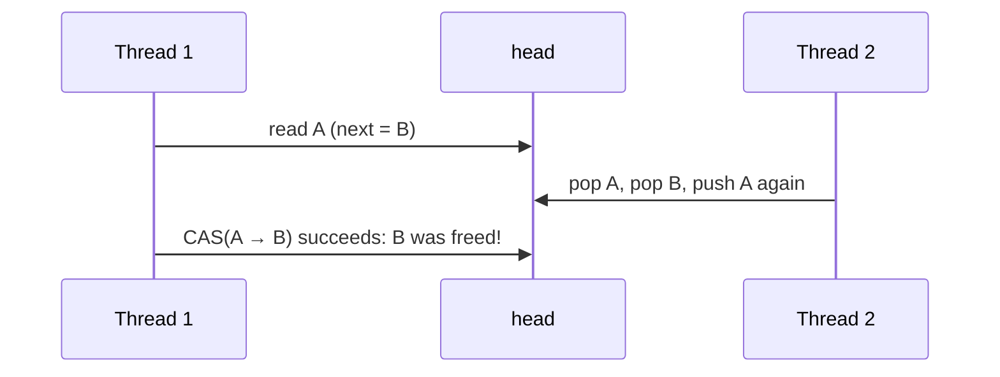

# Lock-Free Programming

**Lock-free** data structures let threads make progress without mutexes: a thread can never block others by being pre-empted while holding a lock. They're used where latency spikes are unacceptable (audio, high-frequency trading, real-time robot control, kernel code, interrupt handlers), and they're notoriously hard to get right. This lesson covers the progress guarantees, **compare-and-swap (CAS)** loops, the **ABA problem**, the classic **single-producer/single-consumer ring buffer**, and memory reclamation (hazard pointers, epochs). It's research-level material: know the concepts, use proven libraries, and reach for locks first.

## 1. Progress guarantees

| Guarantee | Meaning |
|---|---|
| blocking (mutexes) | a thread holding the lock can stall everyone (pre-emption, page faults, priority inversion) |
| **obstruction-free** | a thread running in isolation finishes in finitely many steps |
| **lock-free** | *some* thread always makes progress (the system never stalls) |
| **wait-free** | *every* thread finishes in a bounded number of steps (the strongest, rarest) |

"Lock-free" doesn't automatically mean faster: under low contention a good mutex is often as fast, and much simpler. The win is **bounded latency** and immunity to lock-holder pre-emption.

## 2. Compare-and-swap loops

The fundamental lock-free building block is CAS: "set the value to `desired`, **only if** it's still `expected`":

```cpp
std::atomic<int> max_seen{0};

void update_max(int x) {
    int cur = max_seen.load(std::memory_order_relaxed);
    while (x > cur && !max_seen.compare_exchange_weak(cur, x, std::memory_order_relaxed)) {
        // CAS failed: `cur` now holds the latest value, so loop and re-check
    }
}
```

`compare_exchange_weak` may fail spuriously (on LL/SC architectures like ARM), which is fine inside a loop and cheaper. Use `_strong` when you're not looping.

### A lock-free stack (Treiber stack)

```cpp
template <typename T>
class LockFreeStack {
    struct Node { T value; Node* next; };
    std::atomic<Node*> head_{nullptr};
public:
    void push(T v) {
        Node* n = new Node{std::move(v), head_.load(std::memory_order_relaxed)};
        while (!head_.compare_exchange_weak(n->next, n,
                    std::memory_order_release, std::memory_order_relaxed)) {}   // on failure, n->next = the current head
    }
    std::optional<T> pop() {
        Node* old = head_.load(std::memory_order_acquire);
        while (old && !head_.compare_exchange_weak(old, old->next,
                    std::memory_order_acquire, std::memory_order_acquire)) {}
        if (!old) return std::nullopt;
        T v = std::move(old->value);
        // delete old;   // UNSAFE: another thread may still be reading old->next (see reclamation below)
        return v;
    }
};
```

## 3. The ABA problem

Thread 1 reads head = A (with A→next = B) and is pre-empted. Thread 2 pops A, pops B, and pushes A back (the same address, possibly a recycled allocation). Thread 1 resumes: its CAS sees head == A, **succeeds**, and sets head = B, a node that was already freed. The structure is corrupted.



Fixes:
- **Tagged pointers / version counters:** pair the pointer with a counter incremented on every change, and CAS both (a 128-bit CAS, `cmpxchg16b`, or tag bits packed into unused pointer bits).
- **Safe memory reclamation:** never reuse a node while any thread might hold a reference to it (next section).

## 4. Memory reclamation: the real hard part

When can a popped node be deleted, if another thread may be about to dereference it?

| Technique | Idea |
|---|---|
| **hazard pointers** (standardised in C++26) | each thread publishes the pointers it's currently accessing, and a node is freed only when no hazard pointer refers to it |
| **epoch-based reclamation** / RCU | retired nodes are freed after every thread has passed a grace period (the Linux kernel's RCU, crossbeam-epoch in Rust) |
| reference counting | atomic counts per node: simple, but contention and cycle issues |
| never free (pools) | reuse nodes from a fixed pool, with tagged pointers against ABA: common in embedded code |

## 5. The SPSC ring buffer: lock-free done right

With exactly **one producer thread and one consumer thread**, a ring buffer needs no CAS at all, just two atomic indices with acquire/release:

```cpp
template <typename T, std::size_t N>          // N must be a power of two
class SpscRing {
    std::array<T, N> buf_;
    alignas(64) std::atomic<std::size_t> head_{0};   // written only by the consumer
    alignas(64) std::atomic<std::size_t> tail_{0};   // written only by the producer
public:
    bool push(const T& v) {                          // producer thread only
        auto t = tail_.load(std::memory_order_relaxed);
        if (t - head_.load(std::memory_order_acquire) == N) return false;   // full
        buf_[t & (N - 1)] = v;
        tail_.store(t + 1, std::memory_order_release);  // publish the element
        return true;
    }
    bool pop(T& out) {                               // consumer thread only
        auto h = head_.load(std::memory_order_relaxed);
        if (h == tail_.load(std::memory_order_acquire)) return false;       // empty
        out = buf_[h & (N - 1)];
        head_.store(h + 1, std::memory_order_release);  // free the slot
        return true;
    }
};
```

That's wait-free, allocation-free and bounded: the standard way to pass data from an **interrupt handler or real-time thread** to a logging or processing thread. The indices grow monotonically (wrap-around of `size_t` is harmless), and `alignas(64)` keeps the producer's and consumer's indices on separate cache lines (no false sharing).

## 6. Exam-ready answers

> [!EXAM]
> **Lock-free programming.** A data structure is lock-free if, whatever the scheduling, at least one thread completes its operation in a finite number of steps, and wait-free if every thread does; such structures avoid blocking caused by pre-empted lock holders. They are built from atomic operations, chiefly compare-and-swap loops that read a value, compute an update and retry if another thread changed the value in the meantime. The ABA problem arises when a value changes from A to B and back to A between a thread's read and its compare-and-swap, which then succeeds incorrectly; it is addressed with version-tagged pointers or by preventing memory reuse. Safe memory reclamation for removed nodes requires techniques such as hazard pointers, epoch-based reclamation or reference counting. Single-producer single-consumer ring buffers achieve wait-free operation with atomic indices using acquire-release ordering.

## 7. Cheat sheet

| Need | Approach |
|---|---|
| a lock-free max/counter | CAS loop with `compare_exchange_weak` |
| one producer → one consumer | SPSC ring buffer, acquire/release indices |
| a multi-producer queue | use a proven library (Folly, Boost.Lockfree, moodycamel) |
| ABA | tagged pointers / version counters |
| freeing nodes | hazard pointers, epochs/RCU, or node pools |
| verifying | ThreadSanitizer, stress tests, model checkers (CDSChecker, Relacy) |

> [!INTERVIEW]
> **"What is the ABA problem, and how do you solve it?"** In a CAS-based structure, a thread reads a shared pointer A, gets delayed, and meanwhile other threads change it to B and back to A (often by freeing A and reallocating a node at the same address). The delayed thread's CAS compares only the value, sees A, and succeeds even though the structure changed underneath, for example installing a stale `next` pointer that refers to freed memory. Solutions: attach a version counter to the pointer and CAS both together (a double-width CAS, or tag bits), so a changed-and-restored pointer has a different version; or use safe memory reclamation (hazard pointers, epoch-based schemes) so a node can't be freed and reused while any thread might still hold it.
