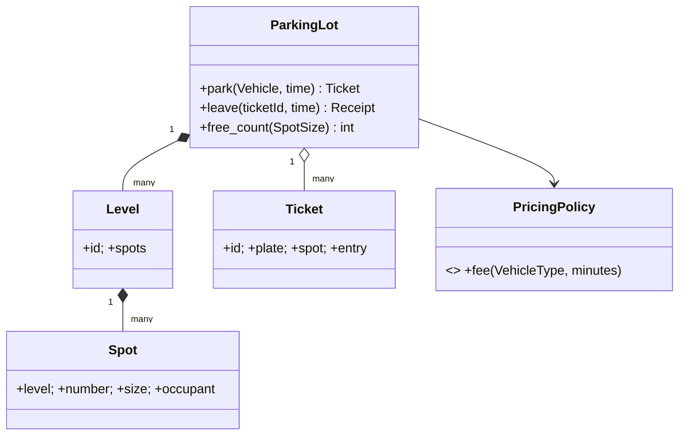

# Case Study: Parking Lot in C++

"Design a parking lot" is the most common object-oriented design interview question, because it tests requirements analysis, class modelling, data structures and extensibility in one problem. This case study works through it as a professional would: requirements, domain model, the key data-structure decision (finding the nearest free spot in O(log n)), pricing with the Strategy pattern, error handling, and the C++ ownership choices, ending with a multi-file implementation (the judged problem).

## 1. Requirements (clarify first)

- Multiple **levels**, each with numbered **spots** of three sizes: `Small` (motorcycle), `Compact` (car) and `Large` (truck or van).
- **Vehicles** fit spots of their size or larger: a motorcycle fits anywhere, and a truck only in Large.
- **Park**: assign the *nearest* suitable free spot (lowest level, then lowest number, then smallest fitting size) and issue a **ticket** with the entry time.
- **Leave**: compute the **fee** from the duration and the vehicle type using pluggable pricing, and free the spot.
- Queries: free spots per size, and occupancy.
- Errors: lot full, unknown ticket, the same vehicle parked twice.

## 2. Domain model



- `Vehicle` is a **value** (plate plus type), and `Ticket` and `Receipt` are values.
- `Spot` objects are **entities** owned by their level. They never move, so they can be identified by `(level, number)`.
- The `PricingPolicy` is injected (DIP and Strategy): hourly, flat-rate, or weekend rules are new classes.

## 3. The data-structure decision

A naive `park` scans every spot (O(N)). With thousands of spots and frequent events, keep a **sorted set of free spots per size**:

```cpp
struct SpotKey {
    int level, number;
    auto operator<=>(const SpotKey&) const = default;   // lexicographic: nearest first
};
std::array<std::set<SpotKey>, 3> free_;                  // one ordered set per SpotSize
```

`park` checks each size from the vehicle's minimum upward, taking `begin()` of each non-empty set and choosing the nearest candidate (the smallest key, with the smaller size breaking ties). That's O(log N) for insert and erase. `leave` reinserts the key. Tickets are in an `unordered_map<TicketId, Ticket>`, and a `unordered_set<std::string>` of plates detects double parking.

## 4. Pricing as a strategy

```cpp
struct PricingPolicy {
    virtual ~PricingPolicy() = default;
    virtual long fee_cents(VehicleType t, long minutes) const = 0;
};

class HourlyPricing : public PricingPolicy {
public:
    long fee_cents(VehicleType t, long minutes) const override {
        static constexpr long rate[] = {100, 250, 400};          // per started hour: moto, car, truck
        long hours = (minutes + 59) / 60;                         // round up started hours
        return std::max(1L, hours) * rate[static_cast<int>(t)];   // minimum one hour
    }
};
```

Money is **integer cents**. Policies are stateless, so one instance can be shared.

## 5. Error handling

Interview-grade code makes failure explicit: `std::expected<Ticket, ParkError>` (C++23), where `ParkError` is an enum class with `Full`, `AlreadyParked` and `UnknownTicket`. Exceptions are reasonable too, but `expected` puts the business outcomes in the type signature and keeps them cheap.

## 6. Extensions interviewers ask about

- **Concurrency** (several gates): put a mutex around the lot, or per-size locks with a consistent lock ordering. Tickets get unique ids from an atomic counter.
- **Reservations** and **EV charging spots**: a new spot attribute plus a filter in allocation. Thanks to the per-size free sets and the injected policy, these touch little existing code (OCP).
- **Persistence**: serialise tickets and occupancy. Spot keys are stable ids, which makes this straightforward.

> [!EXAM]
> **How would you find the nearest free parking spot efficiently, and why does the choice matter for the design?**
> Keep, for each spot size, an ordered set (a balanced BST such as `std::set`) of free spot keys ordered by (level, number). Parking examines the first element of each size set that's large enough, and picks the minimum: O(k log N) for k sizes, effectively O(log N). Leaving reinserts the key in O(log N). A linear scan costs O(N) per event and degrades as the lot grows. Encapsulating this index inside `ParkingLot` means callers only see `park` and `leave`, so the allocation strategy can change (to reservations or EV spots, for example) without affecting clients.

## Worked example: choosing a spot in O(log n)

The key data-structure decision in this case study is to keep the free spots of each size in a **sorted set**, so "nearest free spot that fits" is a `lower_bound` instead of a scan:

```cpp
#include <array>
#include <iostream>
#include <optional>
#include <set>
#include <string>
#include <unordered_map>

enum class Size { Small = 0, Medium = 1, Large = 2 };

class Lot {
    std::array<std::set<int>, 3> free_;                 // free spot numbers per size, sorted
    std::unordered_map<std::string, std::pair<Size, int>> parked_;
public:
    void add_spot(Size s, int number) { free_[static_cast<int>(s)].insert(number); }

    std::optional<int> park(const std::string& plate, Size car) {
        for (int s = static_cast<int>(car); s < 3; ++s) {   // same size first, then bigger
            if (!free_[s].empty()) {
                int spot = *free_[s].begin();                // lowest number = nearest entrance
                free_[s].erase(free_[s].begin());
                parked_[plate] = {static_cast<Size>(s), spot};
                return spot;
            }
        }
        return std::nullopt;                                 // lot full for this car
    }
    bool leave(const std::string& plate) {
        auto it = parked_.find(plate);
        if (it == parked_.end()) return false;
        free_[static_cast<int>(it->second.first)].insert(it->second.second);
        parked_.erase(it);
        return true;
    }
};

int main() {
    Lot lot;
    lot.add_spot(Size::Small, 1);
    lot.add_spot(Size::Medium, 7);
    lot.add_spot(Size::Large, 9);
    auto show = [](std::optional<int> s) { std::cout << (s ? std::to_string(*s) : "full") << '\n'; };
    show(lot.park("KA01", Size::Small));
    show(lot.park("KA02", Size::Small));   // small taken, so it uses medium 7
    show(lot.park("KA03", Size::Large));
    show(lot.park("KA04", Size::Medium));  // nothing left that fits
    lot.leave("KA02");
    show(lot.park("KA04", Size::Medium));
}
```

```output
1
7
9
full
7
```

- **`std::optional<int>`** says "maybe a spot" honestly. A full lot is an expected outcome, not an exception.
- **`std::set` keeps the spots ordered**, so the nearest one is always `begin()`. Insert and erase are O(log n).
- **`parked_`** gives O(1) lookup when a car leaves.

## Common mistakes

- **Scanning every spot on every arrival.** That's fine for 20 spots and too slow for 20,000.
- **Throwing an exception for "lot full".** It's a normal business outcome. Return `optional` or a result type.
- **Storing raw pointers to spots inside a `std::vector<Spot>`** that later grows. The pointers dangle after reallocation.

## Check your understanding

1. Why iterate from the car's size upward?
2. What would change to support "spots nearest to a given entrance" with several entrances?

<details><summary>Answers</summary>

1. A car fits in its own size or larger. Trying the smallest fitting size first saves large spots for large vehicles.
2. Keep one ordered structure per entrance (spots sorted by distance to that entrance), or a priority queue keyed by distance.

</details>
