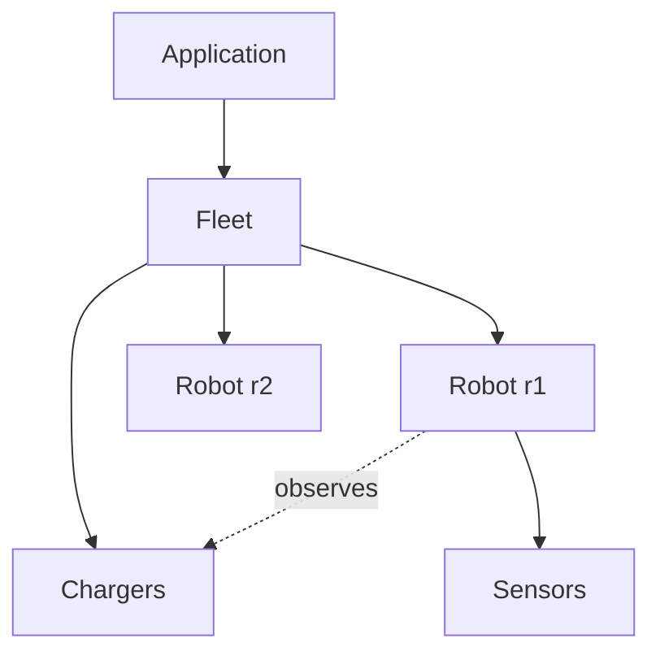

# Relationships and Ownership in C++

In UML, objects relate by **association**, **aggregation**, **composition**, **dependency** and **inheritance**. In C++ every relationship must also answer one question that garbage-collected languages hide: **who owns whom, and who destroys what, when?** Getting this right eliminates leaks, dangling pointers and use-after-free bugs. This lesson maps each relationship to concrete C++ constructs (members, `unique_ptr`, `shared_ptr`, `weak_ptr`, references and raw pointers), covers lifetime rules, back-pointers and cycles, and the "who outlives whom" analysis that professional designs document.

## 1. The relationship table

| UML relationship | Meaning | C++ representation | Lifetime |
|---|---|---|---|
| **Composition** (filled diamond) | the part can't exist without the whole | member object, or `std::unique_ptr<Part>` | the part dies with the whole |
| **Aggregation** (hollow diamond) | the whole uses parts that live independently | non-owning `Part*` / `Part&`, or `std::shared_ptr` when the ownership really is shared | independent |
| **Association** | objects know each other | non-owning pointer, reference, or an id looked up in a registry | independent |
| **Dependency** | uses temporarily | function parameter (`const T&`) | the duration of the call |
| **Inheritance** | is-a | public base class | n/a |

```cpp
class Robot {
    Chassis chassis_;                                   // composition: a member object
    std::unique_ptr<Planner> planner_;                  // composition with polymorphism
    std::vector<std::unique_ptr<Sensor>> sensors_;      // composition: Robot owns its sensors
    Charger* assigned_charger_ = nullptr;               // association: the Fleet owns the chargers
    std::shared_ptr<const Map> map_;                    // shared, immutable map used by many robots
public:
    void plan(const Goal& g);                           // dependency: Goal is only used during the call
};
```

> [!KEY]
> **Default to unique ownership.** Every object should have exactly one owner (a member, a `unique_ptr`, or a container of them) unless shared lifetime is genuinely required. Non-owning relations use raw pointers, references or ids. Raw pointers are fine in modern C++ when they mean "observe, don't own".

## 2. Choosing among `unique_ptr`, `shared_ptr` and a raw pointer

- **`unique_ptr`**: an exclusive owner. It's movable, not copyable, and has zero overhead. Use it for polymorphic composition, pimpl, and factories.
- **`shared_ptr`**: when no single owner can be named, such as a map shared by planners in different threads where the last user frees it, or an object kept alive by asynchronous callbacks. Pay for atomic reference counts and think about cycles.
- **`weak_ptr`**: a non-owning observer of a shared object that can check whether the object is still alive (`lock()`). Use it for caches, observers, and parent pointers in shared trees.
- **Raw pointer or reference**: non-owning, where the pointee is guaranteed to outlive the observer. That guarantee should be structural: the owner holds both, or a parent outlives its children.

## 3. Lifetime analysis: who outlives whom?

Draw the ownership tree, so each object has one parent. Any non-owning pointer must point **up or sideways** to something that outlives it, never down into an object that can be destroyed first.



- Members are destroyed in **reverse order of declaration**. Declare `chargers_` **before** `robots_` in `Fleet`, so robots (whose pointers observe chargers) are destroyed first. Relying on declaration order is legitimate, but leave a comment.
- Before removing an object, **unlink its observers** (for example, clear the robot's `assigned_charger_` when a charger is decommissioned), or use `weak_ptr`/ids so stale references can be detected.

## 4. Back-pointers and cycles

A tree with parent links:

```cpp
struct Node {
    std::vector<std::unique_ptr<Node>> children;   // owns down
    Node* parent = nullptr;                        // observes up: the parent always outlives its children
};
```

With `shared_ptr` both ways, `parent ↔ child` forms a **cycle**: the reference counts never reach zero, so it leaks. The rule is **strong pointers down, weak or raw pointers up**.

## 5. Ids instead of pointers

For large object graphs (ECS game engines, ROS-style systems), store **ids** (`RobotId`, `ChargerId`) and look them up in owning registries. Lookups can fail gracefully (a missing id, rather than a dangling pointer), the data serialises naturally, and memory can be compacted. Strong id types (`enum class RobotId : std::uint32_t {}`) stop ids being mixed up.

## 6. Example: fleet ownership

```cpp
class Fleet {
public:
    Charger& add_charger(std::string id);
    Robot&   add_robot(std::string id);
    bool assign(std::string_view robot, std::string_view charger);  // creates an association
    void decommission_charger(std::string_view id);                 // unlinks robots first!
private:
    std::vector<std::unique_ptr<Charger>> chargers_;   // declared first: destroyed last
    std::vector<std::unique_ptr<Robot>> robots_;       // robots observe chargers
};
```

`unique_ptr` elements keep object addresses stable while the vector grows, so references handed out by `add_robot` stay valid. A `std::vector<Robot>` would move the objects and invalidate every reference.

> [!EXAM]
> **How do composition, aggregation and association map to C++ ownership, and how do you avoid dangling references?**
> Composition means the whole owns the part: a member object or a `unique_ptr`/container of `unique_ptr`, destroyed with the whole. Aggregation and association are non-owning: raw pointers, references or ids to objects owned elsewhere, or `shared_ptr` only when there's genuinely shared lifetime. To avoid dangling references, make every object have a single owner, ensure that non-owning pointers only point to objects that structurally outlive the observer (a parent, or a sibling declared earlier, since members are destroyed in reverse order), unlink observers before destroying their target, and use `weak_ptr` or id lookups where lifetimes aren't structurally guaranteed. Never use `shared_ptr` in both directions, because that creates leaking cycles.
