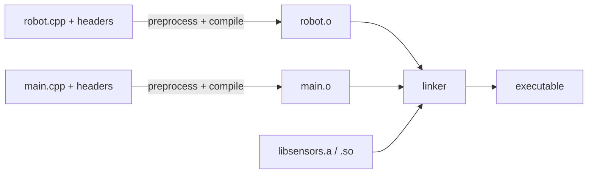

# PIMPL, ABI and Linking

C++ is compiled as separate **translation units** that the linker stitches together. Understanding this model explains a whole family of practical problems:
- why changing a private member forces half a project to recompile
- why a shared library update can crash programs that "didn't change"
- what "undefined reference" and "multiple definition" really mean
- why `inline` has little to do with inlining

This lesson covers the compilation model, the One Definition Rule, name mangling, ABI stability and the PIMPL idiom that addresses both build times and binary compatibility.

## 1. From source to executable



- Each `.cpp` file, with everything it `#include`s, is one **translation unit (TU)**, compiled independently into an object file.
- The object file contains **symbols**: definitions it provides and references it needs.
- The **linker** matches references to definitions. A missing definition gives "undefined reference to `X`". Two strong definitions give "multiple definition of `X`".
- **Static libraries** (`.a`, `.lib`) are archives of object files copied into the executable. **Shared libraries** (`.so`, `.dll`, `.dylib`) are loaded at run time by the dynamic loader, so they can be updated without relinking the program. That's exactly where the ABI matters.

## 2. Name mangling

C++ allows overloading and namespaces, so the symbol name must encode the full signature:

```cpp
namespace nav { double distance(const Point&, const Point&); }
// Itanium ABI (GCC/Clang): _ZN3nav8distanceERK5PointS2_
```

`c++filt _ZN3nav8distanceERK5PointS2_` demangles it, and `nm -C file.o` lists the symbols. To call C++ from C (or expose a C API from C++), disable mangling with `extern "C"`:

```cpp
extern "C" int sensor_read(int id, double* out);   // plain symbol "sensor_read"; no overloading allowed
```

A **C API facade** over a C++ implementation is the most robust way to ship a binary library. The C ABI is stable and every language can call it.

## 3. The One Definition Rule (ODR)

1. In each TU, a variable, function, class or template may be **defined at most once**.
2. Across the program, a non-inline function or variable that is odr-used must be defined **exactly once**.
3. Classes, inline functions, inline variables and templates may be defined in **several** TUs (that's why they live in headers), but every definition must be **token-for-token identical** with the same meaning.

> [!DANGER]
> Violations of rule 3 are **ill-formed, no diagnostic required**. Two TUs defining `struct Config` differently, or compiling the same header with different `#define`s that change a class layout (such as `-DDEBUG` adding a member), produce a program where some code believes the object is 24 bytes and other code believes it's 32. It links fine and corrupts memory at run time. Mixing debug and release builds of a library is a classic way to trigger this.

### What `inline` really means

`inline` on a function or variable means **"this definition may appear in multiple TUs; the linker keeps one"**. Whether the call is actually inlined is the optimiser's independent decision.

```cpp
// header
inline int clamp_rpm(int r) { return r > 9000 ? 9000 : r; }    // OK in many TUs
inline constexpr double kWheelRadius = 0.05;                    // C++17 inline variable
struct Robot { static inline int count = 0; };                  // C++17: no out-of-class definition needed

int helper() { return 1; }    // in a header WITHOUT inline: "multiple definition" once two TUs include it
```

Functions defined inside a class body, templates and `constexpr` functions are implicitly inline.

### Internal linkage

`static` functions or variables at namespace scope, and everything in an **unnamed namespace**, are private to their TU. Use them for helpers in `.cpp` files, so you avoid accidental ODR clashes and the optimiser can do more.

## 4. ABI: the binary contract

The **API** is what source code sees. The **ABI (Application Binary Interface)** is what compiled code relies on:
- name mangling and calling conventions
- object **size and layout** (member offsets)
- vtable layout (the order of virtual functions)
- exception handling and RTTI formats
- the layout of standard-library types (`std::string` changed in GCC 5)

Changes that **break ABI** (clients must recompile) while the source still compiles:

| Change | Why it breaks |
|---|---|
| add, remove or reorder data members | `sizeof` and offsets change; inline code in clients uses the old ones |
| add a virtual function (anywhere but at the end, and even there for derived classes) | vtable slots shift |
| change a parameter or return type | mangled name changes → undefined symbol, or silent mismatch |
| change an inline function's body | old copies are inlined in clients |
| change a default argument | the value is baked into the *caller* |
| change a template's definition | instantiated in clients |
| change `noexcept` (C++17: part of the function type) | mangling of function pointer types |

Safe changes: adding new non-virtual functions, new classes, or new free functions, and changing the bodies of non-inline functions.

## 5. PIMPL: the compilation firewall

**Pointer to IMPLementation** moves all private data and helpers into a class defined only in the `.cpp` file:

```cpp
// motor_controller.h — the public header: stable
#pragma once
#include <memory>

class MotorController {
public:
    explicit MotorController(int can_id);
    ~MotorController();                                         // declared here, defined in the .cpp
    MotorController(MotorController&&) noexcept;
    MotorController& operator=(MotorController&&) noexcept;

    void set_velocity(double rad_s);
    double velocity() const;

private:
    struct Impl;                                                // forward declaration only
    std::unique_ptr<Impl> impl_;
};
```

```cpp
// motor_controller.cpp — the private details: change freely
#include "motor_controller.h"
#include "can_bus.h"                 // heavy headers stay out of clients' builds
#include "pid.h"

struct MotorController::Impl {
    CanBus bus;
    Pid pid{0.8, 0.05, 0.01};
    double target = 0.0;
    explicit Impl(int id) : bus(id) {}
};

MotorController::MotorController(int id) : impl_(std::make_unique<Impl>(id)) {}
MotorController::~MotorController() = default;                       // Impl is complete HERE
MotorController::MotorController(MotorController&&) noexcept = default;
MotorController& MotorController::operator=(MotorController&&) noexcept = default;

void MotorController::set_velocity(double v) { impl_->target = v; }
double MotorController::velocity() const { return impl_->target; }
```

> [!KEY]
> The destructor (and the move operations) **must be declared in the header and defined in the .cpp**, after `Impl` is complete. Otherwise the compiler generates them inline in every client TU, where `std::unique_ptr<Impl>`'s deleter sees an incomplete type. That's a compile error ("invalid application of sizeof to incomplete type").

| Benefit | Cost |
|---|---|
| clients recompile only when the *public* interface changes | one heap allocation per object |
| private members can change without breaking ABI | one pointer indirection per access |
| heavy includes are hidden (faster builds) | more boilerplate (copying needs a manual deep copy) |
| hides implementation details from shipped headers | objects can't be `constexpr`, and the moved-from state has a null `impl_` |

Qt (`d`-pointers), many SDKs and long-lived system libraries use PIMPL to keep ABI stable across releases.

### Alternatives

- **Abstract interface + factory**: `class IMotor { public: virtual ~IMotor() = default; virtual void set_velocity(double) = 0; }; std::unique_ptr<IMotor> make_motor(int id);`. The ABI then depends only on the vtable layout.
- **Fast PIMPL**: in-object aligned storage of a fixed size (no heap), with a `static_assert` on the size in the `.cpp`.
- **Forward declarations** in headers (`class CanBus;` plus pointer/reference members) to cut include dependencies without full PIMPL.
- **C++20 modules** reduce rebuild cost (no textual inclusion), but don't by themselves solve ABI stability.

## 6. Symbol visibility in shared libraries

By default, GCC exports every symbol from a `.so`. Exporting only the API shrinks the library, speeds up loading, avoids clashes, and makes the ABI surface explicit:

```cpp
#define ROBOT_API __attribute__((visibility("default")))
class ROBOT_API MotorController { /* ... */ };
// compile the library with -fvisibility=hidden -fvisibility-inlines-hidden
```

Library versions carry an **SONAME** (`libsensors.so.2`), and an ABI break bumps the major number. Tools like `abidiff` (libabigail) check releases automatically.

## 7. Exam-ready answers

> [!EXAM]
> **The One Definition Rule.** The ODR requires that every variable, function, class type, enumeration and template has at most one definition in a translation unit, and that every non-inline function and variable that is used has exactly one definition in the entire program. Class types, inline functions and variables, and templates may be defined in several translation units provided that all definitions are identical in token sequence and meaning. Violations across translation units often aren't diagnosed by the compiler or linker and lead to undefined behaviour, for example when two translation units see different layouts of the same class.

> [!EXAM]
> **The PIMPL idiom.** PIMPL ("pointer to implementation") separates a class's interface from its implementation by declaring a nested implementation type in the header and holding only a pointer, typically a `std::unique_ptr`, to it, while the implementation type and all private data are defined in the source file. Changes to private members then don't alter the public class's size or layout, so clients need not be recompiled and binary compatibility is preserved, and heavy headers are hidden from clients, reducing build times. The costs are an extra heap allocation and indirection, and the special member functions must be defined in the source file where the implementation type is complete.

## 8. Cheat sheet

| Symptom | Likely cause |
|---|---|
| undefined reference to `X` | declared but never defined/linked; missing `.cpp` or library; C/C++ mangling mismatch (`extern "C"`) |
| multiple definition of `X` | non-inline function or variable defined in a header |
| crash after updating a `.so` | ABI break: layout or vtable changed |
| incomplete type in `unique_ptr` destructor | PIMPL destructor defaulted in the header |
| whole project rebuilds on a private change | expose less in headers: PIMPL, forward declarations |
| two TUs disagree on `sizeof(T)` | ODR violation through macros or mismatched build flags |

> [!INTERVIEW]
> **"You maintain a shared library. Can you add a member to a public class in a minor release?"** Not if clients allocate or embed the object (on the stack, as a member or in arrays) or call inline functions that touch its members: their compiled code hard-codes the old size and offsets. It's possible if the class uses PIMPL (add the member to `Impl`) or is only ever handled through a pointer from a factory. Otherwise, it requires a major version and an SONAME bump. Mention tooling (`abidiff`) and C API facades as ways to guard stability.
