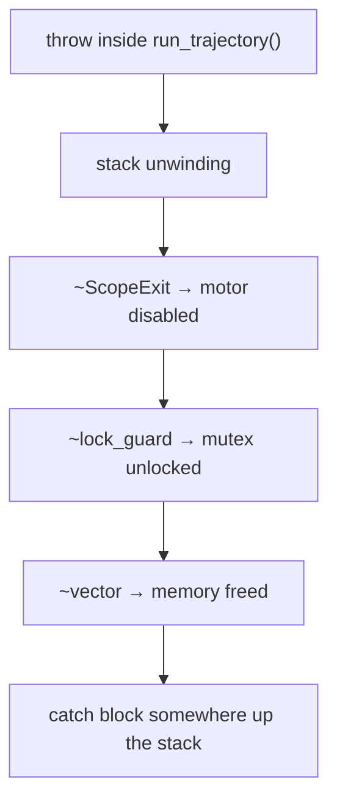

# RAII

**RAII**, short for *Resource Acquisition Is Initialization*, is the single most important idea in C++. You tie a resource's lifetime to an object's lifetime: the **constructor acquires** the resource and the **destructor releases** it. Because C++ guarantees destructors run when objects go out of scope, including during exception unwinding, resources can never leak. That covers memory, files, sockets, mutex locks, GPU buffers, database transactions, and in robotics, *motor enable states*. Python's `with` is RAII that you have to remember to write. In C++ it's automatic for every object.

## 1. Deterministic destruction

```cpp
#include <iostream>
struct Tracer {
    std::string name;
    explicit Tracer(std::string n) : name(std::move(n)) { std::cout << "acquire " << name << '\n'; }
    ~Tracer() { std::cout << "release " << name << '\n'; }      // destructor: runs automatically
};

int main() {
    Tracer a("a");
    {
        Tracer b("b");
    }                       // b released here, at the end of its scope
    Tracer c("c");
}                           // c, then a, released here: REVERSE order of construction
```

```output
acquire a
acquire b
release b
acquire c
release c
release a
```

> [!KEY]
> Destructors run when an automatic object's scope ends, **however** it ends: normal flow, `return`, `break`, `continue`, or an exception propagating through. Objects are destroyed in the reverse order of construction (like a stack). Members are destroyed after the destructor body, in reverse order of declaration.

## 2. Writing an RAII wrapper

Take a C API (`fopen`/`fclose`) and make leaks impossible:

```cpp
#include <cstdio>
#include <stdexcept>
#include <string>

class File {
    std::FILE* f_;
public:
    explicit File(const std::string& path, const char* mode)
        : f_(std::fopen(path.c_str(), mode)) {
        if (!f_) throw std::runtime_error("cannot open " + path);   // acquisition failure throws
    }
    ~File() { if (f_) std::fclose(f_); }                            // release, always

    File(const File&) = delete;              // a file handle can't be copied (two closes!)
    File& operator=(const File&) = delete;

    std::FILE* get() const { return f_; }
};

void save(const std::string& path) {
    File out(path, "w");
    std::fputs("data\n", out.get());
    risky_operation();          // may throw: the file still gets closed
}                               // fclose runs here automatically
```

Rules for an RAII class:

1. Acquire in the constructor, and **throw** if acquisition fails, so an object never exists in a half-built state.
2. Release in the destructor, and **never throw** from a destructor.
3. Decide what copying means. Usually you **forbid** it (`= delete`) or implement transfer (move). See the Rule of Five lesson.

## 3. RAII in the standard library

| Resource | RAII type |
|---|---|
| heap memory | `std::vector`, `std::string`, `std::unique_ptr`, `std::shared_ptr` |
| files | `std::ifstream`, `std::ofstream` |
| mutex locks | `std::lock_guard`, `std::unique_lock`, `std::scoped_lock` |
| threads | `std::jthread` (joins in its destructor) |
| anything with a release function | `std::unique_ptr<T, Deleter>` |

```cpp
#include <mutex>
std::mutex m;
void update() {
    std::lock_guard<std::mutex> lock(m);   // locks here
    modify_shared_state();                 // even if this throws…
}                                          // …the mutex unlocks here
```

## 4. Scope guards: RAII for ad-hoc cleanup

```cpp
template <typename F>
class ScopeExit {
    F f_;
public:
    explicit ScopeExit(F f) : f_(std::move(f)) {}
    ~ScopeExit() { f_(); }
    ScopeExit(const ScopeExit&) = delete;
    ScopeExit& operator=(const ScopeExit&) = delete;
};

void drive(Motor& m) {
    m.enable();
    ScopeExit stop([&] { m.disable(); });   // disable on EVERY exit path
    run_trajectory(m);
}
```

This replaces C's `goto cleanup` pattern and Python's `try/finally`.

## 5. RAII and exception safety

Because unwinding runs destructors, RAII is the foundation of exception-safe C++. Code written with RAII objects needs **no** `try/catch` just to clean up. `try/catch` is only for actually *handling* errors. In a well-written C++ codebase, explicit cleanup code is almost non-existent.



## 6. Exam-ready answers

> [!EXAM]
> **RAII.** Resource Acquisition Is Initialization is a C++ idiom in which the lifetime of a resource (memory, file handle, lock, socket, etc.) is bound to the lifetime of an object: the resource is acquired in the object's constructor and released in its destructor. Because destructors of automatic objects are called deterministically when they go out of scope, including during stack unwinding after an exception, resources are released reliably without explicit cleanup code. Standard examples include containers and smart pointers for memory, file streams for files, and `std::lock_guard` for mutexes. RAII classes typically forbid copying or define move operations to express ownership transfer.

## 7. Cheat sheet

| Need | Code |
|---|---|
| own heap memory | `std::vector`, `std::unique_ptr` |
| lock a mutex for a scope | `std::lock_guard lock(m);` |
| file | `std::ifstream in(path);` |
| wrap a C resource | a class: constructor acquires, destructor releases, copy deleted |
| custom cleanup | `std::unique_ptr<FILE, decltype(&fclose)> f(fopen(...), &fclose);` |
| ad-hoc cleanup | a scope guard class or `std::experimental::scope_exit` |

> [!INTERVIEW]
> **"Why doesn't C++ need `finally`?"** Because RAII makes it unnecessary. Any cleanup goes in a destructor, and destructors run automatically on every exit path, including exceptions. A `finally` block would duplicate cleanup at every use site, while RAII writes it once in the type. (Java and Python added `try-with-resources` and `with` to get closer to the same guarantee.)

## Worked example: cleanup that survives exceptions

```cpp
#include <cstdio>
#include <iostream>
#include <stdexcept>

class File {                                    // RAII wrapper around FILE*
    std::FILE* f_;
public:
    File(const char* path, const char* mode) : f_(std::fopen(path, mode)) {
        if (!f_) throw std::runtime_error("cannot open file");
        std::cout << "opened\n";
    }
    ~File() { std::fclose(f_); std::cout << "closed\n"; }   // always runs
    File(const File&) = delete;                 // one owner: no copies
    File& operator=(const File&) = delete;
    void write(const char* s) { std::fputs(s, f_); }
};

void process(bool fail) {
    File log("/tmp/raii_demo.txt", "w");
    log.write("start\n");
    if (fail) throw std::runtime_error("sensor error");      // early exit
    log.write("done\n");
}

int main() {
    try { process(true); }
    catch (const std::exception& e) { std::cout << "caught: " << e.what() << '\n'; }
}
```

```output
opened
closed
caught: sensor error
```

**"closed" prints before "caught".** As the exception propagates out of `process`, every local object's destructor runs (this is called *stack unwinding*). With raw `fopen`/`fclose`, the early `throw` would leak the file handle.

The same idea is behind `std::unique_ptr` (memory), `std::lock_guard` (mutexes), `std::jthread` (threads) and `std::fstream` (files).

## Common mistakes

- **Forgetting to delete copying.** Two copies would `fclose` the same handle twice. Delete the copy operations, or implement moves.
- **Throwing from a destructor.** During unwinding, that calls `std::terminate`. Destructors should be `noexcept` (they are by default).
- **Calling `new` and `delete` by hand in application code.** Use `std::make_unique` and containers.

## Check your understanding

1. When does a local object's destructor run?
2. Why is RAII better than `try/finally`?

<details><summary>Answers</summary>

1. When it goes out of scope, through normal flow, `return`, `break`, or an exception, in reverse order of construction.
2. The cleanup is written once, in the type, and can't be forgotten at any call site. It also works for any number of resources, in the right order.

</details>
