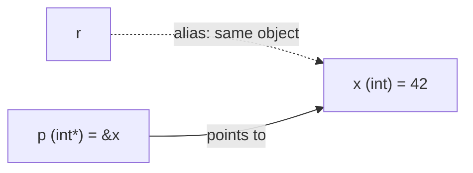

# References

A **reference** is an alias, another name for an existing object. `int& r = x;` means "r *is* x". References give you pass-by-reference without pointer syntax: no `&` at the call site, no `*` to dereference, and no null. They're central to idiomatic C++: functions take large objects by `const T&` to avoid copies, by `T&` to modify them, and operators and range-for loops depend on them. Lvalue references come first. Rvalue references (`T&&`) belong to move semantics, covered in the Memory module.

## 1. Declaring a reference

```cpp
int x = 1;
int& r = x;     // r is another name for x (must be initialised, and can never be re-seated)
r = 42;         // assigns to x
std::cout << x; // 42
```

| | Pointer `int* p` | Reference `int& r` |
|---|---|---|
| must be initialised | no | **yes** |
| can be null | yes | no (no null references in valid code) |
| can be re-seated | yes (`p = &y`) | **no**: `r = y` assigns y's **value** to x |
| access syntax | `*p`, `p->m` | `r`, `r.m` (like the object) |
| has its own address / size | yes | conceptually no (it's an alias) |
| arithmetic | yes | no |



## 2. Pass by reference

```cpp
void increment(int& n) { ++n; }          // modifies the caller's variable

int score = 10;
increment(score);                        // no & at the call site
std::cout << score;                      // 11

void swap(int& a, int& b) { int t = a; a = b; b = t; }
```

## 3. Pass by `const&`: efficiency without copies

```cpp
double average(const std::vector<double>& v) {   // no copy of a possibly huge vector, and no modification
    double s = 0;
    for (double x : v) s += x;
    return v.empty() ? 0 : s / v.size();
}
```

> [!KEY]
> **Parameter-passing guidelines** (from the C++ Core Guidelines):
> | Situation | Signature |
> |---|---|
> | small, cheap-to-copy types (int, double, pointers) as input | `void f(int x)` (by value) |
> | large types (string, vector, your classes) as input | `void f(const T& x)` |
> | the function must modify the caller's object | `void f(T& x)` |
> | the function takes ownership / stores a copy | `void f(T x)` then `std::move` (Move Semantics lesson) |
> | optional input that may be absent | `const T*` (nullable) or `std::optional` |

A `const T&` parameter can also bind to **temporaries**: `average({1.0, 2.0, 3.0})` works, while `T&` would refuse a temporary.

## 4. References in range-for

```cpp
std::vector<std::string> names{"ada", "bo"};
for (auto& n : names) n += "!";            // modify in place
for (const auto& n : names) std::cout << n; // read without copying
for (auto n : names) n += "?";             // modifies COPIES: names unchanged
```

## 5. Returning references

```cpp
class Inventory {
    std::vector<int> stock_;
public:
    int& at(std::size_t i) { return stock_[i]; }        // lets callers modify an element
    const int& at(std::size_t i) const { return stock_[i]; }
};
```

> [!DANGER]
> **Never return a reference to a local variable.** It dangles exactly like a returned pointer to a local:
> ```cpp
> const std::string& bad() { std::string s = "temp"; return s; }   // UB: s is destroyed
> ```
> Return by value instead. Copy elision and move semantics make that cheap. Also be careful holding a reference into a `std::vector`: a `push_back` that reallocates invalidates it.

## 6. Reference binding rules

```cpp
int x = 5;
int& a = x;          // OK: lvalue
// int& b = 5;       // error: a non-const lvalue reference can't bind to a temporary
const int& c = 5;    // OK: const& binds to a temporary and extends its lifetime
// double& d = x;    // error: type mismatch
const double& e = x; // OK: creates a temporary double from x (e is NOT an alias of x!)
```

## 7. Exam-ready answers

> [!EXAM]
> **References in C++.** A reference is an alias for an existing object, declared with `&` (for example `int& r = x;`). It must be initialised when declared, cannot be made to refer to another object afterwards, and cannot be null; all operations on the reference act on the referred object. References allow functions to modify their arguments (pass by reference) without pointer syntax, and `const` references allow large objects to be passed efficiently without copying while preventing modification; `const` lvalue references can also bind to temporaries, extending their lifetime. Returning a reference to a local variable produces a dangling reference.

> [!EXAM]
> **Pointer vs reference.** A pointer is an object holding an address. It can be null, reassigned to point elsewhere, used in arithmetic, and requires explicit dereferencing. A reference is an alias that must be bound at initialisation, cannot be reseated or null, and is used with ordinary object syntax. References are preferred for parameters that must refer to a valid object; pointers are used when "no object" or reseating is needed.

## 8. Cheat sheet

| Need | Code |
|---|---|
| alias | `int& r = x;` |
| modify an argument | `void f(T& x)` |
| read a big object without copying | `void f(const T& x)` |
| loop and modify | `for (auto& e : v)` |
| loop and read | `for (const auto& e : v)` |
| bind a temporary | `const T& t = make();` |
| never | return `T&` to a local |

> [!INTERVIEW]
> **"Can a reference be null or reseated?"** Neither, in valid code. It must be initialised to refer to an object, and assignment through it assigns to that object instead of rebinding. You *can* create a dangling reference (to a destroyed object) or bind one by dereferencing a null pointer (`int& r = *p;` with `p == nullptr`), but both are undefined behaviour. That's why references are used to express "this is never null".
