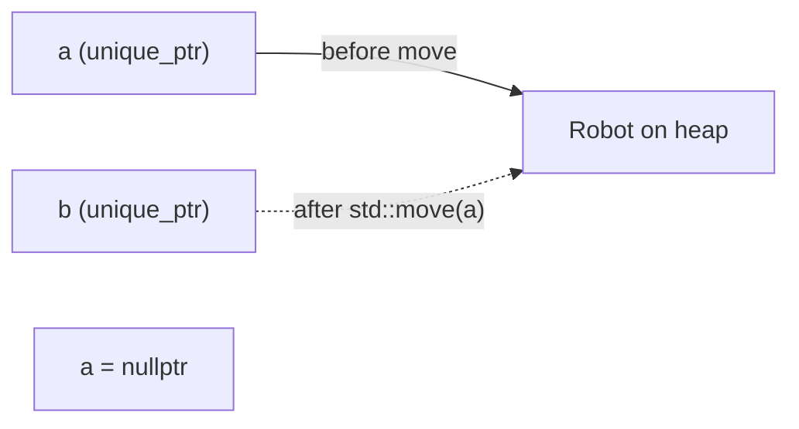

# Smart Pointers

Smart pointers are RAII wrappers around heap pointers that **delete the object automatically** and, just as importantly, **state ownership in the type**. `std::unique_ptr<T>` means "I am the only owner". `std::shared_ptr<T>` means "ownership is shared, and the last owner deletes". `std::weak_ptr<T>` means "I observe a shared object without keeping it alive". With them, modern C++ code has essentially no `delete` statements and no leaks.

## 1. `std::unique_ptr`: exclusive ownership

```cpp
#include <memory>

auto robot = std::make_unique<Robot>("rover");   // allocate + construct; the preferred way
robot->drive(1.0);                               // use like a pointer
Robot& r = *robot;
// automatic delete when robot goes out of scope
```

- **Zero overhead**: the same size and speed as a raw pointer (with the default deleter).
- **Move-only**: you can't copy a unique owner, only transfer ownership with `std::move`.

```cpp
std::unique_ptr<Robot> a = std::make_unique<Robot>("a");
// std::unique_ptr<Robot> b = a;              // error: copy is deleted
std::unique_ptr<Robot> b = std::move(a);       // ownership moves; a is now nullptr
```



Passing ownership to and from functions:

```cpp
std::unique_ptr<Sensor> make_sensor(const std::string& kind);   // factory returns ownership
void install(std::unique_ptr<Sensor> s);                        // takes ownership (by value)
void use(Sensor& s);                                             // borrows: just a reference
void maybe_use(Sensor* s);                                       // borrows, may be null

auto s = make_sensor("lidar");
use(*s);                       // borrow
install(std::move(s));         // give away
```

> [!KEY]
> **Default to `std::unique_ptr`** for heap objects. It's free and it makes ownership explicit. Containers of polymorphic objects, `std::vector<std::unique_ptr<Shape>>`, are the standard way to store a family of derived classes.

Arrays and custom deleters:

```cpp
auto buf = std::make_unique<double[]>(1024);                    // calls delete[] for you
std::unique_ptr<std::FILE, int(*)(std::FILE*)> f(std::fopen("x.txt", "r"), &std::fclose);
```

## 2. `std::shared_ptr`: shared ownership with reference counting

```cpp
auto map = std::make_shared<OccupancyGrid>(1000, 1000);
{
    auto planner_view = map;               // copy: the reference count becomes 2
    std::cout << map.use_count();          // 2
}                                          // planner_view destroyed: the count is 1
std::cout << map.use_count();              // 1
// when the last shared_ptr is destroyed, the grid is deleted
```

How it works: `make_shared` allocates **one block** holding the object plus a **control block** (the strong count, the weak count and the deleter). Copying increments the count **atomically** (thread-safe), and destroying decrements it.

| | `unique_ptr` | `shared_ptr` |
|---|---|---|
| owners | exactly one | many |
| copyable | no (move only) | yes |
| size | 1 pointer | 2 pointers (object + control block) |
| cost | none | atomic reference-count updates and a control block |
| use for | the default | genuinely shared lifetime (caches, graphs, async callbacks) |

> [!WARNING]
> Don't use `shared_ptr` just to avoid thinking about ownership. It hides the ownership structure, costs atomic operations, and enables reference cycles. Most designs have a clear owner: use `unique_ptr`, and hand out references or raw observer pointers.

## 3. Reference cycles and `std::weak_ptr`

```cpp
struct Node {
    std::shared_ptr<Node> next;
    std::weak_ptr<Node>   prev;      // weak: breaks the cycle
};
```

If two objects hold `shared_ptr`s to each other, their counts never reach zero, so **both leak**. `weak_ptr` observes without owning:

```cpp
std::weak_ptr<Node> w = some_shared;
if (auto locked = w.lock()) {        // get a shared_ptr if the object is still alive
    use(*locked);
} else {
    // the object has already been destroyed
}
std::cout << w.expired();
```

Typical uses: back-pointers (child → parent), caches, and observers (the Observer pattern) that mustn't keep their subjects alive.

## 4. `make_unique` / `make_shared` vs `new`

Always use the `make_` functions:

- no `new` appears in your code (the "no naked new" guideline)
- exception safety: `f(std::shared_ptr<A>(new A), g())` could leak in older C++ if `g()` threw between the `new` and the `shared_ptr` construction
- `make_shared` performs one allocation for the object and the control block, instead of two

## 5. Common mistakes

> [!DANGER]
> - Creating two `shared_ptr`s from the **same raw pointer**: `shared_ptr<T> a(p), b(p);` gives two control blocks, so the object is deleted twice. (When a class needs to hand out `shared_ptr`s to itself, use `std::enable_shared_from_this`.)
> - Keeping a raw pointer from `.get()` after the owner died: it dangles.
> - Passing `shared_ptr` by value everywhere just to "use" an object: that's needless atomic traffic. Pass `const T&` or `T*` when you don't share ownership.
> - Cycles of `shared_ptr`: memory leaks.

## 6. Exam-ready answers

> [!EXAM]
> **Smart pointers.** Smart pointers are class templates in `<memory>` that manage dynamically allocated objects through RAII, deleting them automatically. `std::unique_ptr<T>` represents exclusive ownership: it cannot be copied, only moved, and deletes the object when destroyed, with no overhead compared to a raw pointer. `std::shared_ptr<T>` represents shared ownership using a reference count stored in a control block; the object is destroyed when the last `shared_ptr` owning it is destroyed. `std::weak_ptr<T>` holds a non-owning reference to an object managed by `shared_ptr`, does not affect the reference count, and is used to break reference cycles; `lock()` obtains a `shared_ptr` if the object still exists. Objects should be created with `std::make_unique` and `std::make_shared`.

## 7. Cheat sheet

| Need | Code |
|---|---|
| sole owner | `auto p = std::make_unique<T>(args);` |
| transfer | `auto q = std::move(p);` |
| shared owner | `auto s = std::make_shared<T>(args);` |
| observe a shared object | `std::weak_ptr<T> w = s; if (auto sp = w.lock()) ...` |
| heap array | `std::make_unique<T[]>(n)` |
| polymorphic container | `std::vector<std::unique_ptr<Base>>` |
| borrow | pass `T&` / `T*`, not the smart pointer |

> [!INTERVIEW]
> **"When would you use `shared_ptr` over `unique_ptr`, and what's the cost?"** Use `shared_ptr` only when several parts of the program must keep an object alive with no single owner, such as an asset cache, a node in a graph with shared children, or an object captured by asynchronous callbacks. The cost is an extra control block (one allocation with `make_shared`), two-pointer size, and atomic increments and decrements on every copy, plus the risk of cycles, which `weak_ptr` solves.
