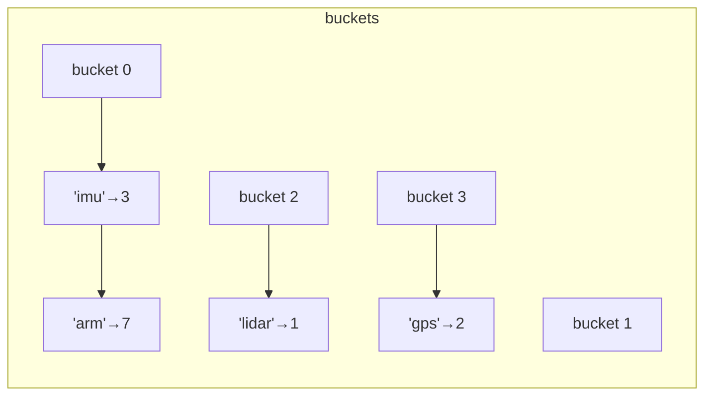

# Unordered Containers and Hashing

`std::unordered_map` and `std::unordered_set` are **hash tables**: average **O(1)** insert, erase and lookup. They're the workhorse for counting, caching, deduplication and graph adjacency. Using them well requires understanding what's underneath: buckets, hash functions, load factor and rehashing. You also need to know how to hash your own types, and why adversarial inputs can turn O(1) into O(n), which in competitive programming is called an **anti-hash test**.

## 1. Basic use

```cpp
#include <unordered_map>
#include <unordered_set>

std::unordered_map<std::string, int> freq;
for (const auto& w : words) ++freq[w];          // operator[] value-initialises missing counts to 0
if (auto it = freq.find("robot"); it != freq.end())
    std::cout << it->second;
freq.contains("x");                              // C++20
freq.erase("robot");

std::unordered_set<int> seen;
if (!seen.insert(x).second) { /* x was a duplicate */ }
```

The interface mirrors `map`/`set`, minus everything order-related (no `lower_bound`), and **iteration order is unspecified**: it can change after any insertion.

## 2. How it works: buckets and chaining

libstdc++ implements `unordered_map` as an array of **buckets**, each a chain of nodes (separate chaining):



1. `hash(key)` produces a `size_t`.
2. `bucket = hash % bucket_count()`.
3. The chain in that bucket is scanned, comparing keys with `==`.

The **load factor** is `size() / bucket_count()`. When it would exceed `max_load_factor()` (default **1.0**), the table **rehashes**: it allocates more buckets (roughly double, rounded to a prime in libstdc++) and redistributes every node. That costs O(n), but it's amortised O(1) per insert.

```cpp
std::unordered_map<int, int> m;
m.max_load_factor();      // 1
m.reserve(1'000'000);     // pre-size the buckets: no rehashing while filling
```

| | Average | Worst case |
|---|---|---|
| find / insert / erase | O(1) | **O(n)** (everything in one bucket) |

> [!KEY]
> Rehashing invalidates **iterators** but not **references or pointers** to elements, because nodes don't move and only the bucket array is rebuilt. That's a guarantee of the node-based design (and a reason it's slower than open-addressing tables).

## 3. Hashing your own types

A key type needs `std::hash<Key>` (or a custom hasher) **and** `operator==`. Equal keys **must** have equal hashes.

```cpp
struct Cell {
    int r, c;
    bool operator==(const Cell&) const = default;
};

struct CellHash {
    std::size_t operator()(const Cell& p) const noexcept {
        std::uint64_t x = (static_cast<std::uint64_t>(static_cast<std::uint32_t>(p.r)) << 32)
                        | static_cast<std::uint32_t>(p.c);      // pack both ints: no collisions
        return std::hash<std::uint64_t>{}(x);
    }
};
std::unordered_set<Cell, CellHash> visited;

// or specialise std::hash so the default works:
template <> struct std::hash<Cell> {
    std::size_t operator()(const Cell& p) const noexcept { return CellHash{}(p); }
};
```

Combining several fields, the boost-style `hash_combine`:

```cpp
inline void hash_combine(std::size_t& seed, std::size_t h) {
    seed ^= h + 0x9e3779b97f4a7c15ULL + (seed << 6) + (seed >> 2);
}
```

> [!WARNING]
> `std::pair` and `std::tuple` have **no** `std::hash` specialisation, so `unordered_map<pair<int,int>, int>` doesn't compile without a custom hasher. And `r * 31 + c`-style hashes collide easily on structured data like grid coordinates.

## 4. Anti-hash tests and hash flooding

`std::hash<int>` in libstdc++ is the **identity function**, and the bucket count follows a known sequence of primes. An adversary who knows this can choose keys that are all multiples of the bucket count, so every key lands in **one bucket** and every operation becomes O(n). Codeforces "hacks" do exactly this to `unordered_map` solutions, and web servers have been taken down by hash flooding (CVE-2011-4815 family). The defence is a randomised, strong mixing hash:

```cpp
struct SplitMix64 {
    std::size_t operator()(std::uint64_t x) const noexcept {
        static const std::uint64_t seed =
            std::chrono::steady_clock::now().time_since_epoch().count();
        x += seed + 0x9e3779b97f4a7c15ULL;
        x = (x ^ (x >> 30)) * 0xbf58476d1ce4e5b9ULL;
        x = (x ^ (x >> 27)) * 0x94d049bb133111ebULL;
        return x ^ (x >> 31);
    }
};
std::unordered_map<long long, int, SplitMix64> safe;
```

## 5. Performance reality

- Each element is a separate heap node, so iteration and lookups chase pointers (cache misses).
- For small n (under ~100), a sorted `vector` + binary search, or even a linear scan, is often faster.
- High-performance code uses **open-addressing** flat tables (`absl::flat_hash_map`, `boost::unordered_flat_map`, `ankerl::unordered_dense`), which are 2–5× faster.
- Always `reserve` when you know the approximate size.

## 6. Exam-ready answers

> [!EXAM]
> **Unordered associative containers.** `std::unordered_map` and `std::unordered_set` are hash tables that store elements in buckets selected by applying a hash function to the key and reducing it modulo the number of buckets; the standard library uses separate chaining. Insertion, deletion and lookup take constant time on average and linear time in the worst case, when many keys collide. The load factor is the ratio of elements to buckets; when it exceeds the maximum load factor (1.0 by default), the table rehashes into more buckets, invalidating iterators but not references to elements. Keys require a hash function and an equality operator such that equal keys produce equal hashes; custom types need a specialisation of `std::hash` or a hasher type. Iteration order is unspecified. Predictable hash functions make the containers vulnerable to adversarial inputs that force collisions, which is mitigated with randomised hash functions.

## 7. Cheat sheet

| Need | Code |
|---|---|
| counting | `++m[key]` |
| dedup | `unordered_set`, `insert(x).second` |
| pre-size | `m.reserve(n)` |
| custom key | `operator==` + a hasher struct |
| pair key | pack into `uint64_t`, or `hash_combine` |
| anti-hack | SplitMix64 hasher with a random seed |
| need order or ranges | use `std::map` instead |

> [!INTERVIEW]
> **"How does a hash map degrade to O(n), and how do you prevent it?"** If many keys hash to the same bucket, either because the hash function is poor or because an attacker crafted collisions against a known, deterministic hash (identity hash for ints, a fixed seed), each bucket chain becomes long and operations scan it linearly. Prevention: a strong mixing hash with a per-process random seed (SipHash in Python and Rust, SplitMix64 in competitive programming), keeping the load factor bounded by rehashing, and, as in Java 8's HashMap, converting long chains into balanced trees to cap the worst case at O(log n).
