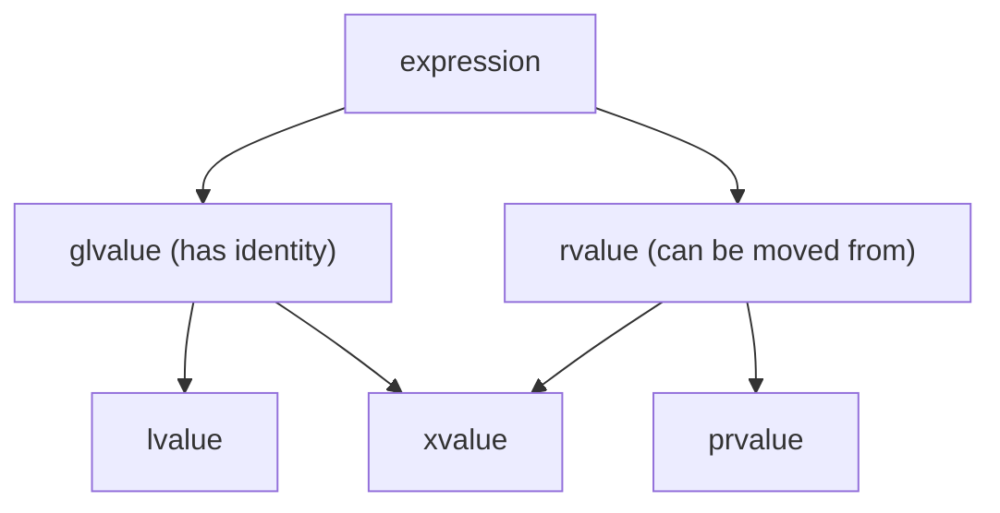

# Value Categories

Every C++ expression has a type **and** a *value category* that says whether it denotes an object with an identity you can refer to again (an **lvalue**) or a temporary that's about to disappear (an **rvalue**). This sounds academic, but it's what makes **move semantics** possible: when the compiler knows an object is a temporary, it can steal its resources instead of copying them. It also explains why `int& r = 5;` fails and `const int& r = 5;` works.

## 1. The intuition

| Category | Intuition | Examples |
|---|---|---|
| **lvalue** | has a name or identity; you can take its address; it persists | `x`, `arr[3]`, `*p`, `obj.member`, a function returning `T&`, a string literal |
| **prvalue** ("pure rvalue") | a temporary value, not yet an object with identity | `42`, `x + 1`, `std::string("hi")`, a function returning `T` by value |
| **xvalue** ("eXpiring") | an object you may steal from: it has identity, but it's about to expire | `std::move(x)`, a function returning `T&&` |



The rule of thumb: **if you can take its address with `&`, it's an lvalue.** `&x` works, while `&42` and `&(x + 1)` don't compile.

## 2. Reference types and what they bind to

| Reference | Binds to lvalues? | Binds to rvalues? |
|---|---|---|
| `T&` | ✅ | ❌ |
| `const T&` | ✅ | ✅ (and extends the temporary's life) |
| `T&&` (rvalue reference) | ❌ | ✅ |

```cpp
int x = 5;
int& a = x;          // OK: lvalue
// int& b = 5;       // error: a non-const lvalue reference can't bind to an rvalue
const int& c = 5;    // OK
int&& d = 5;         // OK: an rvalue reference binds the temporary
// int&& e = x;      // error: x is an lvalue
int&& f = std::move(x);   // OK: std::move turns x into an xvalue
```

## 3. Overloading on value category: the gateway to moves

```cpp
void take(const std::string& s) { std::cout << "copy from lvalue\n"; }
void take(std::string&& s)      { std::cout << "steal from rvalue\n"; }

std::string name = "rover";
take(name);                    // copy from lvalue
take(name + "!");              // steal from rvalue (a temporary)
take(std::move(name));         // steal from rvalue (you promise not to use name's value again)
```

Copy constructors take `const T&` and move constructors take `T&&`, so this overload mechanism is exactly how the compiler picks copy vs move (next lesson).

## 4. The confusing part: a named rvalue reference is an lvalue

```cpp
void sink(std::string&& s) {
    // s has type std::string&&, but the EXPRESSION `s` is an lvalue: it has a name
    std::string a = s;              // COPIES
    std::string b = std::move(s);   // moves: you must std::move again
}
```

> [!KEY]
> **Type and value category are different things.** A variable declared `T&&` binds to rvalues, but using its name gives an lvalue, so you must write `std::move(s)` to pass it on as an rvalue. "If it has a name, it's an lvalue."

## 5. What `std::move` actually does

`std::move` **doesn't move anything**. It's just a cast to an rvalue reference (`static_cast<T&&>(x)`), which turns an lvalue into an xvalue so that move overloads get chosen. The actual moving happens in the move constructor or move assignment operator that gets selected.

After being moved from, an object is in a **valid but unspecified state**: you may destroy it or assign a new value to it, but don't rely on its contents (a moved-from `std::string` is usually empty, but that isn't guaranteed).

## 6. Forwarding references (preview)

In a template, `T&&` with a deduced `T` is special: it binds to **both** lvalues and rvalues (reference collapsing), and `std::forward<T>(arg)` preserves the original category. That's "perfect forwarding", covered in the next lesson.

## 7. Exam-ready answers

> [!EXAM]
> **Value categories.** Every C++ expression belongs to a value category. An lvalue designates an object or function with identity, such as a named variable, whose address can be taken. A prvalue (pure rvalue) is a temporary value used to initialise an object, such as a literal or a function's by-value return. An xvalue (expiring value) designates an object whose resources may be reused, such as the result of `std::move`. lvalues and xvalues are glvalues; prvalues and xvalues are rvalues. Non-const lvalue references bind only to lvalues, const lvalue references bind to both, and rvalue references (`T&&`) bind only to rvalues, which allows functions such as move constructors to be overloaded for temporaries. A named rvalue reference is itself an lvalue.

## 8. Cheat sheet

| Fact | |
|---|---|
| has a name → | lvalue |
| literal, `x + y`, return-by-value → | prvalue |
| `std::move(x)` → | xvalue |
| `T&` binds | lvalues |
| `const T&` binds | everything |
| `T&&` binds | rvalues |
| a named `T&&` parameter, when used → | lvalue (`std::move` it to pass it on) |
| `std::move` is | just a cast |

> [!INTERVIEW]
> **"Does `std::move` move the object?"** No. It's an unconditional cast to an rvalue reference, which signals that the object may be moved from. The move happens only if the receiving operation has a move overload (a move constructor or assignment). If the type has no move constructor, or the object is `const` (`std::move` on a `const T` gives `const T&&`, which binds to the copy constructor), a **copy** silently happens instead.
