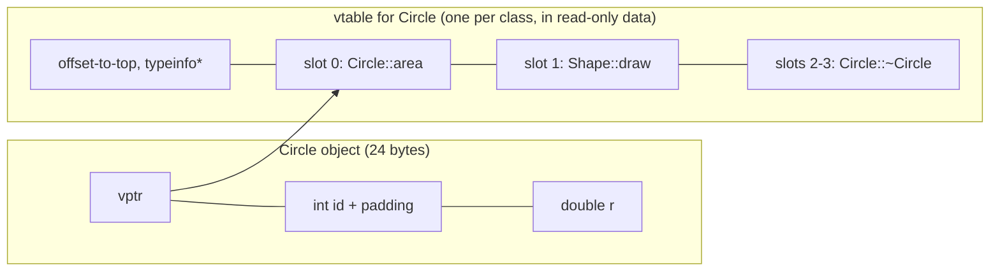

# vtables and Object Layout

The C++ standard says *what* virtual functions do, not *how*. Every major compiler (gcc, clang and MSVC alike) implements them the same way: a per-class **virtual table** of function pointers and a hidden per-object **vptr**. Knowing this model explains the costs of virtual calls, why objects grow by 8 bytes, why constructors dispatch to the base, how `dynamic_cast` works, and why virtual inheritance is expensive. It's standard interview material at systems, HFT and robotics companies. This lesson follows the Itanium C++ ABI used by gcc and clang on Linux.

## 1. The model

```cpp
struct Shape {
    virtual double area() const { return 0; }
    virtual void draw() const {}
    virtual ~Shape() = default;
    int id = 0;
};
struct Circle : Shape {
    double r = 1;
    double area() const override { return 3.14159 * r * r; }
};
```



- **One vtable per polymorphic class** (not per object), stored in read-only memory. Each slot holds the address of the final overrider for that class. `Circle` overrides `area`, so slot 0 points to `Circle::area`. It doesn't override `draw`, so slot 1 still points to `Shape::draw`.
- **One vptr per object** (per polymorphic base subobject), normally at offset 0. That's why `sizeof` grows by a pointer, plus alignment:

```cpp
struct Plain { int x; };                    // sizeof 4
struct Poly  { int x; virtual ~Poly(); };   // sizeof 16 on x86-64: 8 vptr + 4 int + 4 padding
```

- Above the slots, the vtable also holds `offset-to-top` and a pointer to the class's `type_info`. That's what `typeid` and `dynamic_cast` read.

## 2. A virtual call compiled

```cpp
double f(const Shape& s) { return s.area(); }
```

becomes, conceptually:

```cpp
auto vptr = *reinterpret_cast<void***>(&s);     // 1. load the vptr from the object
auto fn   = reinterpret_cast<double(*)(const Shape*)>(vptr[0]);  // 2. load slot 0
return fn(&s);                                  // 3. indirect call, passing this
```

| Cost | Why it matters |
|---|---|
| two dependent loads + an indirect call | a few cycles when cached |
| **no inlining** (usually) | the big one: inlining enables every other optimisation in tight loops |
| branch prediction | well-predicted if the dynamic type is stable at that call site, costly if it's random |
| cache misses | objects scattered on the heap (`vector<unique_ptr<Base>>`) |
| +8 bytes per object | matters for millions of small objects |

> [!KEY]
> A virtual call isn't slow by itself. Its cost is losing inlining and the pointer-chasing data layout that usually comes with it. In a 1 kHz robot control loop with ten controllers, virtual dispatch is irrelevant. In the inner loop of a particle filter over a million particles, it isn't. There, use templates, `final`, `std::variant`, or a data-oriented layout (one array per type).

### Devirtualisation

The compiler can turn a virtual call into a direct (inlinable) call when it can prove the dynamic type: calls on objects by value, on `final` classes or functions, or after inlining reveals the concrete type. `-O2` plus link-time optimisation (`-flto`) does this aggressively.

## 3. Construction and the vptr

The constructor of each class in the hierarchy **sets the vptr to its own class's vtable** before running its body:

1. `Shape()` runs: vptr → Shape's vtable. Virtual calls here go to `Shape`'s versions.
2. `Circle()` runs: vptr → Circle's vtable.

Destruction reverses this. That's the mechanical reason a virtual call in a constructor or destructor never reaches the derived override: the object really *is* a `Shape` at that moment. Pure virtual slots point to `__cxa_pure_virtual`, which aborts with "pure virtual method called".

## 4. RTTI: `typeid` and `dynamic_cast`

```cpp
Shape* p = new Circle;
std::cout << typeid(*p).name();                // mangled name of Circle (read from the vtable)
if (auto* c = dynamic_cast<Circle*>(p))        // nullptr if p isn't (derived from) a Circle
    std::cout << c->r;
Shape& ref = *p;
Circle& cr = dynamic_cast<Circle&>(ref);       // throws std::bad_cast on failure
```

`dynamic_cast` walks the type_info hierarchy found through the vptr. It works only on polymorphic types and costs more than a virtual call (often string or tree comparisons for deep or multiple hierarchies). Frequent `dynamic_cast` "type switches" are a design smell: add a virtual function instead. `static_cast` down a hierarchy is free but **unchecked** (UB if wrong). `-fno-rtti` (common in embedded builds) disables `typeid` and `dynamic_cast`.

## 5. Multiple inheritance layout

```cpp
struct A { virtual void fa(); int a; };
struct B { virtual void fb(); int b; };
struct C : A, B { void fb() override; int c; };
```

A `C` object contains an `A` subobject (with a vptr) at offset 0 and a `B` subobject (with **its own vptr**) at offset 16, followed by `c`. Converting `C*` to `B*` **adjusts the pointer** by +16, so `static_cast<void*>(b_ptr) != static_cast<void*>(c_ptr)` is possible. Calling `fb` through a `B*` lands in a small **thunk** that adjusts `this` back by -16 before jumping to `C::fb`. That's why `reinterpret_cast` between classes in a hierarchy is dangerous: it skips the adjustment.

## 6. Virtual inheritance: the costs

```cpp
struct Device { int id; virtual ~Device() = default; };
struct Sensor : virtual Device { int s; };
struct Actuator : virtual Device { int a; };
struct Servo : Sensor, Actuator { int v; };
```

The shared `Device` subobject's position relative to `Sensor` depends on the **most-derived** type (it's in a different place in a `Servo` than in a standalone `Sensor`). So each object stores, through its vtable, a **virtual base offset**, and every access to `id` from `Sensor` code becomes "load vptr → load offset → add → load". Measured with gcc on x86-64:

| Type | sizeof |
|---|---|
| `Device` (vptr + int) | 16 |
| `Sensor : virtual Device` | 32 |
| `Servo` with virtual inheritance (one `Device`) | 48 |
| `Servo` without virtual inheritance (two `Device`s) | 40 |

Virtual inheritance trades size and speed for a single shared base. The most-derived class constructs the virtual base, and the intermediate classes' calls to its constructor are ignored.

## 7. Empty base optimisation

An empty class has `sizeof` at least 1 (distinct objects need distinct addresses), but **as a base class** it can occupy zero bytes:

```cpp
struct Empty {};
struct F : Empty { int x; };      // sizeof(F) == 4: no space for Empty
struct G { Empty e; int x; };     // sizeof(G) == 8: the member costs 1 byte + padding
struct H { [[no_unique_address]] Empty e; int x; };   // C++20: 4
```

The STL relies on this for stateless allocators and deleters: `unique_ptr<T>` with the default deleter is exactly one pointer in size.

## 8. Exam-ready answers

> [!EXAM]
> **Implementation of virtual functions.** Compilers implement dynamic dispatch with virtual tables. Each polymorphic class has one vtable, an array of pointers to the final overriders of its virtual functions together with run-time type information; each object of a polymorphic class contains a hidden pointer (the vptr) to its class's vtable. A virtual call loads the vptr, indexes the vtable at the function's fixed slot and performs an indirect call. Each constructor sets the vptr to its own class's table before its body runs, which is why virtual calls during construction and destruction resolve to the class under construction. The costs are an extra pointer per object, an indirect call per invocation, and, most significantly, the loss of inlining unless the compiler can devirtualise. Multiple inheritance gives an object several vptrs and requires `this`-pointer adjustment through thunks; virtual inheritance adds virtual base offsets so that one shared base subobject can be located at run time.

## 9. Cheat sheet

| Fact | Value |
|---|---|
| vtables | one per polymorphic class, read-only |
| vptrs | one per polymorphic (sub)object, usually at offset 0 |
| object growth | +8 bytes (x86-64) plus padding |
| virtual call | load vptr → load slot → indirect call |
| main cost | lost inlining, and scattered objects |
| devirtualise | `final`, objects by value, LTO |
| checked downcast | `dynamic_cast` (needs RTTI) |
| empty base | 0 bytes as a base, `[[no_unique_address]]` for members |

> [!INTERVIEW]
> **"How does `p->f()` find the right function at run time, and what does it cost?"** `p` points to an object whose first hidden field is a vptr to its class's vtable; the compiler knows `f`'s fixed slot index, so it emits load-vptr, load-slot, indirect-call. The cost is two memory loads, an indirect branch that's usually well-predicted, and, more importantly, the call can't be inlined unless the compiler proves the dynamic type. Mention the +8 bytes per object, that constructors set the vptr (explaining construction-time dispatch), and that `final`/templates/variant are the tools for hot paths.
