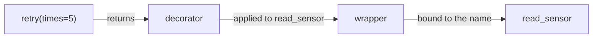

# Advanced Decorators and Closures

Basic decorators wrap a function to add behaviour. Production decorators go further: they **take arguments** (`@retry(times=3)`), **preserve signatures and metadata**, work on **methods** as well as functions, keep **state**, decorate **classes**, and support **async** functions. These are the techniques behind `functools.lru_cache`, Flask's `@app.route`, pytest fixtures, Click commands and FastAPI endpoints. This lesson builds them up from closures.

## 1. Recap: a decorator is a function returning a function

```python
import functools, time

def timed(func):
    @functools.wraps(func)                 # copies __name__, __doc__, __module__, __qualname__, __wrapped__...
    def wrapper(*args, **kwargs):
        t0 = time.perf_counter()
        try:
            return func(*args, **kwargs)
        finally:
            print(f"{func.__name__}: {time.perf_counter() - t0:.4f}s")
    return wrapper

@timed                                     # sugar for: plan = timed(plan)
def plan(goal): ...
```

> [!KEY]
> Always use `functools.wraps`. Without it, the decorated function's `__name__` becomes `"wrapper"`, its docstring vanishes, and debuggers, `help()` and frameworks that introspect functions (pytest, Flask, Click) see the wrong thing. `wraps` also sets `__wrapped__`, so `inspect.signature` reports the original signature.

## 2. Decorators with arguments: three levels

`@retry(times=3)` first **calls** `retry(times=3)`, which must **return a decorator**:

```python
def retry(times=3, exceptions=(Exception,), delay=0.0):
    def decorator(func):                       # level 2: the actual decorator
        @functools.wraps(func)
        def wrapper(*args, **kwargs):          # level 3: replaces the function
            for attempt in range(1, times + 1):
                try:
                    return func(*args, **kwargs)
                except exceptions:
                    if attempt == times:
                        raise
                    time.sleep(delay)
        return wrapper
    return decorator                           # level 1 returns the decorator

@retry(times=5, exceptions=(TimeoutError,))
def read_sensor(): ...
```



### Optional arguments: `@deco` and `@deco(...)` both work

```python
def deco(func=None, *, verbose=False):
    if func is None:                           # called as @deco(verbose=True)
        return functools.partial(deco, verbose=verbose)
    @functools.wraps(func)
    def wrapper(*a, **k):
        if verbose:
            print("->", func.__name__)
        return func(*a, **k)
    return wrapper
```

## 3. Stateful decorators

State can live in the closure (via `nonlocal`), as an attribute on the wrapper, or in a class:

```python
def count_calls(func):
    @functools.wraps(func)
    def wrapper(*args, **kwargs):
        wrapper.calls += 1
        return func(*args, **kwargs)
    wrapper.calls = 0
    return wrapper

class CountCalls:                              # a class-based decorator: instances are callable
    def __init__(self, func):
        functools.update_wrapper(self, func)
        self.func = func
        self.calls = 0
    def __call__(self, *args, **kwargs):
        self.calls += 1
        return self.func(*args, **kwargs)
```

> [!WARNING]
> **Class-based decorators break on methods.** A `CountCalls` instance stored on a class isn't a descriptor, so `obj.method()` doesn't bind `self`, and the call fails with `missing 1 required positional argument: 'self'`. Fix it by implementing `__get__`:
> ```python
> def __get__(self, obj, objtype=None):
>     if obj is None:
>         return self
>     return functools.partial(self.__call__, obj)    # bind the instance like a method would
> ```
> Function-based decorators don't have this problem, because the returned `wrapper` is a function and so already a descriptor.

## 4. Decorating classes and registering

```python
ROUTES = {}
def route(path):
    def register(func):
        ROUTES[path] = func                    # side effect at import time; return func unchanged
        return func
    return register

@route("/status")
def status(): return "ok"

def singleton(cls):                            # a class decorator replacing the class with a factory
    instances = {}
    @functools.wraps(cls)
    def get(*args, **kwargs):
        if cls not in instances:
            instances[cls] = cls(*args, **kwargs)
        return instances[cls]
    return get
```

Registration decorators that return the original function are how Flask routes, pytest fixtures and plugin systems work.

## 5. Order, async, and caching

```python
@a
@b
def f(): ...          # f = a(b(f)): b is applied first (it's closest to the def), then a wraps the result.
                      # Calling f() runs a's wrapper first, which calls b's wrapper, which calls the original.
```

| Topic | Rule |
|---|---|
| stacking | `@a @b def f` means `f = a(b(f))`. At call time, `a`'s wrapper runs first (outermost) |
| async functions | the wrapper must be `async def` and `await func(...)`; check with `inspect.iscoroutinefunction` |
| caching | `@functools.cache` / `@lru_cache(maxsize=N)`: arguments must be hashable; on methods it caches per `self` and keeps instances alive |
| typing | type decorators with `ParamSpec` to preserve signatures (previous lesson) |

```python
def timed_async(func):
    @functools.wraps(func)
    async def wrapper(*args, **kwargs):
        t0 = time.perf_counter()
        try:
            return await func(*args, **kwargs)
        finally:
            print(f"{func.__name__}: {time.perf_counter() - t0:.4f}s")
    return wrapper
```

## 6. Exam-ready answers

> [!EXAM]
> **Advanced decorators.** A decorator is a callable that takes a function (or class) and returns a replacement, applied with the `@` syntax at definition time. Decorators with arguments are implemented as factories: the outer function receives the arguments and returns the actual decorator, which returns the wrapper. `functools.wraps` copies the wrapped function's metadata (name, docstring, qualified name) and records it in `__wrapped__`, preserving introspection. Decorators may hold state in closures, function attributes or callable class instances; class-based decorators must implement `__get__` to work on methods because, unlike functions, they are not descriptors. Stacked decorators are applied bottom-up. Class decorators receive a class and can register, modify or replace it, and decorators for coroutines must themselves be coroutine functions.

## 7. Cheat sheet

| Need | Pattern |
|---|---|
| preserve metadata | `@functools.wraps(func)` on the wrapper |
| decorator arguments | `def deco(arg): def dec(f): def wrapper(...)` |
| optional arguments | `def deco(func=None, *, opt=...)` + `partial` |
| counting or state | a function attribute, or `nonlocal` in the closure |
| class-based decorator on methods | implement `__get__` |
| registration | store the function, return it unchanged |
| async | an `async def` wrapper that awaits |
| memoise | `@functools.cache` / `@lru_cache` |

> [!INTERVIEW]
> **"Write a `@retry(n)` decorator. Why are there three nested functions?"** `retry(n)` runs first, with the argument, and must return a decorator. That decorator receives the function and returns the wrapper. The wrapper is what callers actually invoke, and it loops up to n times, re-raising on the last failure. Each level closes over the variables of the levels outside it (`n`, then `func`). Mention `functools.wraps`, catching only specific exceptions (never a bare `except:`, which would swallow `KeyboardInterrupt`), backoff with jitter for network calls, and making the operation idempotent before retrying it.
