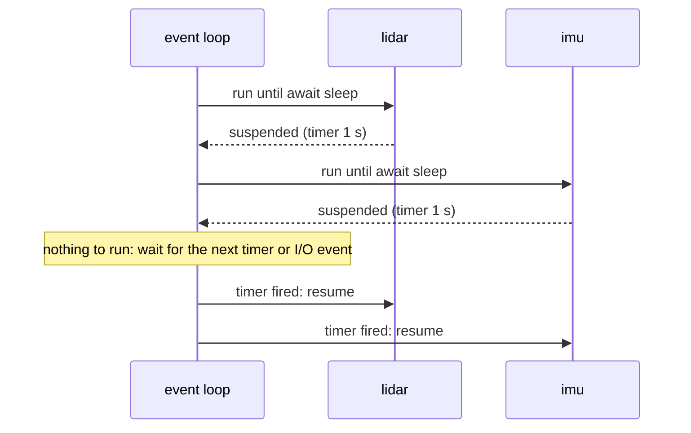

# asyncio Fundamentals

`asyncio` handles **thousands of concurrent I/O operations in a single thread**. Instead of blocking while waiting for the network or a timer, a coroutine **`await`s**, voluntarily handing control back to an **event loop**, which runs other coroutines until the awaited result is ready. That's how high-performance web servers (FastAPI/uvicorn), chat systems, crawlers and robot communication layers work. This lesson builds the mental model: coroutines, the event loop, tasks, `gather`, and why async is **cooperative**.

## 1. Coroutines and `await`

```python
import asyncio

async def read_sensor(name, delay):          # `async def` defines a coroutine function
    print(f"{name}: start")
    await asyncio.sleep(delay)               # suspends THIS coroutine; the loop runs others meanwhile
    print(f"{name}: done")
    return f"{name}-reading"

async def main():
    r = await read_sensor("lidar", 1.0)      # await: run it and wait for its result
    print(r)

asyncio.run(main())                          # create an event loop, run main() to completion, close the loop
```

> [!KEY]
> Calling a coroutine function **doesn't run it**: `read_sensor("x", 1)` just creates a coroutine object (and if you never await it, you get "coroutine was never awaited"). It runs when awaited, or when wrapped in a **task**.

## 2. Concurrency with tasks and `gather`

```python
import time

async def main():
    t0 = time.perf_counter()
    results = await asyncio.gather(          # run concurrently, results in argument order
        read_sensor("lidar", 1.0),
        read_sensor("imu", 1.0),
        read_sensor("gps", 1.0),
    )
    print(results, f"{time.perf_counter() - t0:.1f}s")   # about 1.0 s total, not 3.0 s

asyncio.run(main())
```



```python
async def main():
    task = asyncio.create_task(read_sensor("lidar", 2))   # starts running "in the background" now
    await do_other_things()
    result = await task                                    # collect it later
```

## 3. The event loop

The loop is a scheduler: it keeps a queue of ready coroutines, runs each until its next `await` on something not yet ready, and uses the OS's I/O multiplexing (`epoll`/`kqueue`) to learn when sockets and timers are ready. Everything runs in **one thread**, so there's no parallelism and no data races between `await` points.

> [!DANGER]
> Async is **cooperative**: a coroutine runs until it awaits. A **blocking call** (`time.sleep`, `requests.get`, heavy CPU loops, blocking file or serial I/O) freezes the **entire** loop, so every other task stalls. Use async libraries (`asyncio.sleep`, `aiohttp`, `asyncio.open_connection`), or push blocking work to a thread with `await asyncio.to_thread(func, ...)`. Debug mode (`asyncio.run(main(), debug=True)`) warns about slow callbacks.

## 4. async vs threads vs processes

| | asyncio | threads | processes |
|---|---|---|---|
| Concurrency units | tasks (cheap: KB each, millions possible) | OS threads (MB of stack, hundreds) | processes (heavy) |
| Switching | explicit, only at `await` | preemptive, anywhere | preemptive |
| Data races | none between awaits (single thread) | possible anywhere: need locks | no shared memory by default |
| Needs async libraries | yes | no | no |
| CPU parallelism | no | no (GIL build) | yes |
| Ideal for | many concurrent network connections | a few blocking libraries | CPU-bound work |

## 5. Async network I/O example

```python
async def handle_client(reader: asyncio.StreamReader, writer: asyncio.StreamWriter):
    while data := await reader.readline():        # await while waiting for bytes
        writer.write(data.upper())
        await writer.drain()                      # respect flow control
    writer.close()
    await writer.wait_closed()

async def main():
    server = await asyncio.start_server(handle_client, "127.0.0.1", 9000)
    async with server:
        await server.serve_forever()              # thousands of clients, one thread
```

## 6. Exam-ready answers

> [!EXAM]
> **asyncio.** `asyncio` provides single-threaded concurrency for I/O-bound programs through cooperative multitasking. Coroutine functions are defined with `async def`; calling one returns a coroutine object, which executes when awaited or scheduled as a task. The `await` expression suspends the current coroutine until the awaited operation completes, returning control to the event loop, which runs other ready tasks and monitors I/O and timers. `asyncio.run` starts the event loop, `asyncio.create_task` schedules coroutines concurrently, and `asyncio.gather` runs several awaitables concurrently and collects their results. Because switching occurs only at `await` points, shared state needs no locks between awaits, but any blocking call stalls all tasks, so blocking work must use asynchronous libraries or be offloaded to threads.

## 7. Cheat sheet

| Need | Code |
|---|---|
| entry point | `asyncio.run(main())` |
| run concurrently, collect | `await asyncio.gather(c1, c2, ...)` |
| start in the background | `t = asyncio.create_task(coro)`, then later `await t` |
| non-blocking pause | `await asyncio.sleep(s)` |
| call blocking code | `await asyncio.to_thread(f, *args)` |
| TCP client / server | `asyncio.open_connection` / `asyncio.start_server` |
| debug slow callbacks | `asyncio.run(main(), debug=True)` |

> [!INTERVIEW]
> **"What happens if you call `time.sleep(5)` inside an async function?"** The whole event loop blocks for 5 seconds: `time.sleep` doesn't yield control, so no other task can run, timers fire late, and network handlers stall. Async concurrency only works if every task cooperatively awaits at points where it would wait. The fix is `await asyncio.sleep(5)`. For unavoidably blocking calls (legacy libraries, CPU work), use `await asyncio.to_thread(...)` or `loop.run_in_executor(...)`, which run them in a thread or process pool while the loop keeps serving other tasks.
