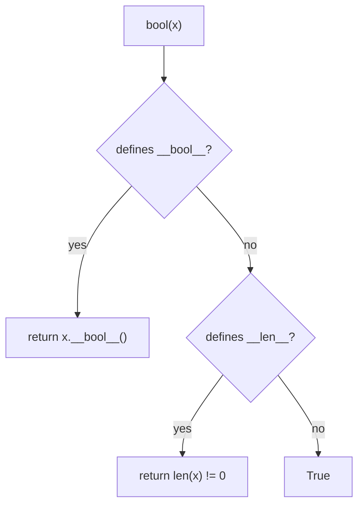

# Booleans and Truthiness

Every `if` and `while` asks a yes/no question. In Python, **any object** can answer it, not just `True` and `False`. Knowing exactly which objects count as "false", and what `and`/`or` really return, separates idiomatic Python from code that merely works. It also explains a family of interview trick questions.

## 1. The `bool` type

`bool` has exactly two values, `True` and `False` (capitalised; `true` is a `NameError`). Comparisons produce them:

```python
print(3 > 2, type(3 > 2))   # True <class 'bool'>
```

`bool` is a **subclass of `int`**: `True == 1` and `False == 0`, and they behave as numbers in arithmetic.

```python
print(True + True + True)          # 3
print(sum([True, False, True]))    # 2: counting with booleans
print(isinstance(True, int))       # True
```

This makes a neat idiom: `sum(x > 0 for x in nums)` counts the positive numbers.

## 2. Truthiness: every object is truthy or falsy

When Python needs a boolean (in `if`, `while`, `and`, `or`, `not`, or `bool(x)`), it asks the object for its **truth value**.

> [!KEY]
> **Falsy values** (memorise this list):
> - `False` and `None`
> - numeric zeros: `0`, `0.0`, `0j`, `Decimal(0)`, `Fraction(0)`
> - empty containers: `""`, `[]`, `()`, `{}`, `set()`, `range(0)`, `b""`
>
> **Everything else is truthy**, including `"0"`, `"False"`, `" "`, `[0]`, `[[]]`, `-1` and `0.0001`.

```python
print(bool(""), bool("0"), bool(" "))   # False True True
print(bool([]), bool([0]))              # False True
print(bool(-1), bool(0.0))              # True False
```

### How Python decides (the protocol)

For `bool(x)` Python calls `x.__bool__()`. If the class doesn't define it, Python uses `x.__len__()` (`0` → falsy). If neither exists, the object is truthy. That's why your own classes are truthy by default, and why containers are falsy exactly when empty.



### Idiomatic tests

```python
items = []
if not items:                 # idiomatic emptiness check
    print("nothing to do")

# avoid:
if len(items) == 0: ...       # works, but wordier
if items == []: ...           # fails for other empty sequences such as ()
```

> [!DANGER]
> Truthiness conflates "empty/zero" with "missing". If `0` or `""` is a **valid** value, test explicitly: `if x is None:`. For example, `def f(timeout=None): if not timeout: ...` wrongly treats `timeout=0` as "not given".

## 3. `and`, `or`, `not` return operands

`not` always returns a real `bool`. But `and` and `or` return **one of their operands**, unchanged:

| Expression | Rule | Example → result |
|---|---|---|
| `x or y` | `x` if `x` is truthy, else `y` | `0 or 5` → `5`; `3 or 5` → `3` |
| `x and y` | `x` if `x` is falsy, else `y` | `0 and 5` → `0`; `3 and 5` → `5` |
| `not x` | `False` if `x` is truthy, else `True` | `not ""` → `True` |

<div class="figure">
<svg viewBox="0 0 600 150" width="600" xmlns="http://www.w3.org/2000/svg" font-family="ui-monospace, monospace" font-size="14">
  <g fill="none" stroke="currentColor" stroke-opacity=".5"><rect x="20" y="20" width="270" height="110" rx="8"/><rect x="310" y="20" width="270" height="110" rx="8"/></g>
  <text x="40" y="48" fill="#2f81f7" font-weight="bold">x or y</text>
  <text x="40" y="78" fill="currentColor">x truthy? → return x</text>
  <text x="40" y="104" fill="currentColor">else     → return y</text>
  <text x="330" y="48" fill="#3fb950" font-weight="bold">x and y</text>
  <text x="330" y="78" fill="currentColor">x falsy? → return x</text>
  <text x="330" y="104" fill="currentColor">else    → return y</text>
</svg>
<figcaption>Both stop as soon as the answer is known (short-circuit). <code>y</code> is not evaluated if <code>x</code> decides.</figcaption>
</div>

```python
print("" or "default")         # default
print("Ada" or "default")      # Ada
print(None or 0)               # 0: both falsy, so the last operand is returned
print(1 and "yes")             # yes
print([] and 1 / 0)            # []: the division never runs
```

### Idioms built on this

```python
name = user_input or "Anonymous"        # default for empty or None
value = cache and cache.get(key)        # guard: only call get if cache is truthy
first = a or b or c or "none"           # first truthy of several
```

> [!WARNING]
> `x = count or 10` replaces a legitimate `0` with `10`. When `0`/`""` are meaningful, use the conditional expression: `x = count if count is not None else 10`.

### Short-circuit evaluation as control flow

Because the right operand may never run, `and` and `or` can guard expensive or dangerous operations:

```python
if n != 0 and total / n > 5:          # no ZeroDivisionError when n == 0
    ...
if i < len(a) and a[i] == target:     # no IndexError when i is out of range
    ...
```

Order matters: put the **guard first**.

## 4. Precedence of logical operators

`not` > `and` > `or`. So:

```python
print(True or False and False)   # True: and first → True or (False and False)
print(not True == False)         # True: == binds tighter → not (True == False)
```

Parenthesise mixed `and`/`or` expressions for readability.

## 5. `None`

`None` is Python's "no value" object, the single instance of `NoneType`. Functions with no `return` return `None`. Test for it with `is`:

```python
result = print("hi")   # print returns None
print(result is None)  # True
```

## 6. The conditional expression (ternary)

> [!SYNTAX]
> `value_if_true if condition else value_if_false`

```python
age = 20
status = "adult" if age >= 18 else "minor"
parity = "even" if n % 2 == 0 else "odd"
```

It's an **expression**, so it produces a value and can go anywhere a value can: inside f-strings, function arguments and comprehensions. Don't nest more than once; use a real `if` statement instead.

C's `cond ? a : b` puts the condition first. Python's reads like English, with the condition in the middle.

## 7. `any()` and `all()`

```python
nums = [3, 0, -2]
print(any(x < 0 for x in nums))   # True: at least one negative
print(all(x > 0 for x in nums))   # False
print(all([]), any([]))           # True False: the vacuous truth rules
```

Both short-circuit: `any` stops at the first truthy element, `all` at the first falsy one.

## 8. Exam-ready answers

> [!EXAM]
> **Truth value testing.** In a Boolean context every Python object has a truth value. The following are considered false: `None`, `False`, zero of any numeric type (`0`, `0.0`, `0j`), and empty sequences and collections (`''`, `()`, `[]`, `{}`, `set()`, `range(0)`). All other objects are true. For user-defined classes Python calls `__bool__()`, falling back to `__len__()`, and objects defining neither are true.

> [!EXAM]
> **Behaviour of `and` and `or`.** Both are short-circuit operators that return one of their operands rather than necessarily a `bool`. `x or y` evaluates `x` and returns it if it is true, otherwise it evaluates and returns `y`. `x and y` returns `x` if it is false, otherwise it evaluates and returns `y`. `not x` always returns a `bool`. Short-circuiting means the second operand is evaluated only when needed, which allows guards such as `n != 0 and t / n > 1`.

## 9. Cheat sheet

| Want | Idiom |
|---|---|
| empty? | `if not seq:` |
| not empty? | `if seq:` |
| is missing? | `if x is None:` |
| default value | `x or default` (only if falsy ≠ valid) |
| count True | `sum(cond for x in xs)` |
| any match | `any(cond for x in xs)` |
| all match | `all(cond for x in xs)` |
| one-line choice | `a if cond else b` |
| safe index check | `i < len(a) and a[i] == t` |

> [!INTERVIEW]
> **"What does `[] or {} or 0 or ''` evaluate to?"** `''`, the **last** operand, because all of them are falsy and `or` returns the last operand when none is truthy. And `[] and 1/0` is `[]` with no `ZeroDivisionError`, because short-circuiting means the division never runs.
