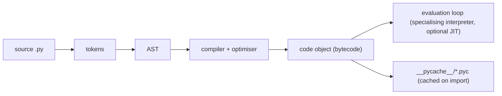

# Bytecode and dis

CPython doesn't run your source code directly. It **compiles** it to **bytecode**, a compact instruction set for a stack-based virtual machine, and then a big evaluation loop (`ceval.c`) executes that bytecode. Since 3.11, the interpreter **specialises** instructions at run time for the types it actually sees (the "Faster CPython" project), and 3.13+ includes an experimental **JIT**. Reading bytecode with the `dis` module explains performance differences, what's atomic in threading, and how features like closures and generators work.

## 1. The pipeline



Every function has a **code object** (`f.__code__`) holding the bytecode and its metadata:

```python
def f(a, b):
    return a + b * 2

f.__code__.co_varnames     # ('a', 'b'): local variable names
f.__code__.co_consts       # constants used
f.__code__.co_argcount     # 2
f.__code__.co_code         # the raw bytes
```

## 2. Reading bytecode with `dis`

```python
import dis
dis.dis(f)
```

```output
  1           RESUME                   0
              LOAD_FAST_BORROW_LOAD_FAST_BORROW 1 (a, b)
              LOAD_SMALL_INT           2
              BINARY_OP                5 (*)
              BINARY_OP                0 (+)
              RETURN_VALUE
```

(That's the output of Python 3.14. Instruction names change between versions, but the model doesn't.) The VM is a **stack machine**: `LOAD_*` pushes values, `BINARY_OP` pops two and pushes the result, and `RETURN_VALUE` pops the top. Columns: source line, offset or label, opcode, argument, and an interpretation of the argument.

| Instruction family | Meaning |
|---|---|
| `LOAD_FAST` / `STORE_FAST` | local variables, in an array indexed by position: **fast** |
| `LOAD_GLOBAL` | a module global or builtin: a dict lookup (cached) |
| `LOAD_ATTR` / `STORE_ATTR` | `obj.attr` |
| `LOAD_DEREF` / `STORE_DEREF` | closure variables (cells) |
| `CALL` | call a function |
| `FOR_ITER`, `GET_ITER` | loops over iterators |
| `POP_JUMP_IF_FALSE`, `JUMP_BACKWARD` | control flow |
| `YIELD_VALUE`, `RETURN_GENERATOR` | generators and coroutines |

## 3. What bytecode explains

### Local variables are faster than globals

```python
import math
def slow(xs):
    return [math.sqrt(x) for x in xs]       # LOAD_GLOBAL math + LOAD_ATTR sqrt on every iteration
def fast(xs, sqrt=math.sqrt):               # a classic micro-optimisation: bind to a local
    return [sqrt(x) for x in xs]
```

Modern CPython caches globals and attributes, so the gap is smaller than it used to be, but locals remain the fastest access.

### `+=` is not atomic

```python
import dis
counter = 0
def inc():
    global counter
    counter += 1
dis.dis(inc)        # LOAD_GLOBAL counter, LOAD_SMALL_INT 1, BINARY_OP (+=), STORE_GLOBAL counter
```

A thread switch can occur **between** loading and storing. Two threads both load 5, both store 6, and an increment is lost. That's why shared counters need a `Lock` even with the GIL.

### Constant folding and other compile-time optimisations

```python
dis.dis(lambda: 24 * 60 * 60)   # LOAD_CONST 86400: the compiler folded it
x in [1, 2, 3]                   # the literal list becomes a constant tuple
x in {1, 2, 3}                   # becomes a constant frozenset (O(1) membership)
```

## 4. The specialising adaptive interpreter (3.11+)

As code runs, CPython **rewrites generic instructions into specialised versions** for the observed types:

```python
def total(xs):
    t = 0
    for x in xs:
        t += x
    return t
for _ in range(100): total([1, 2, 3])        # warm it up
dis.dis(total, adaptive=True)
# FOR_ITER_LIST, BINARY_OP_ADD_INT, ...: specialised for lists and ints
```

If the types change (floats appear), the instruction **de-specialises** and adapts again. This is why 3.11 was 10–60% faster than 3.10, and it rewards **type-stable code**: functions that always see the same types run faster. Python 3.13 added an experimental copy-and-patch **JIT** (`PYTHON_JIT=1` on builds compiled with it) that compiles hot traces of specialised instructions to machine code.

## 5. Exam-ready answers

> [!EXAM]
> **Python bytecode.** CPython compiles source code into bytecode, instructions for a stack-based virtual machine, stored in code objects attached to functions and modules and cached in `.pyc` files. The evaluation loop executes instructions such as `LOAD_FAST`, `LOAD_GLOBAL`, `BINARY_OP`, `CALL` and `RETURN_VALUE`, pushing and popping values on an operand stack. The `dis` module disassembles code objects for inspection. The compiler performs optimisations such as constant folding and converting constant containers to tuples or frozensets. Since Python 3.11, the specialising adaptive interpreter replaces generic instructions with type-specialised variants based on observed run-time types, and later versions add an experimental JIT. Bytecode analysis explains performance characteristics, such as the speed of local versus global variable access, and why operations like `x += 1` are not atomic across threads.

## 6. Cheat sheet

| Need | Tool |
|---|---|
| disassemble | `dis.dis(func)` |
| see specialisations | `dis.dis(func, adaptive=True)` (after warming up) |
| instruction objects | `list(dis.get_instructions(func))` |
| a code object's metadata | `func.__code__.co_varnames`, `co_consts` |
| compile a string | `compile(src, "<str>", "exec")` |
| the AST | `ast.dump(ast.parse(src), indent=2)` |
| cached bytecode | `__pycache__/module.cpython-314.pyc` |

> [!INTERVIEW]
> **"Is `counter += 1` thread-safe in Python because of the GIL?"** No. It compiles to several bytecode instructions: load the value, add, store it back. The interpreter can switch threads between them, so two threads can read the same old value and both write `old + 1`, losing an update. The GIL guarantees only that individual bytecodes (and many built-in operations, like `list.append`) execute atomically with respect to the interpreter's internals. Protect read-modify-write sequences with `threading.Lock`, use `queue.Queue`, or use `itertools.count()`. On free-threaded builds, this matters even more.
